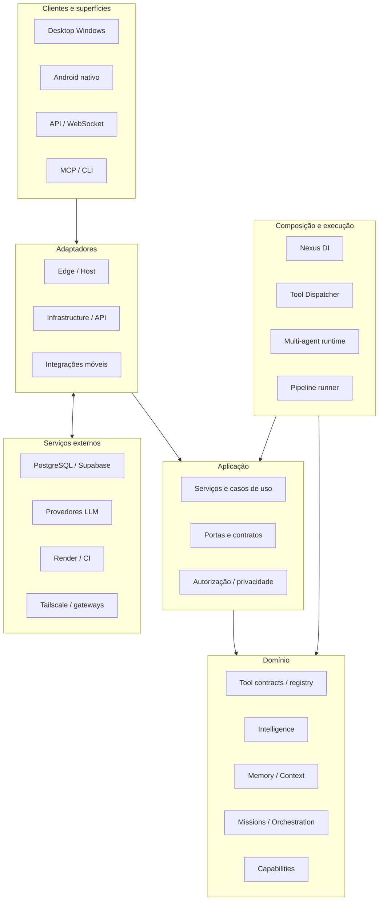

# Jarvis Xerife — mapa arquitetural

Este arquivo é o mapa de alto nível mantido para leitura humana. Para o inventário detalhado de módulos e fluxos, consulte [docs/ARCHITECTURE.md](docs/ARCHITECTURE.md). O mapa automático de arquivos gerado pelo projeto fica em [docs/ARQUIVO_MAP.md](docs/ARQUIVO_MAP.md); ele não deve ser confundido com uma arquitetura de runtime.

## Contexto

Jarvis Xerife é uma plataforma modular cujo núcleo principal é Python. Clientes e superfícies (Desktop, Android, API, MCP e CLI) comunicam-se com serviços de aplicação por adaptadores. O domínio contém contratos e regras; os runtimes fazem composição, despacho de ferramentas e execução multiagente.

## Mapa

## Responsabilidades por diretório

| Caminho | Responsabilidade |
|---|---|
| app/core | Nexus, configuração e mecanismos centrais de composição. |
| app/domain | Modelos, regras e contratos de domínio: ferramentas, capacidades, inteligência, memória, contexto, missões, grafo e orquestração. |
| app/application | Casos de uso, serviços, portas, comunicação e políticas de segurança. |
| app/adapters/api | Adaptadores de entrada HTTP/API. |
| app/adapters/edge | Integrações locais, host, desktop e dispositivos. |
| app/adapters/infrastructure | Persistência, provedores, integrações externas e serviços de infraestrutura. |
| app/runtime | Pipeline runner e runtime de ferramentas. |
| app/multiagent | Scheduler, contratos, fila, workers e execução multiagente. |
| app/communication | Contratos e componentes de comunicação compartilhados. |
| mobile/android | Cliente Android nativo. |
| desktop | Recursos e empacotamento da aplicação desktop. |
| scripts | Operação, instalação, diagnóstico, manutenção e automação. |
| config | Manifests de ferramentas, toolchains e pipelines declarativos. |
| migrations | Evolução versionada do banco. |
| tests | Testes unitários, integração, segurança, contratos e regressão. |
| skills / .agents | Skills e instruções portáteis para hosts de agentes. |

## Subsistemas e limites

### Nexus DI
O Nexus resolve componentes registrados/descobertos e é o mecanismo de composição compartilhado. Wrappers como app/container.py mantêm compatibilidade; não devem ser documentados como um segundo container independente.

### Universal Tool Registry e Dispatcher
ToolManifest é metadado tipado/versionado. ToolRegistry valida e resolve manifests por ID e versão exatos. O dispatcher valida entrada/saída, aplica autorização, resolve o adaptador, aplica controles locais e emite eventos. O registry não autentica, não concede grants, não verifica a saúde real do provider e não executa por si só. A autorização ausente deve resultar em recusa (fail-closed).

### Multiagente
A fila é compartilhada pelo backend configurado; tarefas são reivindicadas com semântica de concorrência, prioridade, dependências, tentativas e lease/fencing. Workers possuem identidade própria no caminho autenticado. O worker direto com credencial Supabase service-role é um caminho legado e não oferece a mesma fronteira de identidade. O runtime é opt-in e a configuração de código não prova que exista worker ativo em produção.

### Inteligência
O domínio normaliza observações/eventos de fontes heterogêneas. Adaptadores e coletores reportam falhas parciais e proveniência. Coleta sob demanda, feeds externos, persistência histórica e workers recorrentes são funcionalidades distintas; não inferir execução recorrente a partir de migrations ou de um adapter presente.

### Desktop e Android
Desktop executa um núcleo local e interface WebView2/servidor local, com controles de acesso próprios. Android é um cliente nativo separado e possui serviços de rede, VPN, acessibilidade e integração MCP com consentimentos e permissões Android. Uma integração de backend não significa que todos os recursos estejam habilitados no dispositivo.

### Pipelines
O pipeline runner mantém compatibilidade com definições declarativas legadas. Passos explícitos de ferramenta podem passar pelo dispatcher; não presumir que todos os pipelines legados foram migrados para o contrato novo.

## Entrypoints conhecidos

- main.py — inicialização principal combinada cloud/edge.
- serve.py — entrada headless usada no deploy API.
- app/bootstrap_edge.py — bootstrap local/edge.
- scripts/start_jarvis_desktop.ps1 — inicialização desktop Windows.
- app/adapters/edge/jarvis_desktop_mcp.py — servidor MCP de desktop.
- scripts/run_multiagent_worker.py — worker multiagente opt-in.
- mobile/android — aplicativo Android nativo.

## Regras para mudanças arquiteturais

1. Não misturar domínio com I/O de provider ou UI.
2. Definir contratos em portas/modelos antes de acoplar adaptadores.
3. Autorização pertence ao host/servidor, não ao prompt do modelo.
4. Identidade, escopo, sessão, ferramenta e tentativa devem ser vinculados na execução sensível.
5. Documentar estados de implementação, testes e operação separadamente.
6. Atualizar este mapa e o documento do subsistema quando diretórios, contratos ou entrypoints mudarem.
