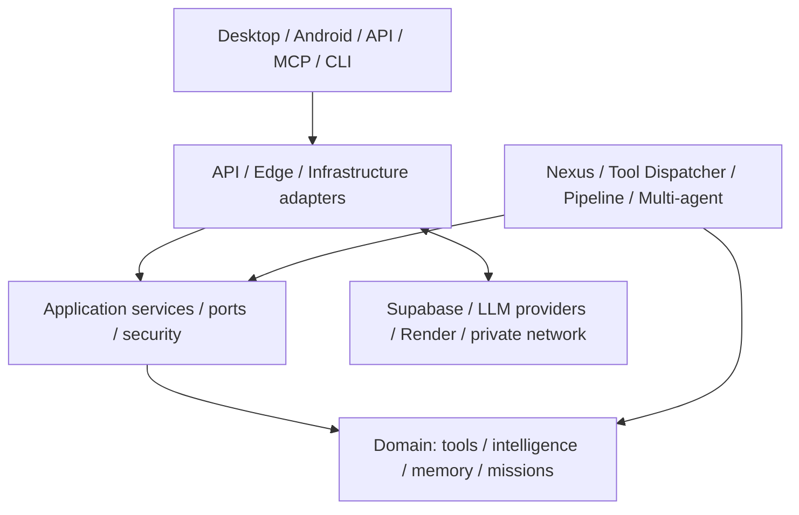

# Jarvis Xerife — mapa de módulos

**Gerador:** scripts/autodoc.py  
**Saída:** árvore de diretórios de código e assinaturas encontradas no checkout.  
**Limite:** este mapa não declara que um módulo esteja carregado, habilitado, autorizado ou saudável em runtime.

O mapa é regenerado pelo workflow .github/workflows/autodoc.yml quando alterações em app/ ou scripts/autodoc.py chegam à branch main. Diretórios de backup, estado de runtime, dependências, documentação e testes são excluídos deliberadamente.

## Estrutura de alto nível

| Diretório | Conteúdo |
|---|---|
| app/core | Nexus DI e configuração. |
| app/domain | Contratos e regras de domínio: tools, capabilities, intelligence, memory, context, graph, missions e orchestration. |
| app/application | Serviços, portas, segurança, privacidade e comunicação. |
| app/adapters | Entradas API, integrações edge/host e adapters de infraestrutura. |
| app/runtime | Pipeline runner e toolbox. |
| app/multiagent | Queue, scheduler, workers, transport e execution plans. |
| app/communication | Contratos e componentes de comunicação compartilhados. |
| desktop | Recursos da aplicação desktop. |
| mobile/android | Aplicativo Android nativo. |
| linux | Provisionamento e integração Linux. |
| config | Manifests de ferramentas, toolchains e pipelines. |
| migrations | Evolução versionada de schema e funções. |
| skills | Skills portáteis para hosts de agentes. |

## Diagrama arquitetural de referência

Para responsabilidades, fluxos, entrypoints e limites entre esses diretórios, use [docs/ARCHITECTURE.md](ARCHITECTURE.md) e o [mapa de alto nível](../ARCHITECTURE.md). O workflow atualiza automaticamente o inventário de diretórios e assinaturas quando o código de app/ ou o gerador muda.
