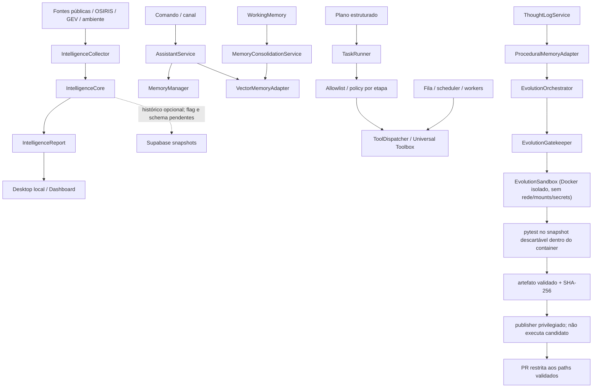

# Cognitive Baseline — Fase C0

**Snapshot:** `main` em `e7b4efa35c8da7fa0ca4c04c7b2b7880478473c2` (pós-PR #769)
**Auditoria:** 2026-11-07
**Estado:** parcial; C0 permanece aberto.
**Escopo:** inspeção estática de código, consumidores, contratos, testes, migrations, workflows e documentação, complementada por probes remotos somente leitura. Não é confirmação de deploy completo, execução ponta a ponta ou comportamento de todos os providers.

## 1. Decisão de fase

O próximo marco realmente pendente é **C0 — Auditoria de capacidades e baseline comportamental**. O roadmap exige que cada capacidade crítica tenha caminho de código, consumidor e teste identificados, com lacunas e incertezas registradas. A árvore atual contém componentes reutilizáveis, mas não demonstra ainda um ciclo cognitivo integrado.

Este documento é o primeiro mapa rastreável de C0; não o conclui. Não criar um novo World Model, segundo sistema de memória, event bus ou scheduler antes de fechar a auditoria e os testes de baseline.

## 2. Níveis de evidência

- **Confirmado no repositório:** código, consumidor direto e teste relevante foram localizados. Isso não prova execução em produção.
- **Parcial:** há código e algum consumidor, mas faltam testes de integração, persistência, autorização ou validação operacional.
- **Implementado, não verificado:** há símbolo/registro/documentação, mas o consumidor comportamental ou teste específico não foi confirmado.
- **Bloqueado:** a capacidade depende de flag, migration, policy ou ambiente que não está validado.
- **Ausente no escopo auditado:** o contrato ou comportamento exigido não foi localizado nos caminhos examinados; não significa prova de inexistência em todo o repositório.

## 3. Inventário por capacidade cognitiva

| Capacidade | Implementação / contrato existente | Consumidor localizado | Testes localizados | Classificação e lacuna |
|---|---|---|---|---|
| Roteamento cognitivo | `app/domain/gears/cognitive_router.py`; registro no Nexus | O componente está no registro; não foi confirmado um ciclo cognitivo contínuo que o consuma | `tests/test_nexus_registry_sync.py` valida sincronização do registro | **Implementado, não verificado.** O código classifica entrada por palavras-chave ou uma chamada LiteLLM; isso é roteamento de conversa, não Reasoning Engine. Não foi localizado teste comportamental específico do roteador. |
| Memória semântica | `app/application/services/memory_manager.py`; armazenamento via `DocumentStore` em `data/jarvis_memory.json` | `AssistantService.process_command()` consulta e grava; `FieldVision` consulta soluções/contexto | PRs #759/#762; testes de redaction, isolamento e readback após recriar o manager | **Persistência local confirmada por arquivo e escopo/redaction nos caminhos cobertos.** Proveniência, retenção governada, exclusão verificável e busca semântica continuam incompletas; busca atual é por substring/token. |
| Memória vetorial | Porta `MemoryProvider`; `VectorMemoryAdapter`; `SupabaseVectorMemoryStore` atrás de `VectorMemoryStore` | `AssistantService`/`MemoryConsolidationService` usam o adapter; leitura e escrita remotas são condicionadas a `SUPABASE_URL` + `SUPABASE_SERVICE_ROLE_KEY` | 38 testes direcionados no PR #769; 16 pgTAP isolados; CI completa aprovada | **Backend durável implementado e migration implantada.** Particionamento por usuário, redaction recursiva de metadata, readback após reinício e bloqueio de consolidação sem persistência saudável estão cobertos. A tabela de produção existe, mas contém 0 linhas; insert/readback real do runtime ainda não foi comprovado. Sem service-role, o adapter mantém fallback volátil. |
| Memória procedural | `app/adapters/infrastructure/procedural_memory_adapter.py`; indexa ThoughtLogs bem-sucedidos | `EvolutionOrchestrator` consulta soluções conhecidas | `tests/adapters/infrastructure/test_procedural_memory_adapter.py` | **Parcial/bloqueado.** `bootstrap_from_db()` existe, mas não foi encontrado call site; o índice é RAM e pode iniciar vazio. O consumer apenas consulta soluções. |
| Working memory / consolidação | `WorkingMemory` e `MemoryConsolidationService` | `OverwatchDaemon` tenta consolidar periodicamente para `VectorMemoryAdapter` | PRs #760 e #769; testes de falha de persistência e recuperação integral da entrada original | **Parcial.** `WorkingMemory` continua volátil, mas o destino vetorial agora pode ser durável. A consolidação não remove entradas enquanto o backend não estiver configurado/saudável e restaura a entrada original integral se a gravação falhar. Ainda falta provar escrita/readback real em produção. |
| Perception / Universal Intelligence | `app/domain/intelligence/contracts.py`; `IntelligenceCollector`, `IntelligenceCore`, history adapter e `IntelligenceRecurringWorker` | Desktop local, dashboard e worker opt-in em `main.py` | Testes de core/collector/observations; pgTAP de lease; testes do worker recorrente | **Schema implantado; worker de produção desabilitado por feature flags.** O Render registra explicitamente `Universal Intelligence recurring worker disabled by feature flags`; a lease está livre e há zero runs. Não confundir código e RPCs presentes com coleta recorrente ativa. |
| World Model | Observações geográficas e temporais existem nos contratos de inteligência | Mapas/dashboard consomem relatórios e observações; não são fonte canônica de estado | Testes de observação cobrem contratos e síntese | **Ausente no escopo auditado como modelo canônico.** Não foi localizado contrato completo para identidade de entidade, relação, afirmação de estado, evento de mudança e projeção temporal reconstruível. `IntelligenceCore` não equivale a World Model. |
| Reasoning / reflexão | `ThoughtLogService`, `MetaReflection`, `TechnicalAnalysisService` | ThoughtLog é usado por evolução, routers e coleta de datasets; MetaReflection alimenta contexto do EvolutionOrchestrator | `tests/application/test_thought_log_service.py`, `tests/test_meta_reflection.py` | **Parcial.** Logs e análise retrospectiva existem. `TechnicalAnalysisService.execute()` retorna `not_implemented`. Não foi demonstrado pipeline Claim/Hypothesis/EvidenceLink/CounterEvidence, calibração ou abstenção. |
| Strategic Planner | `StrategistService` gera matriz de viabilidade/RFC; `DeclarativePlanInterpreter` valida planos estruturados | Router de evolução resolve Strategist; `TaskRunner` executa planos declarativos | `tests/application/test_strategist_service.py`, `tests/test_execution_plan.py`, `tests/multiagent/test_model_plan_adapter.py`, `tests/multiagent/test_task_runner_execution_plan_integration.py` | **Parcial.** `StrategistService.execute()` ainda retorna `not_implemented`; plano declarativo não prova objetivos persistentes, decomposição durável ou replanejamento. |
| Autonomous Executive | `TaskRunner`, scheduler, fila Supabase, workers e Universal Toolbox | Router de missões, orquestrador e workers HTTP/Supabase/supervisionados | `tests/application/test_task_runner.py`, `tests/application/test_task_runner_navigation_plan.py`, testes multiagente e de claims | **Parcial / bloqueado por integração.** Há autorização por etapa e guardas de fila, mas o Toolbox permanece fail-closed sem policy host-backed de produção; E2E entre dois runtimes independentes e verificação de efeito real permanecem pendentes. |
| Initiative | `assistant_proactivity.py`, `assistant_curiosity.py`, `curiosity_engine.py`, health-check do AssistantService e Overwatch | Sugestões contextuais, perguntas durante conversa, health check e alertas de recursos | Testes comportamentais específicos de iniciativa contínua não confirmados nesta passagem | **Parcial.** Há proatividade e monitoramento, mas não foi demonstrado gatilho de mudança do World Model com deduplicação, orçamento, quiet hours e auditoria de decisão. |
| Learning / Evolution | `EvolutionOrchestrator`, `EvolutionGatekeeper`, Docker-backed `EvolutionSandbox`, artifact exporter, trusted publisher, `MetaReflection` | Workflow de evolução separado em candidate-validation e trusted-publication; JarvisDevAgent delega geração e validação ao EvolutionOrchestrator após PR #758 | `tests/application/test_evolution_orchestrator.py`, `tests/test_evolution_sandbox.py`, `tests/test_evolution_gatekeeper.py`, testes de artifact/publisher e workflow permissions | **Parcial, com isolamento corrigido.** PR #756 executa o candidato em Docker sem rede/mounts/segredos; PR #757 separa credencial do provedor e credencial GitHub, valida artefato/digest/commit/path/staging e bloqueia antes do LLM sem `target_file`. Ainda falta mapear alvos confiáveis para capabilities pendentes; timeout é cooperativo e não mata uma chamada síncrona já em andamento. |

## 4. Mapa de fluxo observado

As linhas tracejadas representam dependências ou caminhos que não podem ser tratados como comportamento operacional concluído. A apresentação geoespacial é uma projeção; não deve ser promovida a fonte canônica do World Model.

## 5. Contratos que devem ser reutilizados

| Domínio | Contrato existente | Decisão para a próxima fase |
|---|---|---|
| Inteligência | `IntelligenceEvidence`, `IntelligenceEvent`, `IntelligenceObservation`, `IntelligenceBatch`, `IntelligenceReport` | Estender sem alterar a semântica de eventos/observações; separar identidade observada de identidade estável. |
| Memória | `MemoryProvider`, VectorMemory, ProceduralMemory, WorkingMemory | Manter adaptadores existentes; primeiro medir persistência, recuperação, retenção, conflito e isolamento. |
| Plano | `DeclarativePlanInterpreter`, `PlanOutcome`, TaskRunner e journal | Reutilizar o plano declarativo; não criar segundo scheduler nem converter texto livre diretamente em execução. |
| Execução | scheduler, leases/fencing, ToolAuthorizationPolicy e Toolbox | Reutilizar; política ausente deve continuar fail-closed. |
| Evolução | EvolutionOrchestrator, Gatekeeper e Sandbox | Reutilizar apenas após isolamento real; self-healing/PR repair permanece trilha transversal, não fase cognitiva. |

Não foi justificada nesta auditoria a criação de um novo banco de grafos, event bus, scheduler ou backend de memória.

## 6. Lacunas de C0 ainda abertas

1. **Baseline comportamental integrado:** PR #759 cobre fontes → coletor → `IntelligenceCore` → endpoint autenticado, com deduplicação, correlação candidata, sucesso parcial e isolamento de erros. O contrato está testado com fontes controladas; disponibilidade de todos os providers em produção ainda exige validação.
2. **Memória:** PR #759 comprova readback do `MemoryManager`; PR #762 adiciona redaction fail-closed e escopo por usuário; PR #769 adiciona persistência vetorial Supabase, readback entre processos e rollback lossless da consolidação. A tabela de produção está implantada, mas permanece vazia; falta comprovar um insert/readback real do runtime, idempotência, retention/erasure verificáveis e bootstrap procedural.
3. **Executive / task queue:** PR #761 valida fencing de mensagens em dois processos independentes; PR #766 valida claim → renew → execute → complete em dois processos independentes contra Supabase isolado. PR #773 foi merged em 2026-11-07 e adiciona credenciais opacas por agente, autenticação dupla no caminho HTTP, capabilities concedidas no servidor e tokens distintos por slot. Os workflows associados ao head da PR passaram: suíte completa Linux/Python 3.11.18 com 2.717 passed e 14 skipped; Windows/Python 3.12.10 com 2.716 passed e 15 skipped; testes direcionados da fila 8/8. Isso comprova código e CI, não rollout. A migration de credenciais está agora na main, mas ainda não consta no ledger Supabase; não há tokens provisionados nem configuração de runtime confirmada. O worker Supabase com service-role continua como fallback legado sem identidade individual. A fila permanece global e não persiste owner_id/created_by; o evento task_blocked usa a identidade do chamador autenticado, não um proprietário persistido da tarefa. ToolRegistry segue metadata-only e ToolDispatcher fail-closed sem ToolAuthorizationPolicy host-backed.

4. **Leases e recuperação:** PR #763 e #767 instalaram a RPC NULL-safe, fencing e os cinco índices. Os contratos pgTAP passaram. Ainda falta executar uma tarefa real de ponta a ponta no runtime após registrar ferramentas compatíveis e verificar recuperação após expiração de lease.
5. **Recurring intelligence worker:** tabelas e RPCs foram implantadas e têm RLS/ACL restrita. O Jarvis-api Render está live, mas seus logs mostram que o worker é desabilitado por feature flags; a lease está sem proprietário e existem zero registros de execução. A ativação continua pendente de autorização operacional e validação de uma execução controlada.
6. **Aprovação:** PR #764 exige ator autenticado e persiste `approved_by`/`approved_at`. Falta integrar o provedor real de identidade e política de autorização de produção; o teste atual usa identidade injetada.
7. **Reasoning:** separar ThoughtLog/MetaReflection de inferência rastreável; contraditório, calibração e abstenção ainda não estão demonstrados.
8. **Planning:** provar persistência de objetivo, dependências e replanejamento; matriz de viabilidade e plano declarativo continuam sendo contratos distintos.
9. **Initiative:** demonstrar gatilho independente de prompt, deduplicação, orçamento e política de notificação.
10. **Learning:** isolamento Docker e publicação privilegiada estão implementados (PR #756/#757). O bloqueio é a ausência de `target_file` confiável para capabilities pendentes e o contrato limitado a um arquivo-alvo; não ativar evolução automática multi-arquivo antes de suportar e testar mudanças coordenadas.
11. **Proveniência e privacidade:** PR #762 reduz exposição nos stores cobertos, mas não é DLP/tenant isolation completa para todos os providers, workers, logs e dados vetoriais. Retenção, exclusão verificável e proveniência continuam pendentes.

## 7. Próxima implementação recomendada

**Manter C0 aberto.** O merge da PR #773 fecha a primeira fatia de identidade individual no código e na CI, mas não fecha sua implantação nem os contratos de ownership e autorização. Nenhuma capacidade externa deve ser anunciada enquanto não houver executor invocável e policy host-backed.

Evidências integradas:
- **PR #759 — merged:** baseline da coleta de inteligência e readback do MemoryManager.
- **PR #760 — merged:** health check do vector store mantém fallback puro-Python sem FAISS.
- **PR #761 — merged:** fencing por claim_token; E2E de leader/worker em processos independentes.
- **PR #762 — merged:** redaction fail-closed e escopo por usuário na memória/histórico cobertos.
- **PR #763 — merged:** RPC de renovação de lease com validação explícita de duração nula.
- **PR #764 — merged:** gate de aprovação humana autenticada para propostas do Strategist.
- **PR #765 — merged:** atualização documental do C0 após PRs #759–#764.
- **PR #766 — merged:** E2E real da fila de tarefas em dois processos independentes; pgTAP, renovação, completion e eventos persistidos.
- **PR #767 — merged:** reconciliação do ledger histórico e migrations forward-only.
- **PR #769 — merged:** memória vetorial Supabase, isolamento por usuário, redaction recursiva de metadata, readback entre processos e consolidação com recuperação lossless. O schema está implantado, mas a tabela segue sem registros.
- **PR #770 — merged:** Initiative Engine proposal-only e user-scoped; estado/cooldown ainda process-local e a origem de tarefas não tem owner persistido.
- **PR #772 — merged:** revalidação documental de migrations, memória e runtime.
- **PR #773 — merged:** credenciais individuais de worker, hash-only, rotação/revogação, autenticação dupla HTTP e grants server-side. CI completa aprovada nos dois workflows; a integração GitHub–Supabase aplicou a migration após o merge, mas ainda não há credenciais provisionadas.

Próxima sequência prioritária:
1. **Ownership da tarefa:** introduzir owner/creator persistido a partir do usuário autenticado no enqueue, propagar esse vínculo até os eventos de conclusão/bloqueio e impedir que a identidade do worker seja confundida com a do dono. Exigir migration forward-only, compatibilidade com tarefas legadas e testes de isolamento/atribuição antes de habilitar notificações multiusuário.
2. **Autorização executável:** integrar um registro de executores reais ao heartbeat e ao ToolDispatcher; implementar/registrar ToolAuthorizationPolicy host-backed com principal, sessão, escopo e aprovação. Capability só pode ser concedida quando existir executor invocável e policy válida.
3. **Migração operacional dos workers:** a migration 20261107183000_agent_worker_credentials.sql já foi aplicada pela integração GitHub–Supabase. O próximo gate é provisionar tokens individuais por fluxo administrativo aprovado e secret store; depois comprovar heartbeat/claim/finish/release via HTTP. Não alterar secrets nem desativar o fallback legado nesta etapa documental.
4. **Memória e recorrência:** comprovar insert/readback vetorial real com service role; manter o recurring intelligence worker desabilitado até autorização operacional e uma execução supervisionada com lease/run/persistência/liberação verificadas.
5. Reexecutar o baseline comportamental integrado, fechar as lacunas de C0 e somente então iniciar C1 — World Model.

Não aplicar migrations, provisionar credenciais, alterar feature flags ou executar tarefas reais como parte desta auditoria.

## 8. Trilhas transversais e mudanças recentes

Estas entregas são manutenção ou infraestrutura; não concluem fases cognitivas:

- **PR #739:** adicionou TLS opt-in com verificação obrigatória de certificado ao `MqttHomeAdapter`; issue #705 está fechada. Nenhum broker foi validado nesta auditoria.
- **PR #740:** separou secrets de provedores dos passos pytest do workflow Homeostase; testes antes/depois da cura não recebem essas variáveis.
- **PR #741:** centralizou a política de caminhos protegidos para Gatekeeper/Crystallizer; não fornece isolamento de execução.
- **PR #742:** adicionou a dependência de tarefa-pai também ao claim direto; validação SQL isolada está no workflow dedicado.
- **PR #743:** introduziu o Cognitive Roadmap; C0 permanece pendente.
- **PR #744:** melhorou a apresentação geoespacial; mapa continua sendo superfície de visualização, não World Model.
- **PR #756:** isolou a execução de candidatos em Docker descartável; testes adversariais verificam ausência de rede, mounts e segredos.
- **PR #757:** separou geração/validação de publicação privilegiada, adicionou artefato com digest e publisher path-scoped; a autoevolução falha fechada sem target confiável.
- **PR #758 (merged em 2026-11-06, America/Sao_Paulo):** elimina o pipeline paralelo do JarvisDevAgent, delega ao EvolutionOrchestrator e adiciona cancelamento cooperativo. Merge commit: `a31f5554776531c245166cb864abbf8a0eb03075`.
- **PR #759 (merged):** baseline integrado da coleta de inteligência e readback de memória semântica.
- **PR #760 (merged):** health check correto para o fallback puro-Python do vector store.
- **PR #761 (merged):** fencing por tentativa na fila de mensagens e E2E de dois processos em Supabase isolado.
- **PR #762 (merged):** redaction fail-closed e isolamento por usuário nos caminhos de memória cobertos.
- **PR #763 (merged):** guard forward-only para duração nula na renovação de lease de tarefa.
- **PR #764 (merged):** gate de aprovação humana autenticada para propostas do Strategist.

O workflow `.github/workflows/homeostase.yml` permanece versionado com gatilhos de recuperação e dispatch. Esta auditoria não o executou nem alterou seus gates. A correção automática de PR/CI e os workflows Self Healing permanecem uma trilha transversal obrigatória.

## 9. Estado de verificação desta auditoria

- Base inspecionada: `a2f3d64c099ceecc72cbd45cc471c432ad06ff7b`, merge commit da PR #762, contendo as PRs #759–#764.
- PR #758 está merged. Workflow `Jarvis Task Queue Tests` terminou com **success**, incluindo `Run full test suite`. Build e Auto-Documentation também terminaram com **success**.
- O check `Supabase Preview` terminou com **failure**: `Remote migration versions not found in local migrations directory.` Não é falha do pytest.
- A auditoria remota foi somente leitura. Nenhum DDL, DML, migration repair, push, deploy, grant ou feature flag foi alterado.
- O repositório não possui rulesets ativos. A leitura do endpoint de branch protection retorna HTTP 403 pela integração disponível; nenhuma regra foi alterada.
- A auditoria C0 permanece parcial porque ainda faltam provas integradas listadas na seção 6.

### 9.1 Snapshot operacional Supabase

**Projeto:** `saibtpdehhprttqlgqdt`; estado `ACTIVE_HEALTHY`; PostgreSQL `17.6.1.063`. **Branch Supabase `main`:** `FUNCTIONS_DEPLOYED`; preview `ACTIVE_HEALTHY`.

| Evidência remota | Resultado observado em 2026-11-07 |
|---|---:|
| Arquivos locais em `supabase/migrations` | 26 |
| Entradas no ledger remoto | 26 |
| Versões locais/remotas correspondentes | 26/26 |
| Migrations locais pendentes | 0 |
| Última versão | `20261107025932` |
| `jarvis_agents` | 5 linhas |
| `jarvis_agent_tasks` | 13 linhas |
| `jarvis_agent_attempts` | 12 linhas |
| `jarvis_agent_events` | 24 linhas |
| `jarvis_agent_messages` | 0 linhas |
| `jarvis_environment_observations` | 1.755 linhas |
| `intelligence_event_snapshots` | 0 linhas |
| `intelligence_observation_snapshots` | 0 linhas |
| `jarvis_mobile_device_sessions` | 48 linhas |
| `jarvis_mobile_devices` | 1 linha |

As duas entradas históricas `google_linked_identities` foram preservadas separadamente. A integração GitHub–Supabase aplicou as seis migrations pendentes após o merge do PR #767; o ledger remoto agora contém todas as 26 versões. Não foi executado `db push`, `migration repair` ou DDL manual pelo ChatGPT.

**RPCs, fencing e ACLs verificados diretamente:**
- `claim_jarvis_agent_task` e `claim_next_jarvis_agent_task` aplicam provider policy, heartbeat, ferramentas e dependência de tarefa-pai.
- `renew_jarvis_agent_task_lease` e `release_jarvis_agent_task` existem e são executáveis por `service_role`; não por `anon` ou `authenticated`.
- `jarvis_agent_messages.claim_token` existe; claim retorna token e ACK de três argumentos valida o token. O overload antigo de ACK de dois argumentos permanece no catálogo, mas não tem privilégio EXECUTE para nenhum desses três roles.
- Os cinco índices de attempts, events, parent tasks e routines existem.
- As tabelas `jarvis_intelligence_worker_lease` e `jarvis_intelligence_worker_runs` existem com RLS; as RPCs de claim/renew/release/record/metrics estão restritas a `service_role`.
- `jarvis_mobile_push_devices` não existe porque a sequência histórica migrou para `jarvis_mobile_devices`; a migration de índices não referencia a tabela antiga.

**Estado operacional observado:**
- Três agentes `mini-freellmapi-1/2/3` estão online, provider `groq`, com apenas `text_reasoning` em `available_tools`.
- Duas tarefas antigas permanecem `ready` desde 2026-10-27 e exigem `repository_read`, `github_read` e `production_read`. Nenhum agente anuncia essas capacidades; por isso nenhuma tarefa foi atribuída. O claim está bloqueando corretamente uma atribuição incompatível.
- A lease do recurring intelligence worker está sem proprietário (`worker_id=NULL`, sem expiração) e `jarvis_intelligence_worker_runs` contém zero execuções. A infraestrutura de banco está instalada, mas o processo recorrente não está ativo.
- Render `Jarvis-api` está `live`; o último deploy observado é o commit `cf887192`, que já contém o código de runtime das PRs #759–#764. PRs #766/#767 foram testes, migrations e documentação; não introduziram código de aplicação que exigisse novo deploy Render.

### 9.2 Segurança e performance do banco

- As tabelas públicas verificadas têm RLS habilitado. O probe de privilégios não encontrou grants de tabela para `anon` ou `authenticated`; os acessos observados ficam restritos a `service_role` e ao owner. As entradas do advisor sem policy são INFO neste schema, não prova de exposição pública.
- Os cinco índices de foreign keys de attempts/events/parent/routine foram criados e verificados após PR #767. Ainda há 33 índices não utilizados no advisor; não remover sem evidência de carga.
- Advisor de health não reportou findings.

### 9.2 Segurança e performance do banco

- As tabelas públicas verificadas têm RLS habilitado. A consulta de privilégios não encontrou grants de tabela para `anon` ou `authenticated`; os acessos observados ficam restritos a `service_role` e ao owner. As entradas do advisor sem policy são INFO neste schema, não prova de exposição pública.
- Os cinco índices de foreign keys para attempts/events/parent/routine foram criados e verificados após PR #767. Ainda há 33 índices não utilizados no advisor; não remover sem evidência de carga.
- Advisor de health não reportou findings.

### 9.3 Limites de execução local e E2E

- A máquina Windows conectada não possui `docker` nem Supabase CLI global no PATH; a stack local não foi executada nela.
- **PR #761:** workflow efêmero Supabase, pgTAP e leader/worker de mensagens em processos independentes com clientes próprios.
- **PR #766:** workflow efêmero Supabase, pgTAP e `SupabaseTaskQueueMiniAgent` em processo filho com cliente independente. O pai enfileira; o filho faz heartbeat, claim, renew, execução e completion; o pai verifica task, attempt e eventos persistidos.
- **PR #767:** pgTAP isolado para provider-aware claim, message fencing, lease renewal, release de tentativa falha, cinco índices, recurring intelligence worker, RLS e ACLs. PR Validation e Task Queue também passaram.
- Esses testes comprovam contratos em banco isolado. Em produção, os agentes heartbeat estão online, mas as tarefas existentes não são reivindicadas porque as capabilities exigidas não estão registradas nos agentes. Não interpretar E2E isolado como prova de autonomia de produção.

### 9.4 Memória: persistência e privacidade

- `MemoryManager` sanitiza texto de usuário e resposta antes de persistir; email, CPF e telefone são redigidos. O readback após recriar o manager está coberto pela PR #759.
- A PR #762 particiona a memória semântica por identidade autenticada, usando digest SHA-256 no nome do arquivo. Chamadas sem usuário ficam restritas ao compartimento local/sistema; registros legados globais não são copiados para partições de usuário.
- A identidade autenticada é propagada nos caminhos de API, interpretação, histórico SQLite e worker cobertos. Histórico não escopado retorna somente registros locais; consultas vetoriais filtram pelo proprietário e rejeitam `user_id` injetado em metadata não confiável.
- `VectorMemoryAdapter` agora usa `SupabaseVectorMemoryStore` quando o admin client está configurado; sem ele, mantém fallback volátil. A tabela remota está implantada e protegida, mas a contagem atual é zero, então a integração de escrita/readback do runtime ainda não foi demonstrada.
- `ProceduralMemoryAdapter.bootstrap_from_db()` ainda não tem call site confirmado; o índice de soluções permanece volátil.
- A redaction atual cobre padrões de email, CPF e telefone; não é uma política DLP completa. A exclusão/purge de IDs vetoriais e a retenção de ThoughtLogs/logs ainda precisam de prova ponta a ponta.

### 9.5 Reconciliação do ledger após merge do PR #767

O SQL efetivamente registrado foi recuperado de `supabase_migrations.schema_migrations.statements`. Os 20 arquivos históricos foram reconstruídos com seus version IDs originais, preservando as duas entradas distintas `google_linked_identities`. Após o merge, a integração GitHub–Supabase aplicou as seis migrations forward-only. A verificação posterior confirmou 26/26 versões no ledger remoto, 26/26 arquivos locais correspondentes e zero migrations pendentes. A revalidação posterior à PR #769 elevou o estado para 27/27; ver seção 9.6.

**Estado final de schema:**
- Provider-aware claims, heartbeat reconciliation e parent-task guard estão ativos.
- Fencing de mensagens está ativo: coluna `claim_token`, claim que retorna token e ACK de três argumentos. O ACK legado de dois argumentos continua no catálogo, mas está sem EXECUTE para service_role/anon/authenticated.
- Renovação NULL-safe de lease e release de tentativa falha estão presentes.
- Cinco índices de worker lease estão presentes.
- Tabelas e RPCs do recurring intelligence worker estão presentes e protegidas por RLS/ACL de service role.
- Projeto `ACTIVE_HEALTHY`, branch `FUNCTIONS_DEPLOYED`.

**Limite operacional:** o schema do recurring intelligence worker está implantado, mas nenhuma execução foi registrada e a lease permanece livre. Os mini-agentes Groq estão online, mas só anunciam `text_reasoning`; as duas tarefas prontas exigem capabilities adicionais. Não ampliar `available_tools` sem executores reais e não ativar o worker recorrente até integrar seu processo/scheduler e validar uma execução controlada.

Nenhum DDL/DML manual, `db push`, `migration repair`, grant ou deploy manual foi executado. As migrations foram aplicadas pela integração GitHub–Supabase após o merge do PR #767.

**Conclusão:** C0 continua aberto. Universal Intelligence já possui coleta, normalização e candidatos de correlação, mas histórico persistente ainda não está provado. C1 — World Model permanece bloqueado até fechar baseline de memória, identidade, proveniência e integração operacional.

### 9.6 Revalidação 2026-11-07 após PR #769

Esta seção supersede as contagens anteriores de migrations e o diagnóstico de memória vetorial.

**Repositório e deploy**
- main auditada em e7b4efa35c8da7fa0ca4c04c7b2b7880478473c2; PR #769 foi merged no commit 203725a7a3f47df390347482d703a2380c8f2142.
- Render Jarvis-api está live no commit e7b4efa35c8da7fa0ca4c04c7b2b7880478473c2, com deploy concluído às 13:37:49 UTC de 2026-11-07. O deploy inclui a implementação de memória vetorial da PR #769.

**Supabase — ledger e memória vetorial**
- Projeto saibtpdehhprttqlgqdt: ACTIVE_HEALTHY; branch main: FUNCTIONS_DEPLOYED.
- supabase/migrations contém 27 arquivos SQL e list_migrations retorna 27 versões remotas. Comparação por par version + name: 27/27 correspondentes, nenhuma migration local ausente, nenhuma remota ausente e nenhuma versão duplicada.
- public.jarvis_vector_memories existe com RLS habilitado. service_role tem SELECT/INSERT/DELETE e não tem UPDATE; anon e authenticated não têm SELECT. A tabela contém 0 linhas e 0 scopes; portanto o schema e os grants estão comprovados, mas ainda não há prova de persistência real de memória pelo runtime.
- A migration da memória vetorial foi aplicada pela integração GitHub–Supabase após o merge. Nenhum db push, migration repair, DDL ou DML manual foi executado nesta revalidação.

**Multiagente e capabilities**
- Três agentes mini-freellmapi-1/2/3 estão available, provider groq, com available_tools=[text_reasoning], active_tasks=0.
- Duas tarefas permanecem ready e requerem repository_read, github_read, production_read; não há agente que anuncie essas capabilities e nenhuma tarefa foi forçada a claim.
- ToolRegistry continua sendo metadata-only; ToolDispatcher falha fechado sem ToolAuthorizationPolicy host-backed de produção. A CapabilityAuthorizer legada não satisfaz o contrato de principal/sessão autenticados nem de aprovação vinculada à requisição. Não anunciar ferramentas externas até existir executor funcional e policy confiável.

**Universal Intelligence recorrente**
- A migration e as RPCs de lease/run estão presentes. jarvis_intelligence_worker_lease está sem proprietário e jarvis_intelligence_worker_runs contém 0 execuções.
- O Render Jarvis-api tem um único serviço web; os logs de 2026-11-07 registram repetidamente Universal Intelligence recurring worker disabled by feature flags, inclusive após o deploy atual. O código inicia o worker supervisionado em main.py apenas quando JARVIS_INTELLIGENCE_WORKER_ENABLED=true e JARVIS_INTELLIGENCE_HISTORY_ENABLED=true.
- Não foram alteradas flags nem iniciada coleta recorrente. A ativação requer decisão explícita porque passará a coletar e persistir dados continuamente.

**Próximos gates de C0**
1. Integrar um registro de executores reais ao heartbeat; capability só pode ser anunciada quando houver executor invocável e policy de autorização host-backed.
2. Ligar repository_read, github_read e production_read a adaptadores read-only autorizados; então revalidar as duas tarefas prontas sem forçar claim.
3. Comprovar insert/readback real de memória vetorial por service role, mantendo a tabela inacessível a roles de cliente.
4. Obter autorização operacional para habilitar o worker recorrente e executar uma primeira coleta supervisionada; verificar lease, run record, persistência e liberação.
5. Manter C0 aberto até que os baselines comportamentais estejam comprovados. C1 — World Model não começa antes disso.

### 9.7 Identidade individual de workers — snapshot pré-merge (histórico)

> Esta seção registra o estado da branch antes do merge da PR #773. Para o estado atual em main e a evidência de CI, consulte a seção 9.8.

A branch de implementação adiciona um caminho autenticado para workers HTTP:

- `jarvis_agent_credentials` armazena somente SHA-256 do token opaco, `agent_id`, principal, grant de capabilities, expiração, último uso e revogação. A tabela tem RLS e ACL restrita a `service_role`.
- `scripts/manage_agent_worker_credentials.py` provisiona/rotaciona ou revoga credenciais por agente. O token bruto é exibido uma vez; reemissão revoga a credencial anterior e o prazo máximo é 90 dias. Provisionamento redefine o agente para offline e substitui capabilities antigas; revogação também marca offline e limpa o grant.
- Heartbeat, claim, finish e release exigem o JWT do chamador e `X-Jarvis-Worker-Token`. O agente declarado no corpo precisa corresponder ao principal autenticado.
- O heartbeat ignora `available_tools` enviado pelo cliente e grava somente o grant armazenado no servidor. A allowlist inicial é exclusivamente `text_reasoning`.
- `PriorityQueueMiniAgent` envia as duas identidades separadamente. O runtime prefere HTTP quando a credencial individual está configurada, exige um token diferente para cada slot concorrente e falha fechado quando a configuração está incompleta.

**Limites ainda abertos:**

- A migration `20261107183000_agent_worker_credentials.sql` existe apenas na branch; não foi aplicada ao Supabase e não há credenciais provisionadas em produção.
- O worker Supabase que usa diretamente `SUPABASE_SERVICE_ROLE_KEY` continua como fallback legado e não passa pela identidade individual HTTP.
- O grant provisionado é server-side, mas ainda não é attestation dinâmica de executor. Só `text_reasoning` pode ser concedido.
- Ownership/creator de tarefas continua separado como próxima mudança; o principal do worker não substitui o dono da tarefa.
- `ToolAuthorizationPolicy` host-backed ainda não está implementada/registrada em produção; o dispatcher deve continuar fail-closed.

Os testes da branch cobrem hash-only, rotação, expiração, revogação, capabilities não permitidas, heartbeat sem spoofing, impersonation em heartbeat/claim e seleção/falha do runtime. O merge e a integração da migration ainda dependem de CI e do fluxo normal de publicação. C0 permanece aberto; C1 não começa.

### 9.8 Revalidação após os merges das PRs #770 e #773 — 2026-11-07

**Snapshot do repositório**
- A branch main contém o merge da PR #773 no commit 4f35eac4a425bd508f0e156637f35a9f9e0f01b3; o commit mais recente consultado é 1ad74752a6393cb8f0de3614d74be0994ece940b (atualização do mapa de arquitetura).
- Não havia PRs abertas no momento da consulta. As PRs #770, #772 e #773 estavam merged.
- O commit mais recente de documentação usa [skip ci]; a ausência de runs nesse commit não é falha de CI.

**CI da PR #773**
- Task Queue Tests, run 42403685896 (#777): success. Testes direcionados da fila: **8 passed**; suíte completa Windows/Python 3.12.10: **2.716 passed, 15 skipped, 80 warnings**.
- JARVIS PR Validation, run 42403685897 (#434): success. Frontend geospatial e build Docker do sandbox: success; suíte completa Linux/Python 3.11.18: **2.717 passed, 14 skipped, 8 warnings**.
- O bot de revisão Codex não concluiu a revisão por limite de uso; não há review formal registrada na PR. Isso não altera o resultado verde dos workflows, mas significa que a revisão automatizada independente não foi comprovada.

**Identidade de worker — código versus runtime**
- app/adapters/infrastructure/agent_worker_credentials.py armazena hash SHA-256 de token opaco e resolve agent_id, principal_id e capabilities concedidas pelo operador. A allowlist atual contém apenas text_reasoning.
- app/adapters/infrastructure/routers/agent_tasks.py exige JWT do chamador e X-Jarvis-Worker-Token para heartbeat, claim, finish e release; o agent_id do corpo é comparado ao agente resolvido pelo token e capabilities/concurrency do heartbeat vêm do servidor.
- app/multiagent/agent_worker_runtime.py prefere HTTP autenticado quando há tokens individuais configurados. O backend Supabase com service-role continua como fallback legado e não possui identidade individual equivalente.
- A consulta read-only de list_migrations confirmou **28 versões remotas**; a última é 20261107183000 / agent_worker_credentials. A migration foi aplicada pela integração GitHub–Supabase após o merge; nenhuma aplicação manual foi feita nesta auditoria.
- A consulta SQL read-only encontrou **0 linhas** em jarvis_agent_credentials; portanto não há credenciais individuais provisionadas no banco. RLS está habilitado, service_role tem SELECT/INSERT/UPDATE, e anon/authenticated não têm SELECT. O advisor classifica RLS sem policy como INFO; neste caso, o ACL service-role-only é a barreira observada. Três mini-freellmapi estão available e anunciam somente text_reasoning (heartbeat em 21:47:53–21:47:54 UTC). O backend efetivamente usado por esses processos e as variáveis do Render não foram inspecionados nesta execução. O caminho HTTP individual está **implementado e testado em CI**, mas não está **runtime/production verified**.

**Ownership e autorização**
- jarvis_agent_tasks continua sem owner_id/created_by; o serviço de enqueue não persiste o usuário autenticado. A PR #770 documenta que o sinal task_blocked usa o chamador autenticado, não o proprietário da tarefa.
- ToolRegistry permanece metadata-only e ToolDispatcher falha fechado sem ToolAuthorizationPolicy host-backed. Não há evidência de executores externos autorizados para repository_read, github_read ou production_read.
- O worker recorrente de Universal Intelligence continua desabilitado por feature flags; não foi iniciada coleta nem escrita operacional.

**Conclusão C0**
- A identidade individual HTTP avançou para TESTED (CI), não RUNTIME_VERIFIED.
- Ownership persistido, autorização host-backed, executores reais, readback vetorial em runtime e worker recorrente supervisionado continuam pendentes.
- C0 permanece aberto. C1 — World Model não começa até que os gates obrigatórios de C0 sejam comprovados.
