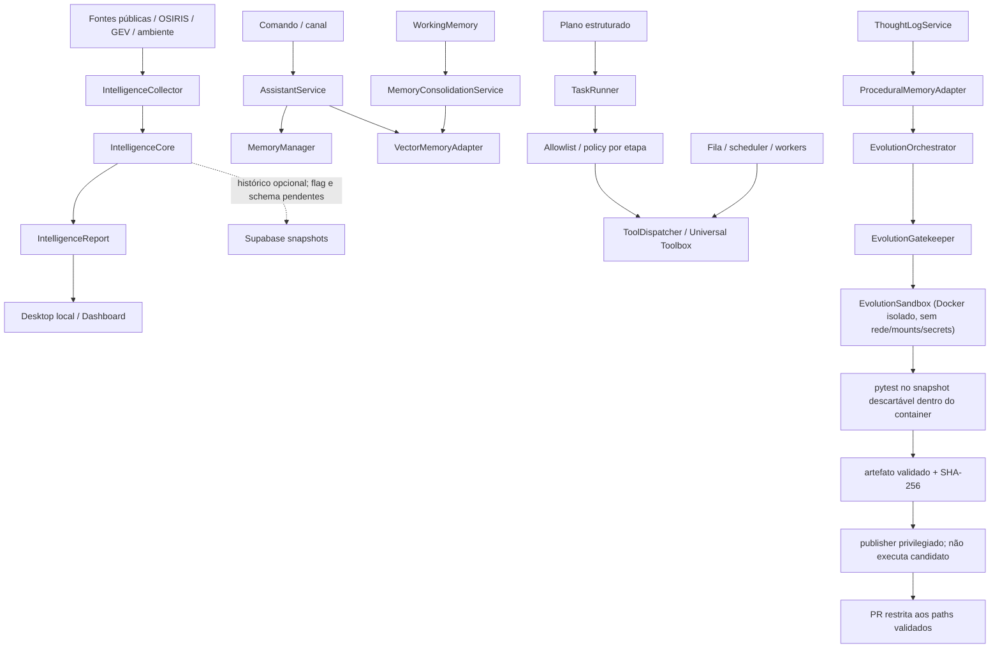

# Cognitive Baseline — Fase C0

**Snapshot:** `main` em `a31f5554776531c245166cb864abbf8a0eb03075` (baseline pós-PR #758)
**Auditoria:** 2026-11-06
**Estado:** parcial; C0 permanece aberto.
**Escopo:** inspeção estática de código, consumidores, contratos, testes, migrations, workflows e documentação, complementada por probes remotos somente leitura. Não é confirmação de deploy completo, execução ponta a ponta ou comportamento de todos os providers.

## 1. Decisão de fase

O próximo marco realmente pendente é **C0 — Auditoria de capacidades e baseline comportamental**. O roadmap exige que cada capacidade crítica tenha caminho de código, consumidor e teste identificados, com lacunas e incertezas registradas. A árvore atual contém componentes reutilizáveis, mas não demonstra ainda um ciclo cognitivo integrado.

Este documento é o primeiro mapa rastreável de C0; não o conclui. Não criar um novo World Model, segundo sistema de memória, event bus ou scheduler antes de fechar a auditoria e os testes de baseline.

## 2. Níveis de evidência

- **Confirmado no repositório:** código, consumidor direto e teste relevante foram localizados. Isso não prova execução em produção.
- **Parcial:** há código e algum consumidor, mas faltam testes de integração, persistência, autorização ou validação operacional.
- **Implementado, não verificado:** há símbolo/registro/documentação, mas o consumidor comportamental ou teste específico não foi confirmado.
- **Bloqueado:** a capacidade depende de flag, migration, policy ou ambiente que não está validado.
- **Ausente no escopo auditado:** o contrato ou comportamento exigido não foi localizado nos caminhos examinados; não significa prova de inexistência em todo o repositório.

## 3. Inventário por capacidade cognitiva

| Capacidade | Implementação / contrato existente | Consumidor localizado | Testes localizados | Classificação e lacuna |
|---|---|---|---|---|
| Roteamento cognitivo | `app/domain/gears/cognitive_router.py`; registro no Nexus | O componente está no registro; não foi confirmado um ciclo cognitivo contínuo que o consuma | `tests/test_nexus_registry_sync.py` valida sincronização do registro | **Implementado, não verificado.** O código classifica entrada por palavras-chave ou uma chamada LiteLLM; isso é roteamento de conversa, não Reasoning Engine. Não foi localizado teste comportamental específico do roteador. |
| Memória semântica | `app/application/services/memory_manager.py`; armazenamento via `DocumentStore` em `data/jarvis_memory.json` | `AssistantService.process_command()` consulta e grava; `FieldVision` consulta soluções/contexto | `tests/application/test_memory_manager.py`; PR #759 adiciona readback após recriar o manager | **Persistência local confirmada por arquivo; isolamento por usuário, redaction, proveniência, retenção governada e falha de escrita continuam sem contrato suficiente.** Busca é por substring/token, não semântica vetorial. |
| Memória vetorial | Porta `MemoryProvider`; `app/adapters/infrastructure/vector_memory_adapter.py` | `AssistantService.process_command()` consulta últimos 30 dias e grava comando/resposta | `tests/adapters/infrastructure/test_vector_memory_adapter.py` | **Process-local, não durável.** `_events` e FAISS ficam em RAM; não há save/load nem readback após reinício. Se o PII redactor não resolver, o adapter armazena o texto original. |
| Memória procedural | `app/adapters/infrastructure/procedural_memory_adapter.py`; indexa ThoughtLogs bem-sucedidos | `EvolutionOrchestrator` consulta soluções conhecidas | `tests/adapters/infrastructure/test_procedural_memory_adapter.py` | **Parcial/bloqueado.** `bootstrap_from_db()` existe, mas não foi encontrado call site; o índice é RAM e pode iniciar vazio. O consumer apenas consulta soluções. |
| Working memory / consolidação | `WorkingMemory` e `MemoryConsolidationService` | `OverwatchDaemon` tenta consolidar periodicamente para `VectorMemoryAdapter` | PR #760 adiciona teste de consolidação no fallback sem FAISS | **Parcial.** `WorkingMemory` é volátil; o destino vetorial também é RAM. PR #760 adiciona health check explícito para o fallback Python; CI ainda precisa validar. Falta persistência durável e prova de recuperação após reinício. |
| Perception / Universal Intelligence | `app/domain/intelligence/contracts.py`: `IntelligenceEvidence`, `IntelligenceEvent`, `IntelligenceObservation`, `IntelligenceBatch`, `IntelligenceReport`; `IntelligenceCollector` e `IntelligenceCore` | Desktop local, dashboard de inteligência e worker recorrente chamam `collect_live_intelligence()` | `tests/application/test_intelligence_core.py`, `test_intelligence_observations.py`, `test_intelligence_collector.py`; testes do dashboard e Desktop | **Confirmado no repositório; runtime parcial.** Há normalização, deduplicação determinística e candidatos de correlação. O histórico está atrás de feature flag e o worker recorrente depende da reconciliação de migrations. |
| World Model | Observações geográficas e temporais existem nos contratos de inteligência | Mapas/dashboard consomem relatórios e observações; não são fonte canônica de estado | Testes de observação cobrem contratos e síntese | **Ausente no escopo auditado como modelo canônico.** Não foi localizado contrato completo para identidade de entidade, relação, afirmação de estado, evento de mudança e projeção temporal reconstruível. `IntelligenceCore` não equivale a World Model. |
| Reasoning / reflexão | `ThoughtLogService`, `MetaReflection`, `TechnicalAnalysisService` | ThoughtLog é usado por evolução, routers e coleta de datasets; MetaReflection alimenta contexto do EvolutionOrchestrator | `tests/application/test_thought_log_service.py`, `tests/test_meta_reflection.py` | **Parcial.** Logs e análise retrospectiva existem. `TechnicalAnalysisService.execute()` retorna `not_implemented`. Não foi demonstrado pipeline Claim/Hypothesis/EvidenceLink/CounterEvidence, calibração ou abstenção. |
| Strategic Planner | `StrategistService` gera matriz de viabilidade/RFC; `DeclarativePlanInterpreter` valida planos estruturados | Router de evolução resolve Strategist; `TaskRunner` executa planos declarativos | `tests/application/test_strategist_service.py`, `tests/test_execution_plan.py`, `tests/multiagent/test_model_plan_adapter.py`, `tests/multiagent/test_task_runner_execution_plan_integration.py` | **Parcial.** `StrategistService.execute()` ainda retorna `not_implemented`; plano declarativo não prova objetivos persistentes, decomposição durável ou replanejamento. |
| Autonomous Executive | `TaskRunner`, scheduler, fila Supabase, workers e Universal Toolbox | Router de missões, orquestrador e workers HTTP/Supabase/supervisionados | `tests/application/test_task_runner.py`, `tests/application/test_task_runner_navigation_plan.py`, testes multiagente e de claims | **Parcial / bloqueado por integração.** Há autorização por etapa e guardas de fila, mas o Toolbox permanece fail-closed sem policy host-backed de produção; E2E entre dois runtimes independentes e verificação de efeito real permanecem pendentes. |
| Initiative | `assistant_proactivity.py`, `assistant_curiosity.py`, `curiosity_engine.py`, health-check do AssistantService e Overwatch | Sugestões contextuais, perguntas durante conversa, health check e alertas de recursos | Testes comportamentais específicos de iniciativa contínua não confirmados nesta passagem | **Parcial.** Há proatividade e monitoramento, mas não foi demonstrado gatilho de mudança do World Model com deduplicação, orçamento, quiet hours e auditoria de decisão. |
| Learning / Evolution | `EvolutionOrchestrator`, `EvolutionGatekeeper`, Docker-backed `EvolutionSandbox`, artifact exporter, trusted publisher, `MetaReflection` | Workflow de evolução separado em candidate-validation e trusted-publication; JarvisDevAgent delega geração e validação ao EvolutionOrchestrator após PR #758 | `tests/application/test_evolution_orchestrator.py`, `tests/test_evolution_sandbox.py`, `tests/test_evolution_gatekeeper.py`, testes de artifact/publisher e workflow permissions | **Parcial, com isolamento corrigido.** PR #756 executa o candidato em Docker sem rede/mounts/segredos; PR #757 separa credencial do provedor e credencial GitHub, valida artefato/digest/commit/path/staging e bloqueia antes do LLM sem `target_file`. Ainda falta mapear alvos confiáveis para capabilities pendentes; timeout é cooperativo e não mata uma chamada síncrona já em andamento. |

## 4. Mapa de fluxo observado

As linhas tracejadas representam dependências ou caminhos que não podem ser tratados como comportamento operacional concluído. A apresentação geoespacial é uma projeção; não deve ser promovida a fonte canônica do World Model.

## 5. Contratos que devem ser reutilizados

| Domínio | Contrato existente | Decisão para a próxima fase |
|---|---|---|
| Inteligência | `IntelligenceEvidence`, `IntelligenceEvent`, `IntelligenceObservation`, `IntelligenceBatch`, `IntelligenceReport` | Estender sem alterar a semântica de eventos/observações; separar identidade observada de identidade estável. |
| Memória | `MemoryProvider`, VectorMemory, ProceduralMemory, WorkingMemory | Manter adaptadores existentes; primeiro medir persistência, recuperação, retenção, conflito e isolamento. |
| Plano | `DeclarativePlanInterpreter`, `PlanOutcome`, TaskRunner e journal | Reutilizar o plano declarativo; não criar segundo scheduler nem converter texto livre diretamente em execução. |
| Execução | scheduler, leases/fencing, ToolAuthorizationPolicy e Toolbox | Reutilizar; política ausente deve continuar fail-closed. |
| Evolução | EvolutionOrchestrator, Gatekeeper e Sandbox | Reutilizar apenas após isolamento real; self-healing/PR repair permanece trilha transversal, não fase cognitiva. |

Não foi justificada nesta auditoria a criação de um novo banco de grafos, event bus, scheduler ou backend de memória.

## 6. Lacunas de C0 ainda abertas

1. **Baseline comportamental integrado:** PR #759 está merged. O teste `test_authenticated_collection_endpoint_integrates_sources_core_and_report` cobre fontes independentes → coletor → `IntelligenceCore` → endpoint autenticado, incluindo deduplicação, correlação candidata, sucesso parcial, isolamento de erros e histórico desativado. Isso valida o contrato com fontes controladas, não a disponibilidade de todos os providers em produção.
2. **Mapa completo de consumidores e configuração:** completar flags, migrations, ACLs, entry points, processos e estado de deploy de cada componente crítico.
3. **Memória:** PR #759 comprova readback do `MemoryManager` após recriar a instância; PR #762 adiciona redaction e partição por usuário para memória semântica baseada em arquivo, além de escopo na história SQLite/vetorial. Ainda faltam idempotência, expiração/retention, falha de escrita validada em todos os caminhos, persistência vetorial após reinício e bootstrap/recuperação procedural.
4. **Reasoning:** separar ThoughtLog/MetaReflection de inferência rastreável; o pipeline de contraditório, calibração e abstenção ainda não está demonstrado.
5. **Planning:** provar persistência de objetivo, dependências e replanejamento; a matriz de viabilidade e o plano declarativo são capacidades diferentes.
6. **Executive:** PR #761 comprova troca de mensagens entre processos independentes contra Supabase isolado e fencing de ACK. Isso não comprova o caminho de execução da fila de tarefas nem comportamento em produção. Ainda falta escolher e validar o runtime canônico.
7. **Initiative:** demonstrar gatilho independente de prompt, deduplicação, orçamento e política de notificação.
8. **Learning:** o isolamento Docker e a publicação privilegiada já estão implementados (PR #756/#757). O bloqueio atual é a ausência de `target_file` confiável para as capabilities pendentes e a limitação do contrato atual a um único arquivo-alvo; não ativar evolução automática para features que exijam mudanças coordenadas de código e testes até existir suporte multi-arquivo com testes correspondentes.
9. **Proveniência e privacidade:** PR #762 reduz exposição na memória semântica e história cobertas, mas não constitui política completa de tenant para todos os providers, workers, logs e dados vetoriais. Retenção, exclusão verificável, proveniência e minimização continuam pendentes.

## 7. Próxima implementação recomendada

**Manter C0 aberto.** As PRs #759–#764 fecharam contratos importantes, mas não reconciliaram o estado operacional do Supabase nem concluíram o runtime autônomo.

Evidências integradas:

- **PR #759 — merged:** baseline da coleta de inteligência pelo endpoint autenticado e readback do `MemoryManager` após recriar a instância. Suíte completa e workflow de fila passaram.
- **PR #760 — merged:** `VectorMemoryAdapter.is_healthy()` reconhece o backend puro-Python quando FAISS não está disponível. Consolidação e busca cobertas; não adiciona persistência vetorial.
- **PR #761 — merged:** fencing por `claim_token` na fila de mensagens; ACK obsoleto é rejeitado e a RPC antiga sem token perde execução para `service_role`. O workflow dedicado sobe Supabase isolado, roda pgTAP e executa `test_supabase_message_process_e2e.py` com leader e worker em processos separados, cada um com cliente próprio. O workflow Task Queue passou; o PR Validation foi cancelado e não é contado como sucesso. A migration não foi aplicada ao projeto remoto.
- **PR #762 — merged:** redaction fail-closed de email/CPF/telefone, partição de memória semântica por identidade autenticada, escopo da história SQLite e filtragem vetorial por proprietário. PR Validation e Task Queue passaram. Não torna o vector store durável nem implementa DLP completa.
- **PR #763 — merged:** migration forward-only para rejeitar duração `NULL` na renovação de lease de tarefa, preservando a migration histórica. pgTAP, suíte completa e Task Queue passaram. A RPC continua ausente no banco remoto porque a migration não foi aplicada.
- **PR #764 — merged:** propostas viáveis ficam pendentes até aprovação explícita; a rota exige identidade autenticada, persiste `approved_by`/`approved_at` e o RFC verifica a aprovação persistida. PR Validation e Task Queue passaram. O teste usa dependência de identidade controlada; não é prova de integração de ponta a ponta com o provedor de identidade de produção.

Pendências reais de C0:

1. **Durabilidade de memória:** readback semântico em arquivo está coberto; provar idempotência, retenção/expiração e recuperação de memória vetorial/procedural após reinício.
2. **Runtime canônico:** o supervisor atual inicia `SupabaseTaskQueueMiniAgent` ou `PriorityQueueMiniAgent`; a via `AgentLeader`/`AgentWorker` continua separada. Escolher e integrar um único caminho operacional.
3. **Task queue E2E:** validar dois processos independentes contra banco isolado no caminho de tarefas, incluindo renovação, expiração, fencing e recuperação. O E2E da PR #761 cobre a fila de mensagens, não a fila de tarefas.
4. **Ledger Supabase:** reconciliar versões e SQL local/remoto antes de qualquer `migration repair`, `db push` ou aplicação de migration. O branch remoto continua `MIGRATIONS_FAILED`; a RPC de renovação e a coluna/token de fencing não existem no schema remoto.
5. **Aprovação:** integrar a identidade real e uma política explícita de quem pode aprovar; a API agora exige ator autenticado e grava auditoria, mas o teste ainda usa identidade injetada.
6. **Privacidade:** ampliar redaction/retention/erasure e provar purge em todos os stores, incluindo vetores, ThoughtLogs e logs operacionais.
7. **Reasoning, Planning e Initiative:** completar os contratos comportamentais listados na seção 6.

Não iniciar C1 nem ativar workers recorrentes enquanto o ledger não for reconciliado e os caminhos de execução/lease não forem validados.

## 8. Trilhas transversais e mudanças recentes

Estas entregas são manutenção ou infraestrutura; não concluem fases cognitivas:

- **PR #739:** adicionou TLS opt-in com verificação obrigatória de certificado ao `MqttHomeAdapter`; issue #705 está fechada. Nenhum broker foi validado nesta auditoria.
- **PR #740:** separou secrets de provedores dos passos pytest do workflow Homeostase; testes antes/depois da cura não recebem essas variáveis.
- **PR #741:** centralizou a política de caminhos protegidos para Gatekeeper/Crystallizer; não fornece isolamento de execução.
- **PR #742:** adicionou a dependência de tarefa-pai também ao claim direto; validação SQL isolada está no workflow dedicado.
- **PR #743:** introduziu o Cognitive Roadmap; C0 permanece pendente.
- **PR #744:** melhorou a apresentação geoespacial; mapa continua sendo superfície de visualização, não World Model.
- **PR #756:** isolou a execução de candidatos em Docker descartável; testes adversariais verificam ausência de rede, mounts e segredos.
- **PR #757:** separou geração/validação de publicação privilegiada, adicionou artefato com digest e publisher path-scoped; a autoevolução falha fechada sem target confiável.
- **PR #758 (merged em 2026-11-06, America/Sao_Paulo):** elimina o pipeline paralelo do JarvisDevAgent, delega ao EvolutionOrchestrator e adiciona cancelamento cooperativo. Merge commit: `a31f5554776531c245166cb864abbf8a0eb03075`.
- **PR #759 (merged):** baseline integrado da coleta de inteligência e readback de memória semântica.
- **PR #760 (merged):** health check correto para o fallback puro-Python do vector store.
- **PR #761 (merged):** fencing por tentativa na fila de mensagens e E2E de dois processos em Supabase isolado.
- **PR #762 (merged):** redaction fail-closed e isolamento por usuário nos caminhos de memória cobertos.
- **PR #763 (merged):** guard forward-only para duração nula na renovação de lease de tarefa.
- **PR #764 (merged):** gate de aprovação humana autenticada para propostas do Strategist.

O workflow `.github/workflows/homeostase.yml` permanece versionado com gatilhos de recuperação e dispatch. Esta auditoria não o executou nem alterou seus gates. A correção automática de PR/CI e os workflows Self Healing permanecem uma trilha transversal obrigatória.

## 9. Estado de verificação desta auditoria

- Base inspecionada: `a2f3d64c099ceecc72cbd45cc471c432ad06ff7b`, merge commit da PR #762, contendo as PRs #759–#764.
- PR #758 está merged. Workflow `Jarvis Task Queue Tests` terminou com **success**, incluindo `Run full test suite`. Build e Auto-Documentation também terminaram com **success**.
- O check `Supabase Preview` terminou com **failure**: `Remote migration versions not found in local migrations directory.` Não é falha do pytest.
- A auditoria remota foi somente leitura. Nenhum DDL, DML, migration repair, push, deploy, grant ou feature flag foi alterado.
- O repositório não possui rulesets ativos. A leitura do endpoint de branch protection retorna HTTP 403 pela integração disponível; nenhuma regra foi alterada.
- A auditoria C0 permanece parcial porque ainda faltam provas integradas listadas na seção 6.

### 9.1 Snapshot operacional Supabase

**Projeto:** `saibtpdehhprttqlgqdt`; estado do projeto `ACTIVE_HEALTHY`; PostgreSQL `17.6.1.063`.

| Evidência remota | Resultado observado |
|---|---:|
| Status da branch Supabase `main` | `MIGRATIONS_FAILED` |
| Arquivos locais em `supabase/migrations` após reconciliação do ledger | 26 |
| Entradas no ledger remoto | 20 |
| Versões remotas restauradas com prefixo exato no repositório | 20 |
| Migrations locais pendentes após o último version remoto | 6 |
| `jarvis_agents` | 5 linhas |
| `jarvis_agent_tasks` | 13 linhas |
| `jarvis_agent_attempts` | 12 linhas |
| `jarvis_agent_events` | 24 linhas |
| `jarvis_agent_messages` | 0 linhas |
| `jarvis_environment_observations` | 1.755 linhas |
| `intelligence_event_snapshots` | 0 linhas |
| `intelligence_observation_snapshots` | 0 linhas |
| `jarvis_mobile_device_sessions` | 48 linhas |
| `jarvis_mobile_devices` | 1 linha |

O ledger remoto ainda contém duas entradas chamadas `google_linked_identities`; ambas foram restauradas separadamente com seus version IDs originais, sem deduplicação. As 20 versões remotas agora têm arquivos locais com o prefixo exato. Restam seis migrations locais pendentes, todas com versões posteriores ao último registro remoto:
- `20261105202000_direct_claim_parent_dependency_guard.sql`
- `20261107010000_multi_agent_message_claim_fencing.sql`
- `20261107020000_task_lease_renewal_null_duration_guard.sql`
- `20261107025840_release_failed_task_attempt.sql`
- `20261107025853_worker_lease_supporting_indexes.sql`
- `20261107025932_intelligence_recurring_worker.sql`

A migration antiga `20261028130000_worker_lease_and_security_hardening.sql` foi retirada do conjunto pendente: além de duplicar a RPC de lease corrigida pela PR #763, ela referenciava `jarvis_mobile_push_devices`, tabela removida pela migration posterior `mobile_native_event_queue`. Seus cinco índices foram isolados numa migration forward-only que não referencia a tabela obsoleta. A migration de Red/Blue e a migration de heartbeat também foram removidas como duplicatas/supersedidas pelas versões históricas restauradas e pela migration remota de provider-aware claims.

Não executar `migration repair`, `db push` ou aplicar migrations pendentes até a validação do PR de reconciliação e revisão da ordem final.

**RPCs e colunas verificadas diretamente no schema remoto em 2026-11-06:**
- `claim_jarvis_agent_message(p_agent_id text, p_lease_seconds integer)` existe sem token de tentativa.
- `ack_jarvis_agent_message(p_message_id uuid, p_agent_id text)` continua na assinatura antiga de dois argumentos.
- `public.jarvis_agent_messages.claim_token` não existe.
- `renew_jarvis_agent_task_lease` não existe.
- `claim_jarvis_agent_task` e `claim_next_jarvis_agent_task` existem.
- `lease_expires_at` existe nas tabelas de mensagens e tarefas.

Portanto, as migrations de fencing da fila de mensagens (PR #761) e de validação de duração nula da renovação de lease (PR #763) estão no Git, mas não estão aplicadas no Supabase remoto. A migration da PR #763 define a RPC completa `renew_jarvis_agent_task_lease` com a validação de `NULL` e, se aplicada, cria a função ausente no schema atual. Ela ainda não foi aplicada remotamente e não instala os cinco índices/objetos adicionais da migration histórica `20261028130000_worker_lease_and_security_hardening.sql`. O projeto pode estar `ACTIVE_HEALTHY` enquanto a branch de migrations permanece `MIGRATIONS_FAILED`; são estados distintos.

Nenhum DDL, DML, migration repair, grant ou deploy foi executado nesta revalidação. Não ativar o worker de mensagens/tarefas que dependa das novas assinaturas antes da reconciliação e implantação controlada do ledger.

### 9.2 Segurança e performance do banco

- As 26 tabelas apontadas pelo advisor têm RLS habilitado e nenhuma policy. A consulta de privilégios não encontrou grants de tabela para `anon` ou `authenticated`; os acessos observados ficam restritos a `service_role` e ao owner. O advisor classifica isso como INFO. Não tratar ausência de policy, isoladamente, como exposição pública.
- Advisor de performance reporta cinco foreign keys sem índice de cobertura e 33 índices ainda não utilizados. Não remover índices sem evidência de carga; avaliar os cinco índices ausentes depois da reconciliação de migrations.
- Advisor de health não reportou findings.

### 9.3 Limites de execução local

- A máquina Windows conectada não possui `docker` nem `supabase` CLI disponíveis no PATH; por isso, a stack local não foi executada nessa máquina.
- O workflow GitHub da PR #761 executou uma stack Supabase efêmera no runner Ubuntu, rodou pgTAP e `test_supabase_message_process_e2e.py` com leader e worker em processos separados e clientes independentes. Isso comprova o contrato da fila de mensagens em banco isolado, não produção.
- Ainda falta E2E entre processos independentes para a fila de tarefas usada pelo runtime supervisionado.

### 9.4 Memória: persistência e privacidade

- `MemoryManager` sanitiza texto de usuário e resposta antes de persistir; email, CPF e telefone são redigidos. O readback após recriar o manager está coberto pela PR #759.
- A PR #762 particiona a memória semântica por identidade autenticada, usando digest SHA-256 no nome do arquivo. Chamadas sem usuário ficam restritas ao compartimento local/sistema; registros legados globais não são copiados para partições de usuário.
- A identidade autenticada é propagada nos caminhos de API, interpretação, histórico SQLite e worker cobertos. Histórico não escopado retorna somente registros locais; consultas vetoriais filtram pelo proprietário e rejeitam `user_id` injetado em metadata não confiável.
- `VectorMemoryAdapter` agora falha fechado quando o redactor não está disponível e aceita o backend puro-Python sem FAISS (PR #760/#762). O store continua em memória do processo; não há save/load nem readback vetorial após reinício.
- `ProceduralMemoryAdapter.bootstrap_from_db()` ainda não tem call site confirmado; o índice de soluções permanece volátil.
- A redaction atual cobre padrões de email, CPF e telefone; não é uma política DLP completa. A exclusão/purge de IDs vetoriais e a retenção de ThoughtLogs/logs ainda precisam de prova ponta a ponta.

### 9.5 Reconciliação do ledger em 2026-11-07

A coluna `supabase_migrations.schema_migrations.statements` foi consultada em modo somente leitura. Ela contém o SQL efetivamente registrado para cada versão remota. Os 20 arquivos históricos foram reconstruídos a partir desses statements, preservando inclusive as duas entradas distintas `google_linked_identities`. Verificação local do branch de reconciliação: 20/20 versões remotas presentes, 26 arquivos locais no total e seis migrations pendentes acima do maior version remoto.

**Estado de schema confirmado:**
- `model_provider`, `mark_stale_jarvis_agents_offline` e o roteamento provider-aware estão presentes; a migration histórica remota `20261027165940` foi restaurada no repositório.
- `release_jarvis_agent_task` já existe no banco remoto; sua migration local foi rebaseada para registrar a definição no histórico sem alterar a semântica.
- A RPC de claim da fila já respeita dependência de tarefa-pai; a RPC de claim direto ainda não. A migration `20261105202000` permanece pendente.
- `jarvis_mobile_push_devices` não existe; a sequência histórica cria essa tabela e depois a migration de fila nativa a remove, criando `jarvis_mobile_devices`. A antiga migration de hardening não podia ser reaplicada depois dessa transição.
- Os cinco índices de recuperação/lookup de attempts, events, parent tasks e routines não existem. A migration `20261107025853` agora cria apenas esses índices.
- `renew_jarvis_agent_task_lease` não existe no remoto; `20261107020000` continua pendente.
- `jarvis_agent_messages.claim_token` não existe e o ACK remoto continua na assinatura antiga de dois argumentos; `20261107010000` continua pendente.
- As tabelas/RPCs do recurring intelligence worker não existem; `20261107025932` continua pendente e ainda precisa de validação isolada.
- O estado remoto da branch Supabase permanece `MIGRATIONS_FAILED`. Restaurar os arquivos locais corrige a ausência de versões no repositório, mas não altera o ledger remoto.

Nenhum DDL, DML, `migration repair`, `db push`, grant ou deploy foi executado.

**Conclusão:** C0 continua aberto. Universal Intelligence já possui coleta, normalização e candidatos de correlação, mas histórico persistente ainda não está provado. C1 — World Model permanece bloqueado até fechar baseline de memória, identidade, proveniência e integração operacional.
