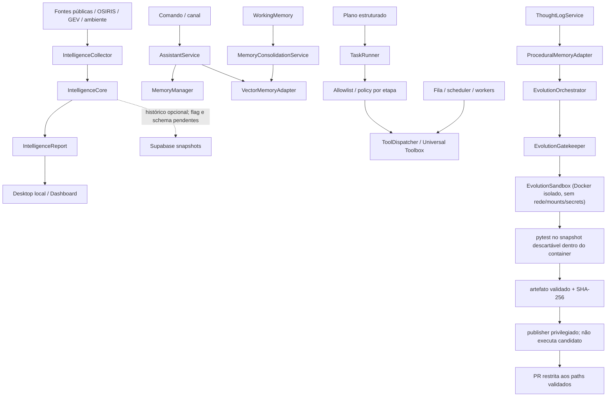

# Cognitive Baseline — Fase C0

**Snapshot:** `main` em `a31f5554776531c245166cb864abbf8a0eb03075` (baseline pós-PR #758)
**Auditoria:** 2026-11-06
**Estado:** parcial; C0 permanece aberto.
**Escopo:** inspeção estática de código, consumidores, contratos, testes, migrations, workflows e documentação, complementada por probes remotos somente leitura. Não é confirmação de deploy completo, execução ponta a ponta ou comportamento de todos os providers.

## 1. Decisão de fase

O próximo marco realmente pendente é **C0 — Auditoria de capacidades e baseline comportamental**. O roadmap exige que cada capacidade crítica tenha caminho de código, consumidor e teste identificados, com lacunas e incertezas registradas. A árvore atual contém componentes reutilizáveis, mas não demonstra ainda um ciclo cognitivo integrado.

Este documento é o primeiro mapa rastreável de C0; não o conclui. Não criar um novo World Model, segundo sistema de memória, event bus ou scheduler antes de fechar a auditoria e os testes de baseline.

## 2. Níveis de evidência

- **Confirmado no repositório:** código, consumidor direto e teste relevante foram localizados. Isso não prova execução em produção.
- **Parcial:** há código e algum consumidor, mas faltam testes de integração, persistência, autorização ou validação operacional.
- **Implementado, não verificado:** há símbolo/registro/documentação, mas o consumidor comportamental ou teste específico não foi confirmado.
- **Bloqueado:** a capacidade depende de flag, migration, policy ou ambiente que não está validado.
- **Ausente no escopo auditado:** o contrato ou comportamento exigido não foi localizado nos caminhos examinados; não significa prova de inexistência em todo o repositório.

## 3. Inventário por capacidade cognitiva

| Capacidade | Implementação / contrato existente | Consumidor localizado | Testes localizados | Classificação e lacuna |
|---|---|---|---|---|
| Roteamento cognitivo | `app/domain/gears/cognitive_router.py`; registro no Nexus | O componente está no registro; não foi confirmado um ciclo cognitivo contínuo que o consuma | `tests/test_nexus_registry_sync.py` valida sincronização do registro | **Implementado, não verificado.** O código classifica entrada por palavras-chave ou uma chamada LiteLLM; isso é roteamento de conversa, não Reasoning Engine. Não foi localizado teste comportamental específico do roteador. |
| Memória semântica | `app/application/services/memory_manager.py`; armazenamento via `DocumentStore` em `data/jarvis_memory.json` | `AssistantService.process_command()` consulta e grava; `FieldVision` consulta soluções/contexto | `tests/application/test_memory_manager.py`; PR #759 adiciona readback após recriar o manager | **Persistência local confirmada por arquivo; isolamento por usuário, redaction, proveniência, retenção governada e falha de escrita continuam sem contrato suficiente.** Busca é por substring/token, não semântica vetorial. |
| Memória vetorial | Porta `MemoryProvider`; `app/adapters/infrastructure/vector_memory_adapter.py` | `AssistantService.process_command()` consulta últimos 30 dias e grava comando/resposta | `tests/adapters/infrastructure/test_vector_memory_adapter.py` | **Process-local, não durável.** `_events` e FAISS ficam em RAM; não há save/load nem readback após reinício. Se o PII redactor não resolver, o adapter armazena o texto original. |
| Memória procedural | `app/adapters/infrastructure/procedural_memory_adapter.py`; indexa ThoughtLogs bem-sucedidos | `EvolutionOrchestrator` consulta soluções conhecidas | `tests/adapters/infrastructure/test_procedural_memory_adapter.py` | **Parcial/bloqueado.** `bootstrap_from_db()` existe, mas não foi encontrado call site; o índice é RAM e pode iniciar vazio. O consumer apenas consulta soluções. |
| Working memory / consolidação | `WorkingMemory` e `MemoryConsolidationService` | `OverwatchDaemon` tenta consolidar periodicamente para `VectorMemoryAdapter` | PR #760 adiciona teste de consolidação no fallback sem FAISS | **Parcial.** `WorkingMemory` é volátil; o destino vetorial também é RAM. PR #760 adiciona health check explícito para o fallback Python; CI ainda precisa validar. Falta persistência durável e prova de recuperação após reinício. |
| Perception / Universal Intelligence | `app/domain/intelligence/contracts.py`: `IntelligenceEvidence`, `IntelligenceEvent`, `IntelligenceObservation`, `IntelligenceBatch`, `IntelligenceReport`; `IntelligenceCollector` e `IntelligenceCore` | Desktop local, dashboard de inteligência e worker recorrente chamam `collect_live_intelligence()` | `tests/application/test_intelligence_core.py`, `test_intelligence_observations.py`, `test_intelligence_collector.py`; testes do dashboard e Desktop | **Confirmado no repositório; runtime parcial.** Há normalização, deduplicação determinística e candidatos de correlação. O histórico está atrás de feature flag e o worker recorrente depende da reconciliação de migrations. |
| World Model | Observações geográficas e temporais existem nos contratos de inteligência | Mapas/dashboard consomem relatórios e observações; não são fonte canônica de estado | Testes de observação cobrem contratos e síntese | **Ausente no escopo auditado como modelo canônico.** Não foi localizado contrato completo para identidade de entidade, relação, afirmação de estado, evento de mudança e projeção temporal reconstruível. `IntelligenceCore` não equivale a World Model. |
| Reasoning / reflexão | `ThoughtLogService`, `MetaReflection`, `TechnicalAnalysisService` | ThoughtLog é usado por evolução, routers e coleta de datasets; MetaReflection alimenta contexto do EvolutionOrchestrator | `tests/application/test_thought_log_service.py`, `tests/test_meta_reflection.py` | **Parcial.** Logs e análise retrospectiva existem. `TechnicalAnalysisService.execute()` retorna `not_implemented`. Não foi demonstrado pipeline Claim/Hypothesis/EvidenceLink/CounterEvidence, calibração ou abstenção. |
| Strategic Planner | `StrategistService` gera matriz de viabilidade/RFC; `DeclarativePlanInterpreter` valida planos estruturados | Router de evolução resolve Strategist; `TaskRunner` executa planos declarativos | `tests/application/test_strategist_service.py`, `tests/test_execution_plan.py`, `tests/multiagent/test_model_plan_adapter.py`, `tests/multiagent/test_task_runner_execution_plan_integration.py` | **Parcial.** `StrategistService.execute()` ainda retorna `not_implemented`; plano declarativo não prova objetivos persistentes, decomposição durável ou replanejamento. |
| Autonomous Executive | `TaskRunner`, scheduler, fila Supabase, workers e Universal Toolbox | Router de missões, orquestrador e workers HTTP/Supabase/supervisionados | `tests/application/test_task_runner.py`, `tests/application/test_task_runner_navigation_plan.py`, testes multiagente e de claims | **Parcial / bloqueado por integração.** Há autorização por etapa e guardas de fila, mas o Toolbox permanece fail-closed sem policy host-backed de produção; E2E entre dois runtimes independentes e verificação de efeito real permanecem pendentes. |
| Initiative | `assistant_proactivity.py`, `assistant_curiosity.py`, `curiosity_engine.py`, health-check do AssistantService e Overwatch | Sugestões contextuais, perguntas durante conversa, health check e alertas de recursos | Testes comportamentais específicos de iniciativa contínua não confirmados nesta passagem | **Parcial.** Há proatividade e monitoramento, mas não foi demonstrado gatilho de mudança do World Model com deduplicação, orçamento, quiet hours e auditoria de decisão. |
| Learning / Evolution | `EvolutionOrchestrator`, `EvolutionGatekeeper`, Docker-backed `EvolutionSandbox`, artifact exporter, trusted publisher, `MetaReflection` | Workflow de evolução separado em candidate-validation e trusted-publication; JarvisDevAgent delega geração e validação ao EvolutionOrchestrator após PR #758 | `tests/application/test_evolution_orchestrator.py`, `tests/test_evolution_sandbox.py`, `tests/test_evolution_gatekeeper.py`, testes de artifact/publisher e workflow permissions | **Parcial, com isolamento corrigido.** PR #756 executa o candidato em Docker sem rede/mounts/segredos; PR #757 separa credencial do provedor e credencial GitHub, valida artefato/digest/commit/path/staging e bloqueia antes do LLM sem `target_file`. Ainda falta mapear alvos confiáveis para capabilities pendentes; timeout é cooperativo e não mata uma chamada síncrona já em andamento. |

## 4. Mapa de fluxo observado

As linhas tracejadas representam dependências ou caminhos que não podem ser tratados como comportamento operacional concluído. A apresentação geoespacial é uma projeção; não deve ser promovida a fonte canônica do World Model.

## 5. Contratos que devem ser reutilizados

| Domínio | Contrato existente | Decisão para a próxima fase |
|---|---|---|
| Inteligência | `IntelligenceEvidence`, `IntelligenceEvent`, `IntelligenceObservation`, `IntelligenceBatch`, `IntelligenceReport` | Estender sem alterar a semântica de eventos/observações; separar identidade observada de identidade estável. |
| Memória | `MemoryProvider`, VectorMemory, ProceduralMemory, WorkingMemory | Manter adaptadores existentes; primeiro medir persistência, recuperação, retenção, conflito e isolamento. |
| Plano | `DeclarativePlanInterpreter`, `PlanOutcome`, TaskRunner e journal | Reutilizar o plano declarativo; não criar segundo scheduler nem converter texto livre diretamente em execução. |
| Execução | scheduler, leases/fencing, ToolAuthorizationPolicy e Toolbox | Reutilizar; política ausente deve continuar fail-closed. |
| Evolução | EvolutionOrchestrator, Gatekeeper e Sandbox | Reutilizar apenas após isolamento real; self-healing/PR repair permanece trilha transversal, não fase cognitiva. |

Não foi justificada nesta auditoria a criação de um novo banco de grafos, event bus, scheduler ou backend de memória.

## 6. Lacunas de C0 ainda abertas

1. **Baseline comportamental integrado:** PR #759 cobre fontes → coletor → `IntelligenceCore` → endpoint autenticado, com deduplicação, correlação candidata, sucesso parcial e isolamento de erros. O contrato está testado com fontes controladas; disponibilidade de todos os providers em produção ainda exige validação.
2. **Memória:** PR #759 comprova readback do `MemoryManager` após recriar a instância; PR #762 adiciona redaction fail-closed e escopo por usuário nos caminhos cobertos. O vector store continua em memória do processo; faltam persistência/readback vetorial após reinício, idempotência, retention/erasure verificáveis e bootstrap procedural.
3. **Executive / task queue:** PR #761 valida fencing de mensagens em dois processos independentes; PR #766 valida claim → renew → execute → complete de tarefa em dois processos independentes contra Supabase isolado. Isso prova o contrato de banco, não a execução de tarefas reais no runtime de produção. Três mini-agentes Groq estão online, mas anunciam apenas `text_reasoning`; as duas tarefas prontas exigem `repository_read`, `github_read` e `production_read`. O claim está corretamente bloqueado por incompatibilidade de capacidades.
4. **Leases e recuperação:** PR #763 e #767 instalaram a RPC NULL-safe, fencing e os cinco índices. Os contratos pgTAP passaram. Ainda falta executar uma tarefa real de ponta a ponta no runtime após registrar ferramentas compatíveis e verificar recuperação após expiração de lease.
5. **Recurring intelligence worker:** tabelas e RPCs foram implantadas e têm RLS. A lease está sem proprietário e existem zero registros de execução; o processo recorrente ainda não foi ativado nem validado operacionalmente.
6. **Aprovação:** PR #764 exige ator autenticado e persiste `approved_by`/`approved_at`. Falta integrar o provedor real de identidade e política de autorização de produção; o teste atual usa identidade injetada.
7. **Reasoning:** separar ThoughtLog/MetaReflection de inferência rastreável; contraditório, calibração e abstenção ainda não estão demonstrados.
8. **Planning:** provar persistência de objetivo, dependências e replanejamento; matriz de viabilidade e plano declarativo continuam sendo contratos distintos.
9. **Initiative:** demonstrar gatilho independente de prompt, deduplicação, orçamento e política de notificação.
10. **Learning:** isolamento Docker e publicação privilegiada estão implementados (PR #756/#757). O bloqueio é a ausência de `target_file` confiável para capabilities pendentes e o contrato limitado a um arquivo-alvo; não ativar evolução automática multi-arquivo antes de suportar e testar mudanças coordenadas.
11. **Proveniência e privacidade:** PR #762 reduz exposição nos stores cobertos, mas não é DLP/tenant isolation completa para todos os providers, workers, logs e dados vetoriais. Retenção, exclusão verificável e proveniência continuam pendentes.

## 7. Próxima implementação recomendada

**Manter C0 aberto.** As PRs #759–#767 fecharam contratos de coleta, memória, aprovação, fencing e migrações. A camada de banco está reconciliada; o bloqueio agora é a integração entre capacidades anunciadas pelos agentes e ferramentas realmente executáveis.

Evidências integradas:
- **PR #759 — merged:** baseline da coleta de inteligência e readback do `MemoryManager`.
- **PR #760 — merged:** health check do vector store mantém fallback puro-Python sem FAISS.
- **PR #761 — merged:** fencing por `claim_token`; E2E de leader/worker em processos independentes.
- **PR #762 — merged:** redaction fail-closed e escopo por usuário na memória/histórico cobertos.
- **PR #763 — merged:** RPC de renovação de lease com validação explícita de duração nula.
- **PR #764 — merged:** gate de aprovação humana autenticada para propostas do Strategist.
- **PR #765 — merged:** atualização documental do C0 após PRs #759–#764.
- **PR #766 — merged:** E2E real da fila de tarefas em dois processos independentes; pgTAP, renovação, completion e eventos persistidos.
- **PR #767 — merged:** reconstrução exata das 20 migrations históricas, seis migrations forward-only e reconciliação automática do ledger após merge. Supabase agora registra 26/26 versões e está `ACTIVE_HEALTHY`.

Próxima sequência:
1. Integrar o registry real de ferramentas ao heartbeat/upsert do agente; nunca anunciar capability sem executor funcional.
2. Implementar/ligar `repository_read`, `github_read` e `production_read` aos conectores autorizados ou encaminhar essas tarefas para agentes que já possuam tais ferramentas.
3. Revalidar as duas tarefas prontas sem forçar claim; executar uma tarefa controlada após a compatibilidade de capabilities estar comprovada.
4. Configurar o processo recorrente de inteligência e comprovar claim de lease, execução, persistência de run e liberação.
5. Completar durabilidade vetorial/procedural, retention/erasure e proveniência.
6. Só então fechar C0 e iniciar C1 — World Model.

## 8. Trilhas transversais e mudanças recentes

Estas entregas são manutenção ou infraestrutura; não concluem fases cognitivas:

- **PR #739:** adicionou TLS opt-in com verificação obrigatória de certificado ao `MqttHomeAdapter`; issue #705 está fechada. Nenhum broker foi validado nesta auditoria.
- **PR #740:** separou secrets de provedores dos passos pytest do workflow Homeostase; testes antes/depois da cura não recebem essas variáveis.
- **PR #741:** centralizou a política de caminhos protegidos para Gatekeeper/Crystallizer; não fornece isolamento de execução.
- **PR #742:** adicionou a dependência de tarefa-pai também ao claim direto; validação SQL isolada está no workflow dedicado.
- **PR #743:** introduziu o Cognitive Roadmap; C0 permanece pendente.
- **PR #744:** melhorou a apresentação geoespacial; mapa continua sendo superfície de visualização, não World Model.
- **PR #756:** isolou a execução de candidatos em Docker descartável; testes adversariais verificam ausência de rede, mounts e segredos.
- **PR #757:** separou geração/validação de publicação privilegiada, adicionou artefato com digest e publisher path-scoped; a autoevolução falha fechada sem target confiável.
- **PR #758 (merged em 2026-11-06, America/Sao_Paulo):** elimina o pipeline paralelo do JarvisDevAgent, delega ao EvolutionOrchestrator e adiciona cancelamento cooperativo. Merge commit: `a31f5554776531c245166cb864abbf8a0eb03075`.
- **PR #759 (merged):** baseline integrado da coleta de inteligência e readback de memória semântica.
- **PR #760 (merged):** health check correto para o fallback puro-Python do vector store.
- **PR #761 (merged):** fencing por tentativa na fila de mensagens e E2E de dois processos em Supabase isolado.
- **PR #762 (merged):** redaction fail-closed e isolamento por usuário nos caminhos de memória cobertos.
- **PR #763 (merged):** guard forward-only para duração nula na renovação de lease de tarefa.
- **PR #764 (merged):** gate de aprovação humana autenticada para propostas do Strategist.

O workflow `.github/workflows/homeostase.yml` permanece versionado com gatilhos de recuperação e dispatch. Esta auditoria não o executou nem alterou seus gates. A correção automática de PR/CI e os workflows Self Healing permanecem uma trilha transversal obrigatória.

## 9. Estado de verificação desta auditoria

- Base inspecionada: `a2f3d64c099ceecc72cbd45cc471c432ad06ff7b`, merge commit da PR #762, contendo as PRs #759–#764.
- PR #758 está merged. Workflow `Jarvis Task Queue Tests` terminou com **success**, incluindo `Run full test suite`. Build e Auto-Documentation também terminaram com **success**.
- O check `Supabase Preview` terminou com **failure**: `Remote migration versions not found in local migrations directory.` Não é falha do pytest.
- A auditoria remota foi somente leitura. Nenhum DDL, DML, migration repair, push, deploy, grant ou feature flag foi alterado.
- O repositório não possui rulesets ativos. A leitura do endpoint de branch protection retorna HTTP 403 pela integração disponível; nenhuma regra foi alterada.
- A auditoria C0 permanece parcial porque ainda faltam provas integradas listadas na seção 6.

### 9.1 Snapshot operacional Supabase

**Projeto:** `saibtpdehhprttqlgqdt`; estado `ACTIVE_HEALTHY`; PostgreSQL `17.6.1.063`. **Branch Supabase `main`:** `FUNCTIONS_DEPLOYED`; preview `ACTIVE_HEALTHY`.

| Evidência remota | Resultado observado em 2026-11-07 |
|---|---:|
| Arquivos locais em `supabase/migrations` | 26 |
| Entradas no ledger remoto | 26 |
| Versões locais/remotas correspondentes | 26/26 |
| Migrations locais pendentes | 0 |
| Última versão | `20261107025932` |
| `jarvis_agents` | 5 linhas |
| `jarvis_agent_tasks` | 13 linhas |
| `jarvis_agent_attempts` | 12 linhas |
| `jarvis_agent_events` | 24 linhas |
| `jarvis_agent_messages` | 0 linhas |
| `jarvis_environment_observations` | 1.755 linhas |
| `intelligence_event_snapshots` | 0 linhas |
| `intelligence_observation_snapshots` | 0 linhas |
| `jarvis_mobile_device_sessions` | 48 linhas |
| `jarvis_mobile_devices` | 1 linha |

As duas entradas históricas `google_linked_identities` foram preservadas separadamente. A integração GitHub–Supabase aplicou as seis migrations pendentes após o merge do PR #767; o ledger remoto agora contém todas as 26 versões. Não foi executado `db push`, `migration repair` ou DDL manual pelo ChatGPT.

**RPCs, fencing e ACLs verificados diretamente:**
- `claim_jarvis_agent_task` e `claim_next_jarvis_agent_task` aplicam provider policy, heartbeat, ferramentas e dependência de tarefa-pai.
- `renew_jarvis_agent_task_lease` e `release_jarvis_agent_task` existem e são executáveis por `service_role`; não por `anon` ou `authenticated`.
- `jarvis_agent_messages.claim_token` existe; claim retorna token e ACK de três argumentos valida o token. O overload antigo de ACK de dois argumentos permanece no catálogo, mas não tem privilégio EXECUTE para nenhum desses três roles.
- Os cinco índices de attempts, events, parent tasks e routines existem.
- As tabelas `jarvis_intelligence_worker_lease` e `jarvis_intelligence_worker_runs` existem com RLS; as RPCs de claim/renew/release/record/metrics estão restritas a `service_role`.
- `jarvis_mobile_push_devices` não existe porque a sequência histórica migrou para `jarvis_mobile_devices`; a migration de índices não referencia a tabela antiga.

**Estado operacional observado:**
- Três agentes `mini-freellmapi-1/2/3` estão online, provider `groq`, com apenas `text_reasoning` em `available_tools`.
- Duas tarefas antigas permanecem `ready` desde 2026-10-27 e exigem `repository_read`, `github_read` e `production_read`. Nenhum agente anuncia essas capacidades; por isso nenhuma tarefa foi atribuída. O claim está bloqueando corretamente uma atribuição incompatível.
- A lease do recurring intelligence worker está sem proprietário (`worker_id=NULL`, sem expiração) e `jarvis_intelligence_worker_runs` contém zero execuções. A infraestrutura de banco está instalada, mas o processo recorrente não está ativo.
- Render `Jarvis-api` está `live`; o último deploy observado é o commit `cf887192`, que já contém o código de runtime das PRs #759–#764. PRs #766/#767 foram testes, migrations e documentação; não introduziram código de aplicação que exigisse novo deploy Render.

### 9.2 Segurança e performance do banco

- As tabelas públicas verificadas têm RLS habilitado. O probe de privilégios não encontrou grants de tabela para `anon` ou `authenticated`; os acessos observados ficam restritos a `service_role` e ao owner. As entradas do advisor sem policy são INFO neste schema, não prova de exposição pública.
- Os cinco índices de foreign keys de attempts/events/parent/routine foram criados e verificados após PR #767. Ainda há 33 índices não utilizados no advisor; não remover sem evidência de carga.
- Advisor de health não reportou findings.

### 9.2 Segurança e performance do banco

- As tabelas públicas verificadas têm RLS habilitado. A consulta de privilégios não encontrou grants de tabela para `anon` ou `authenticated`; os acessos observados ficam restritos a `service_role` e ao owner. As entradas do advisor sem policy são INFO neste schema, não prova de exposição pública.
- Os cinco índices de foreign keys para attempts/events/parent/routine foram criados e verificados após PR #767. Ainda há 33 índices não utilizados no advisor; não remover sem evidência de carga.
- Advisor de health não reportou findings.

### 9.3 Limites de execução local e E2E

- A máquina Windows conectada não possui `docker` nem Supabase CLI global no PATH; a stack local não foi executada nela.
- **PR #761:** workflow efêmero Supabase, pgTAP e leader/worker de mensagens em processos independentes com clientes próprios.
- **PR #766:** workflow efêmero Supabase, pgTAP e `SupabaseTaskQueueMiniAgent` em processo filho com cliente independente. O pai enfileira; o filho faz heartbeat, claim, renew, execução e completion; o pai verifica task, attempt e eventos persistidos.
- **PR #767:** pgTAP isolado para provider-aware claim, message fencing, lease renewal, release de tentativa falha, cinco índices, recurring intelligence worker, RLS e ACLs. PR Validation e Task Queue também passaram.
- Esses testes comprovam contratos em banco isolado. Em produção, os agentes heartbeat estão online, mas as tarefas existentes não são reivindicadas porque as capabilities exigidas não estão registradas nos agentes. Não interpretar E2E isolado como prova de autonomia de produção.

### 9.4 Memória: persistência e privacidade

- `MemoryManager` sanitiza texto de usuário e resposta antes de persistir; email, CPF e telefone são redigidos. O readback após recriar o manager está coberto pela PR #759.
- A PR #762 particiona a memória semântica por identidade autenticada, usando digest SHA-256 no nome do arquivo. Chamadas sem usuário ficam restritas ao compartimento local/sistema; registros legados globais não são copiados para partições de usuário.
- A identidade autenticada é propagada nos caminhos de API, interpretação, histórico SQLite e worker cobertos. Histórico não escopado retorna somente registros locais; consultas vetoriais filtram pelo proprietário e rejeitam `user_id` injetado em metadata não confiável.
- `VectorMemoryAdapter` agora falha fechado quando o redactor não está disponível e aceita o backend puro-Python sem FAISS (PR #760/#762). O store continua em memória do processo; não há save/load nem readback vetorial após reinício.
- `ProceduralMemoryAdapter.bootstrap_from_db()` ainda não tem call site confirmado; o índice de soluções permanece volátil.
- A redaction atual cobre padrões de email, CPF e telefone; não é uma política DLP completa. A exclusão/purge de IDs vetoriais e a retenção de ThoughtLogs/logs ainda precisam de prova ponta a ponta.

### 9.5 Reconciliação do ledger após merge do PR #767

O SQL efetivamente registrado foi recuperado de `supabase_migrations.schema_migrations.statements`. Os 20 arquivos históricos foram reconstruídos com seus version IDs originais, preservando as duas entradas distintas `google_linked_identities`. Após o merge, a integração GitHub–Supabase aplicou as seis migrations forward-only. A verificação posterior confirmou 26/26 versões no ledger remoto, 26/26 arquivos locais correspondentes e zero migrations pendentes.

**Estado final de schema:**
- Provider-aware claims, heartbeat reconciliation e parent-task guard estão ativos.
- Fencing de mensagens está ativo: coluna `claim_token`, claim que retorna token e ACK de três argumentos. O ACK legado de dois argumentos continua no catálogo, mas está sem EXECUTE para service_role/anon/authenticated.
- Renovação NULL-safe de lease e release de tentativa falha estão presentes.
- Cinco índices de worker lease estão presentes.
- Tabelas e RPCs do recurring intelligence worker estão presentes e protegidas por RLS/ACL de service role.
- Projeto `ACTIVE_HEALTHY`, branch `FUNCTIONS_DEPLOYED`.

**Limite operacional:** o schema do recurring intelligence worker está implantado, mas nenhuma execução foi registrada e a lease permanece livre. Os mini-agentes Groq estão online, mas só anunciam `text_reasoning`; as duas tarefas prontas exigem capabilities adicionais. Não ampliar `available_tools` sem executores reais e não ativar o worker recorrente até integrar seu processo/scheduler e validar uma execução controlada.

Nenhum DDL/DML manual, `db push`, `migration repair`, grant ou deploy manual foi executado. As migrations foram aplicadas pela integração GitHub–Supabase após o merge do PR #767.

**Conclusão:** C0 continua aberto. Universal Intelligence já possui coleta, normalização e candidatos de correlação, mas histórico persistente ainda não está provado. C1 — World Model permanece bloqueado até fechar baseline de memória, identidade, proveniência e integração operacional.
