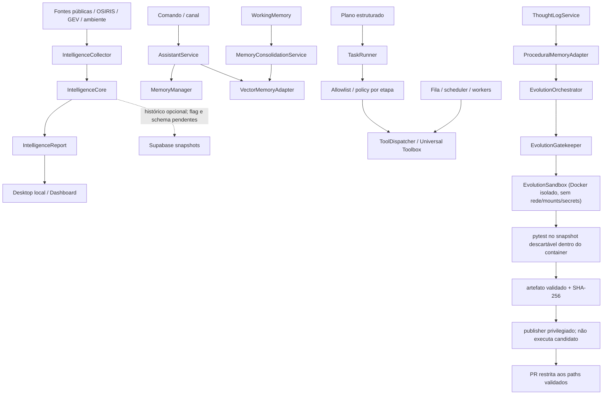

# Cognitive Baseline — Fase C0

**Snapshot:** `main` em `a31f5554776531c245166cb864abbf8a0eb03075` (baseline pós-PR #758)
**Auditoria:** 2026-11-06
**Estado:** parcial; C0 permanece aberto.
**Escopo:** inspeção estática de código, consumidores, contratos, testes, migrations, workflows e documentação, complementada por probes remotos somente leitura. Não é confirmação de deploy completo, execução ponta a ponta ou comportamento de todos os providers.

## 1. Decisão de fase

O próximo marco realmente pendente é **C0 — Auditoria de capacidades e baseline comportamental**. O roadmap exige que cada capacidade crítica tenha caminho de código, consumidor e teste identificados, com lacunas e incertezas registradas. A árvore atual contém componentes reutilizáveis, mas não demonstra ainda um ciclo cognitivo integrado.

Este documento é o primeiro mapa rastreável de C0; não o conclui. Não criar um novo World Model, segundo sistema de memória, event bus ou scheduler antes de fechar a auditoria e os testes de baseline.

## 2. Níveis de evidência

- **Confirmado no repositório:** código, consumidor direto e teste relevante foram localizados. Isso não prova execução em produção.
- **Parcial:** há código e algum consumidor, mas faltam testes de integração, persistência, autorização ou validação operacional.
- **Implementado, não verificado:** há símbolo/registro/documentação, mas o consumidor comportamental ou teste específico não foi confirmado.
- **Bloqueado:** a capacidade depende de flag, migration, policy ou ambiente que não está validado.
- **Ausente no escopo auditado:** o contrato ou comportamento exigido não foi localizado nos caminhos examinados; não significa prova de inexistência em todo o repositório.

## 3. Inventário por capacidade cognitiva

| Capacidade | Implementação / contrato existente | Consumidor localizado | Testes localizados | Classificação e lacuna |
|---|---|---|---|---|
| Roteamento cognitivo | `app/domain/gears/cognitive_router.py`; registro no Nexus | O componente está no registro; não foi confirmado um ciclo cognitivo contínuo que o consuma | `tests/test_nexus_registry_sync.py` valida sincronização do registro | **Implementado, não verificado.** O código classifica entrada por palavras-chave ou uma chamada LiteLLM; isso é roteamento de conversa, não Reasoning Engine. Não foi localizado teste comportamental específico do roteador. |
| Memória semântica | `app/application/services/memory_manager.py`; armazenamento em `data/jarvis_memory.json` | `AssistantService.process_command()` consulta e grava; `FieldVision` consulta soluções/contexto | `tests/application/test_memory_manager.py` | **Confirmado no repositório.** Busca por palavras-chave e limite de interações; proveniência, conflito, retenção governada e readback após reinício precisam de baseline próprio. |
| Memória vetorial | Porta `MemoryProvider`; `app/adapters/infrastructure/vector_memory_adapter.py` | `AssistantService.process_command()` consulta últimos 30 dias e grava comando/resposta | `tests/adapters/infrastructure/test_vector_memory_adapter.py` | **Confirmado no repositório.** O adaptador local não demonstra por si só memória persistente multi-runtime nem consolidação sem perda. |
| Memória procedural | `app/adapters/infrastructure/procedural_memory_adapter.py`; indexa ThoughtLogs bem-sucedidos | `EvolutionOrchestrator` consulta soluções conhecidas | `tests/adapters/infrastructure/test_procedural_memory_adapter.py` | **Parcial.** Há consumidor e teste; falta comprovar atualização, recuperação e validade contextual em um ciclo de evolução real. |
| Working memory / consolidação | `WorkingMemory` e `MemoryConsolidationService` | `OverwatchDaemon` tenta consolidar periodicamente para `VectorMemoryAdapter` | Teste dedicado de ponta a ponta não confirmado nesta passagem | **Parcial.** O fluxo existe no código, mas o contrato de expiração, idempotência, falha de destino e recuperação precisa de teste comportamental. |
| Perception / Universal Intelligence | `app/domain/intelligence/contracts.py`: `IntelligenceEvidence`, `IntelligenceEvent`, `IntelligenceObservation`, `IntelligenceBatch`, `IntelligenceReport`; `IntelligenceCollector` e `IntelligenceCore` | Desktop local, dashboard de inteligência e worker recorrente chamam `collect_live_intelligence()` | `tests/application/test_intelligence_core.py`, `test_intelligence_observations.py`, `test_intelligence_collector.py`; testes do dashboard e Desktop | **Confirmado no repositório; runtime parcial.** Há normalização, deduplicação determinística e candidatos de correlação. O histórico está atrás de feature flag e o worker recorrente depende da reconciliação de migrations. |
| World Model | Observações geográficas e temporais existem nos contratos de inteligência | Mapas/dashboard consomem relatórios e observações; não são fonte canônica de estado | Testes de observação cobrem contratos e síntese | **Ausente no escopo auditado como modelo canônico.** Não foi localizado contrato completo para identidade de entidade, relação, afirmação de estado, evento de mudança e projeção temporal reconstruível. `IntelligenceCore` não equivale a World Model. |
| Reasoning / reflexão | `ThoughtLogService`, `MetaReflection`, `TechnicalAnalysisService` | ThoughtLog é usado por evolução, routers e coleta de datasets; MetaReflection alimenta contexto do EvolutionOrchestrator | `tests/application/test_thought_log_service.py`, `tests/test_meta_reflection.py` | **Parcial.** Logs e análise retrospectiva existem. `TechnicalAnalysisService.execute()` retorna `not_implemented`. Não foi demonstrado pipeline Claim/Hypothesis/EvidenceLink/CounterEvidence, calibração ou abstenção. |
| Strategic Planner | `StrategistService` gera matriz de viabilidade/RFC; `DeclarativePlanInterpreter` valida planos estruturados | Router de evolução resolve Strategist; `TaskRunner` executa planos declarativos | `tests/application/test_strategist_service.py`, `tests/test_execution_plan.py`, `tests/multiagent/test_model_plan_adapter.py`, `tests/multiagent/test_task_runner_execution_plan_integration.py` | **Parcial.** `StrategistService.execute()` ainda retorna `not_implemented`; plano declarativo não prova objetivos persistentes, decomposição durável ou replanejamento. |
| Autonomous Executive | `TaskRunner`, scheduler, fila Supabase, workers e Universal Toolbox | Router de missões, orquestrador e workers HTTP/Supabase/supervisionados | `tests/application/test_task_runner.py`, `tests/application/test_task_runner_navigation_plan.py`, testes multiagente e de claims | **Parcial / bloqueado por integração.** Há autorização por etapa e guardas de fila, mas o Toolbox permanece fail-closed sem policy host-backed de produção; E2E entre dois runtimes independentes e verificação de efeito real permanecem pendentes. |
| Initiative | `assistant_proactivity.py`, `assistant_curiosity.py`, `curiosity_engine.py`, health-check do AssistantService e Overwatch | Sugestões contextuais, perguntas durante conversa, health check e alertas de recursos | Testes comportamentais específicos de iniciativa contínua não confirmados nesta passagem | **Parcial.** Há proatividade e monitoramento, mas não foi demonstrado gatilho de mudança do World Model com deduplicação, orçamento, quiet hours e auditoria de decisão. |
| Learning / Evolution | `EvolutionOrchestrator`, `EvolutionGatekeeper`, Docker-backed `EvolutionSandbox`, artifact exporter, trusted publisher, `MetaReflection` | Workflow de evolução separado em candidate-validation e trusted-publication; JarvisDevAgent delega geração e validação ao EvolutionOrchestrator após PR #758 | `tests/application/test_evolution_orchestrator.py`, `tests/test_evolution_sandbox.py`, `tests/test_evolution_gatekeeper.py`, testes de artifact/publisher e workflow permissions | **Parcial, com isolamento corrigido.** PR #756 executa o candidato em Docker sem rede/mounts/segredos; PR #757 separa credencial do provedor e credencial GitHub, valida artefato/digest/commit/path/staging e bloqueia antes do LLM sem `target_file`. Ainda falta mapear alvos confiáveis para capabilities pendentes; timeout é cooperativo e não mata uma chamada síncrona já em andamento. |

## 4. Mapa de fluxo observado

As linhas tracejadas representam dependências ou caminhos que não podem ser tratados como comportamento operacional concluído. A apresentação geoespacial é uma projeção; não deve ser promovida a fonte canônica do World Model.

## 5. Contratos que devem ser reutilizados

| Domínio | Contrato existente | Decisão para a próxima fase |
|---|---|---|
| Inteligência | `IntelligenceEvidence`, `IntelligenceEvent`, `IntelligenceObservation`, `IntelligenceBatch`, `IntelligenceReport` | Estender sem alterar a semântica de eventos/observações; separar identidade observada de identidade estável. |
| Memória | `MemoryProvider`, VectorMemory, ProceduralMemory, WorkingMemory | Manter adaptadores existentes; primeiro medir persistência, recuperação, retenção, conflito e isolamento. |
| Plano | `DeclarativePlanInterpreter`, `PlanOutcome`, TaskRunner e journal | Reutilizar o plano declarativo; não criar segundo scheduler nem converter texto livre diretamente em execução. |
| Execução | scheduler, leases/fencing, ToolAuthorizationPolicy e Toolbox | Reutilizar; política ausente deve continuar fail-closed. |
| Evolução | EvolutionOrchestrator, Gatekeeper e Sandbox | Reutilizar apenas após isolamento real; self-healing/PR repair permanece trilha transversal, não fase cognitiva. |

Não foi justificada nesta auditoria a criação de um novo banco de grafos, event bus, scheduler ou backend de memória.

## 6. Lacunas de C0 ainda abertas

1. **Baseline comportamental integrado:** os testes existentes exercitam componentes separadamente; falta um teste reproduzível que estabeleça o comportamento conjunto de uma fonte → coletor → normalização/deduplicação → consumidor.
2. **Mapa completo de consumidores e configuração:** completar flags, migrations, ACLs, entry points, processos e estado de deploy de cada componente crítico.
3. **Memória:** provar store/readback, deduplicação, expiração, falha de backend e comportamento após reinício; distinguir memória local de compartilhada.
4. **Reasoning:** separar ThoughtLog/MetaReflection de inferência rastreável; registrar que o pipeline de contraditório/calibração não está demonstrado.
5. **Planning:** provar persistência de objetivo, dependências e replanejamento; a matriz de viabilidade e o plano declarativo são capacidades diferentes.
6. **Executive:** validar autorização no momento do dispatch, idempotência, leases, recuperação e efeito pós-ação com dois processos/runtimes independentes.
7. **Initiative:** demonstrar gatilho independente de prompt, deduplicação, orçamento e política de notificação.
8. **Learning:** o isolamento Docker e a publicação privilegiada já estão implementados (PR #756/#757). O bloqueio atual é a ausência de `target_file` confiável para as capabilities pendentes e a limitação do contrato atual a um único arquivo-alvo; não ativar evolução automática para features que exijam mudanças coordenadas de código e testes até existir suporte multi-arquivo com testes correspondentes.
9. **Proveniência e privacidade:** mapear retenção, exclusão, isolamento por usuário/tenant e minimização para eventos, observações, memórias e logs.

## 7. Próxima implementação recomendada

**Concluir C0 com um conjunto pequeno de testes de baseline de integração, sem criar módulos novos.**

Primeiro teste recomendado: exercitar `collect_live_intelligence()` com duas fontes controladas, uma fonte falhando parcialmente e eventos duplicados/fora de ordem; verificar que o relatório preserva proveniência, não perde a fonte saudável, deduplica deterministicamente e não promove correlação candidata a fato. O código de `IntelligenceCore` e os testes de coletor já existem; o incremento deve fixar o contrato entre eles.

Em paralelo, preparar baseline de memória e autorização do plano com fakes, sem acesso a banco ou serviços externos. Só depois de C0 satisfazer seus critérios, iniciar C1 com contratos/projeções do World Model.

## 8. Trilhas transversais e mudanças recentes

Estas entregas são manutenção ou infraestrutura; não concluem fases cognitivas:

- **PR #739:** adicionou TLS opt-in com verificação obrigatória de certificado ao `MqttHomeAdapter`; issue #705 está fechada. Nenhum broker foi validado nesta auditoria.
- **PR #740:** separou secrets de provedores dos passos pytest do workflow Homeostase; testes antes/depois da cura não recebem essas variáveis.
- **PR #741:** centralizou a política de caminhos protegidos para Gatekeeper/Crystallizer; não fornece isolamento de execução.
- **PR #742:** adicionou a dependência de tarefa-pai também ao claim direto; validação SQL isolada está no workflow dedicado.
- **PR #743:** introduziu o Cognitive Roadmap; C0 permanece pendente.
- **PR #744:** melhorou a apresentação geoespacial; mapa continua sendo superfície de visualização, não World Model.
- **PR #756:** isolou a execução de candidatos em Docker descartável; testes adversariais verificam ausência de rede, mounts e segredos.
- **PR #757:** separou geração/validação de publicação privilegiada, adicionou artefato com digest e publisher path-scoped; a autoevolução falha fechada sem target confiável.
- **PR #758 (merged em 2026-11-06, America/Sao_Paulo):** elimina o pipeline paralelo do JarvisDevAgent, delega ao EvolutionOrchestrator e adiciona cancelamento cooperativo. Merge commit: `a31f5554776531c245166cb864abbf8a0eb03075`.

O workflow `.github/workflows/homeostase.yml` permanece versionado com gatilhos de recuperação e dispatch. Esta auditoria não o executou nem alterou seus gates. A correção automática de PR/CI e os workflows Self Healing permanecem uma trilha transversal obrigatória.

## 9. Estado de verificação desta auditoria

- Base inspecionada: `a31f5554776531c245166cb864abbf8a0eb03075`, merge commit da PR #758.
- PR #758 está merged. Workflow `Jarvis Task Queue Tests` terminou com **success**, incluindo `Run full test suite`. Build e Auto-Documentation também terminaram com **success**.
- O check `Supabase Preview` terminou com **failure**: `Remote migration versions not found in local migrations directory.` Não é falha do pytest.
- A auditoria remota foi somente leitura. Nenhum DDL, DML, migration repair, push, deploy, grant ou feature flag foi alterado.
- O repositório não possui rulesets ativos. A leitura do endpoint de branch protection retorna HTTP 403 pela integração disponível; nenhuma regra foi alterada.
- A auditoria C0 permanece parcial porque ainda faltam provas integradas listadas na seção 6.

### 9.1 Snapshot operacional Supabase

**Projeto:** `saibtpdehhprttqlgqdt`; estado do projeto `ACTIVE_HEALTHY`; PostgreSQL `17.6.1.063`.

| Evidência remota | Resultado observado |
|---|---:|
| Status da branch Supabase `main` | `MIGRATIONS_FAILED` |
| Arquivos locais em `supabase/migrations` | 25 |
| Entradas no ledger remoto | 20 |
| Versões com timestamp idêntico local/remoto | 5 |
| Tabelas `intelligence_event_snapshots` | 0 linhas |
| Tabelas `intelligence_observation_snapshots` | 0 linhas |
| Tabela legada `jarvis_environment_observations` | 1.755 linhas |
| Tabelas/RPCs do worker recorrente | Ausentes |
| `jarvis_agents` com status `available` | 3 |
| `jarvis_agents` com status `offline` | 2 |
| Tarefas | 8 completed, 3 cancelled, 2 ready |
| Mensagens em `jarvis_agent_messages` | 0 |
| Definições em `jarvis_routine_definitions` | 0 |

Os três registros disponíveis são `mini-freellmapi-1/2/3`, com heartbeat recente e zero tarefas ativas. Isso comprova presença registrada no control plane; não comprova dois Harness independentes concluindo um ciclo E2E.

O ledger remoto contém versões que não existem como nomes de arquivo locais. Há também duas entradas remotas chamadas `google_linked_identities`. A auditoria anterior encontrou SQL semanticamente equivalente nessas duas entradas, mas não há prova suficiente para reparar o ledger por renomeação. Seis migrations locais não possuem contraparte exata no ledger, incluindo `20261103184308_intelligence_recurring_worker.sql`. Não executar `migration repair`, `db push` ou aplicar essa migration antes de reconciliar cada SQL com o schema remoto.

A migration do worker recorrente cria lease, runs e cinco RPCs protegidas. Como esses objetos não existem no projeto, o worker deve permanecer desativado. As tabelas de histórico existem, mas estão vazias; a persistência de snapshots não está operacionalmente comprovada.

### 9.2 Segurança e performance do banco

- As 26 tabelas apontadas pelo advisor têm RLS habilitado e nenhuma policy. A consulta de privilégios não encontrou grants de tabela para `anon` ou `authenticated`; os acessos observados ficam restritos a `service_role` e ao owner. O advisor classifica isso como INFO. Não tratar ausência de policy, isoladamente, como exposição pública.
- Advisor de performance reporta cinco foreign keys sem índice de cobertura e 33 índices ainda não utilizados. Não remover índices sem evidência de carga; avaliar os cinco índices ausentes depois da reconciliação de migrations.
- Advisor de health não reportou findings.

### 9.3 Limites de execução local

- A máquina Windows conectada não possui `docker` nem `supabase` CLI disponíveis no PATH. Portanto, não foi possível executar stack Supabase local nem reproduzir E2E com banco local nesta rodada.
- Os testes de concorrência existentes usam fila compartilhada em memória. Os testes SQL de provider/claim verificam contratos de RPC, mas não substituem teste entre dois processos Harness independentes contra banco isolado.

**Conclusão:** C0 continua aberto. Universal Intelligence já possui coleta, normalização e candidatos de correlação, mas histórico persistente ainda não está provado. C1 — World Model permanece bloqueado até fechar baseline de memória, identidade, proveniência e integração operacional.
