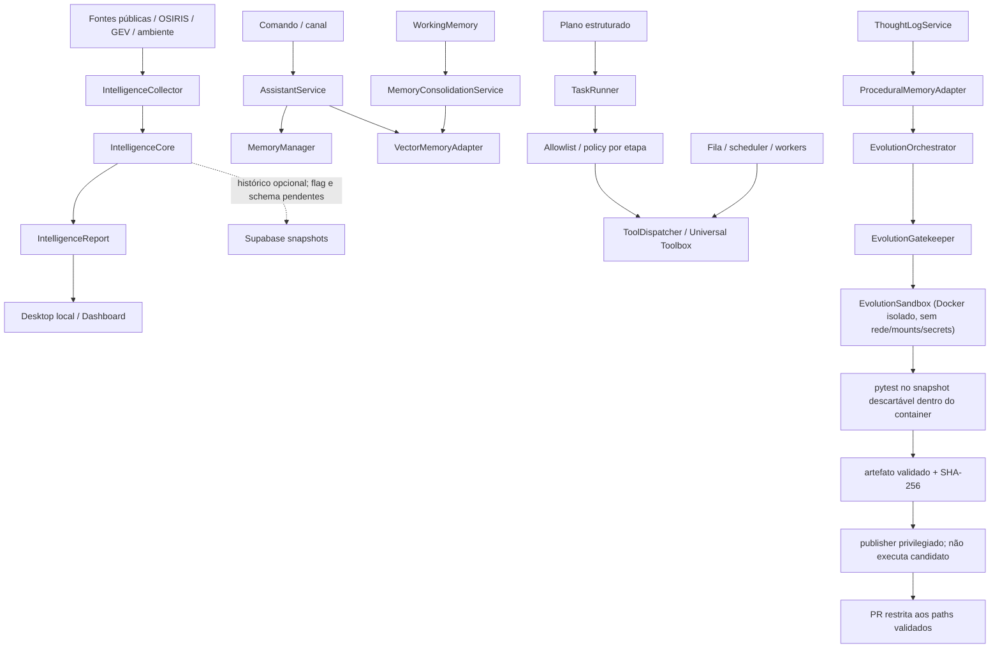

# Cognitive Baseline — Fase C0

**Snapshot original:** `main` em `82ca2ac70f67e8418f62079f7d94e3fc8b4d1230` (pós-PR #774; histórico)
**Última revalidação:** `main` em `152a7f87d213c158be7658371581b466fec78be0` (2026-11-13); código funcional no parent `7b6bcfa269390a17b844edc8d7e37cdf1e746f77`.
**Auditoria original:** 2026-11-07
**Estado atual:** parcial; C0 permanece aberto.
**Escopo:** inspeção estática de código, consumidores, contratos, testes, migrations, workflows e documentação, complementada por probes remotos somente leitura. Não é confirmação de deploy completo, execução ponta a ponta ou comportamento de todos os providers.

## 1. Decisão de fase

O próximo marco realmente pendente é **C0 — Auditoria de capacidades e baseline comportamental**. O roadmap exige que cada capacidade crítica tenha caminho de código, consumidor e teste identificados, com lacunas e incertezas registradas. A árvore atual contém componentes reutilizáveis, mas não demonstra ainda um ciclo cognitivo integrado.

Este documento é o primeiro mapa rastreável de C0; não o conclui. Não criar um novo World Model, segundo sistema de memória, event bus ou scheduler antes de fechar a auditoria e os testes de baseline.

## 2. Níveis de evidência

- **Confirmado no repositório:** código, consumidor direto e teste relevante foram localizados. Isso não prova execução em produção.
- **Parcial:** há código e algum consumidor, mas faltam testes de integração, persistência, autorização ou validação operacional.
- **Implementado, não verificado:** há símbolo/registro/documentação, mas o consumidor comportamental ou teste específico não foi confirmado.
- **Bloqueado:** a capacidade depende de flag, migration, policy ou ambiente que não está validado.
- **Ausente no escopo auditado:** o contrato ou comportamento exigido não foi localizado nos caminhos examinados; não significa prova de inexistência em todo o repositório.

## 3. Inventário por capacidade cognitiva

| Capacidade | Implementação / contrato existente | Consumidor localizado | Testes localizados | Classificação e lacuna |
|---|---|---|---|---|
| Roteamento cognitivo | `app/domain/gears/cognitive_router.py`; pipeline `config/pipelines/jarvis_chat.yml`; runner `app/runtime/pipeline_runner.py`. | `run_pipeline()` aparece no CLI e em testes; nenhum consumidor de aplicação estrito foi localizado. `data/nexus_registry.json` não registra `cognitive_router`. | `tests/domain/test_cognitive_router.py` cobre inicialização de metadata; `tests/test_pipeline_runner.py` cobre o runner e a resolução do pipeline. | **Implementado, consumo de aplicação não verificado.** Graphify encontrou somente o teste `test_execute_initializes_missing_metadata()` como caller estrito de `CognitiveRouter.execute()`. O runner não injeta `metadata` por padrão; o pipeline `jarvis_chat` não tem caminho de aplicação comprovado. Não equivale a Reasoning Engine. |
| Memória semântica | `app/application/services/memory_manager.py`; armazenamento via `DocumentStore` em `data/jarvis_memory.json` | `AssistantService.process_command()` consulta e grava; `FieldVision` consulta soluções/contexto | PRs #759/#762; testes de redaction, isolamento e readback após recriar o manager | **Persistência local confirmada por arquivo e escopo/redaction nos caminhos cobertos.** Proveniência, retenção governada, exclusão verificável e busca semântica continuam incompletas; busca atual é por substring/token. |
| Memória vetorial | Porta `MemoryProvider`; `VectorMemoryAdapter`; `SupabaseVectorMemoryStore` atrás de `VectorMemoryStore` | `AssistantService`/`MemoryConsolidationService` usam o adapter; leitura e escrita remotas são condicionadas a `SUPABASE_URL` + `SUPABASE_SERVICE_ROLE_KEY` | 38 testes direcionados no PR #769; 16 pgTAP isolados; CI completa aprovada | **Backend durável implementado e migration implantada.** Particionamento por usuário, redaction recursiva de metadata, readback após reinício e bloqueio de consolidação sem persistência saudável estão cobertos. A tabela de produção existe, mas contém 0 linhas; insert/readback real do runtime ainda não foi comprovado. Sem service-role, o adapter mantém fallback volátil. |
| Memória procedural | `app/adapters/infrastructure/procedural_memory_adapter.py`; indexa ThoughtLogs bem-sucedidos | `EvolutionOrchestrator` consulta soluções conhecidas | `tests/adapters/infrastructure/test_procedural_memory_adapter.py` | **Parcial/bloqueado.** `bootstrap_from_db()` existe, mas não foi encontrado call site; o índice é RAM e pode iniciar vazio. O consumer apenas consulta soluções. |
| Working memory / consolidação | `WorkingMemory` e `MemoryConsolidationService` | `OverwatchDaemon` tenta consolidar periodicamente para `VectorMemoryAdapter` | PRs #760 e #769; testes de falha de persistência e recuperação integral da entrada original | **Parcial.** `WorkingMemory` continua volátil, mas o destino vetorial agora pode ser durável. A consolidação não remove entradas enquanto o backend não estiver configurado/saudável e restaura a entrada original integral se a gravação falhar. Ainda falta provar escrita/readback real em produção. |
| Perception / Universal Intelligence | `app/domain/intelligence/contracts.py`; `IntelligenceCollector`, `IntelligenceCore`, history adapter e `IntelligenceRecurringWorker` | Desktop local, dashboard e worker opt-in em `main.py` | Testes de core/collector/observations; pgTAP de lease; testes do worker recorrente | **Schema implantado; worker de produção desabilitado por feature flags.** O Render registra explicitamente `Universal Intelligence recurring worker disabled by feature flags`; a lease está livre e há zero runs. Não confundir código e RPCs presentes com coleta recorrente ativa. |
| World Model | Observações geográficas e temporais existem nos contratos de inteligência | Mapas/dashboard consomem relatórios e observações; não são fonte canônica de estado | Testes de observação cobrem contratos e síntese | **Ausente no escopo auditado como modelo canônico.** Não foi localizado contrato completo para identidade de entidade, relação, afirmação de estado, evento de mudança e projeção temporal reconstruível. `IntelligenceCore` não equivale a World Model. |
| Reasoning / reflexão | `ThoughtLogService`, `MetaReflection`, `TechnicalAnalysisService` | ThoughtLog é usado por evolução, routers e coleta de datasets; MetaReflection alimenta contexto do EvolutionOrchestrator | `tests/application/test_thought_log_service.py`, `tests/test_meta_reflection.py` | **Parcial.** Logs e análise retrospectiva existem. `TechnicalAnalysisService.execute()` retorna `not_implemented`. Não foi demonstrado pipeline Claim/Hypothesis/EvidenceLink/CounterEvidence, calibração ou abstenção. |
| Strategic Planner | `StrategistService` avalia e arquiva propostas; `DeclarativePlanInterpreter` valida planos estruturados. | Router de evolução expõe consulta/aprovação/rejeição; Graphify não encontrou caller estrito de produção para `StrategistService.execute()`. `TaskRunner` consome planos declarativos em caminho separado. | `tests/application/test_strategist_service.py`, `tests/test_execution_plan.py`, `tests/multiagent/test_model_plan_adapter.py`, `tests/multiagent/test_task_runner_execution_plan_integration.py`. | **Parcial.** `execute()` não é stub: implementa `evaluate_proposal` e arquivamento. Falta consumer de produção para criação de propostas, objetivos persistentes, decomposição durável e replanejamento. Não confundir o router de propostas com um Strategic Planner operacional. |
| Autonomous Executive | `TaskRunner`, scheduler, fila Supabase, workers e Universal Toolbox; gateway de sessão do host integrado pelo PR #823 às superfícies MCP específicas. | Router de missões, orquestrador e workers HTTP/Supabase/supervisionados; host filesystem/commands/shell navigation usam `SessionAuthorizationGateway`. | `tests/application/test_task_runner.py`, `tests/application/test_task_runner_navigation_plan.py`, testes multiagente/claims e `tests/adapters/edge/test_desktop_session_authorization.py`. | **Parcial / bloqueado por composição.** O gateway de sessão não substitui `HostToolAuthorizationPolicy` do Toolbox nem prova E2E entre runtimes. O PR #823 cobre host filesystem, comandos estruturados, shell navigation e PowerShell restrito; não é middleware global para todos os inputs desktop/Android/browser. Verificação de efeitos reais permanece pendente. |
| Initiative | `ProactiveInitiativeEngine` é consumido por `AssistantService`; `create_api_server()` inicia/encerra `start_proactive_monitor()` no lifespan. `process_command()` e `on_event()` registram usuários/sinais; a entrega é proposal-only e limitada ao `JARVIS_MOBILE_USER_ID`. | `tests/application/test_assistant_proactive_monitor.py` e `tests/adapters/infrastructure/test_api_server.py::test_api_lifespan_starts_and_stops_proactive_monitor`. | **REUSE_PARTIAL.** Há composition root e teste do ciclo start/stop. Usuários ativos, sinais, propostas pendentes, instâncias e cooldown são process-local; restart perde estado. Não há verificação de execução/entrega em produção nem gatilho baseado no World Model. |
| Learning / Evolution | `EvolutionOrchestrator`, `EvolutionGatekeeper`, Docker-backed `EvolutionSandbox`, artifact exporter, trusted publisher, `MetaReflection` | Workflow de evolução separado em candidate-validation e trusted-publication; JarvisDevAgent delega geração e validação ao EvolutionOrchestrator após PR #758 | `tests/application/test_evolution_orchestrator.py`, `tests/test_evolution_sandbox.py`, `tests/test_evolution_gatekeeper.py`, testes de artifact/publisher e workflow permissions | **Parcial, com isolamento corrigido.** PR #756 executa o candidato em Docker sem rede/mounts/segredos; PR #757 separa credencial do provedor e credencial GitHub, valida artefato/digest/commit/path/staging e bloqueia antes do LLM sem `target_file`. Ainda falta mapear alvos confiáveis para capabilities pendentes; timeout é cooperativo e não mata uma chamada síncrona já em andamento. |

## 4. Mapa de fluxo observado

As linhas tracejadas representam dependências ou caminhos que não podem ser tratados como comportamento operacional concluído. A apresentação geoespacial é uma projeção; não deve ser promovida a fonte canônica do World Model.

## 5. Contratos que devem ser reutilizados

| Domínio | Contrato existente | Decisão para a próxima fase |
|---|---|---|
| Inteligência | `IntelligenceEvidence`, `IntelligenceEvent`, `IntelligenceObservation`, `IntelligenceBatch`, `IntelligenceReport` | Estender sem alterar a semântica de eventos/observações; separar identidade observada de identidade estável. |
| Memória | `MemoryProvider`, VectorMemory, ProceduralMemory, WorkingMemory | Manter adaptadores existentes; primeiro medir persistência, recuperação, retenção, conflito e isolamento. |
| Plano | `DeclarativePlanInterpreter`, `PlanOutcome`, TaskRunner e journal | Reutilizar o plano declarativo; não criar segundo scheduler nem converter texto livre diretamente em execução. |
| Execução | scheduler, leases/fencing, ToolAuthorizationPolicy e Toolbox | Reutilizar; política ausente deve continuar fail-closed. |
| Evolução | EvolutionOrchestrator, Gatekeeper e Sandbox | Reutilizar apenas após isolamento real; self-healing/PR repair permanece trilha transversal, não fase cognitiva. |

Não foi justificada nesta auditoria a criação de um novo banco de grafos, event bus, scheduler ou backend de memória.

## 6. Lacunas de C0 ainda abertas

1. **Baseline comportamental integrado:** PR #759 cobre fontes → coletor → `IntelligenceCore` → endpoint autenticado, com deduplicação, correlação candidata, sucesso parcial e isolamento de erros. O contrato está testado com fontes controladas; disponibilidade de todos os providers em produção ainda exige validação.
2. **Memória:** PR #759 comprova readback do `MemoryManager`; PR #762 adiciona redaction fail-closed e escopo por usuário; PR #769 adiciona persistência vetorial Supabase, readback entre processos e rollback lossless da consolidação. A tabela de produção está implantada, mas permanece vazia; falta comprovar um insert/readback real do runtime, idempotência, retention/erasure verificáveis e bootstrap procedural.
3. **Executive / task queue:** PR #761 valida fencing de mensagens em dois processos independentes; PR #766 valida claim → renew → execute → complete em dois processos independentes contra Supabase isolado. PR #773 foi merged em 2026-11-07 e adiciona credenciais opacas por agente, autenticação dupla no caminho HTTP, capabilities concedidas no servidor e tokens distintos por slot. Os workflows associados ao head da PR passaram: suíte completa Linux/Python 3.11.18 com 2.717 passed e 14 skipped; Windows/Python 3.12.10 com 2.716 passed e 15 skipped; testes direcionados da fila 8/8. Isso comprova código e CI, não ativação do novo caminho. A migration de credenciais foi aplicada e consta no ledger remoto; a tabela tem 0 credenciais provisionadas. Logs Render após o deploy confirmam que os três workers ainda usam o fallback legado Supabase service-role, sem identidade individual. A fila permanece global e não persiste owner_id/created_by; o evento task_blocked usa a identidade do chamador autenticado, não um proprietário persistido da tarefa. ToolRegistry segue metadata-only e ToolDispatcher fail-closed sem ToolAuthorizationPolicy host-backed.

4. **Leases e recuperação:** PR #763 e #767 instalaram a RPC NULL-safe, fencing e os cinco índices. Os contratos pgTAP passaram. Ainda falta executar uma tarefa real de ponta a ponta no runtime após registrar ferramentas compatíveis e verificar recuperação após expiração de lease.
5. **Recurring intelligence worker:** tabelas e RPCs foram implantadas e têm RLS/ACL restrita. O Jarvis-api Render está live, mas seus logs mostram que o worker é desabilitado por feature flags; a lease está sem proprietário e existem zero registros de execução. A ativação continua pendente de autorização operacional e validação de uma execução controlada.
6. **Aprovação:** PR #764 exige ator autenticado e persiste `approved_by`/`approved_at`. Falta integrar o provedor real de identidade e política de autorização de produção; o teste atual usa identidade injetada.
7. **Reasoning:** separar ThoughtLog/MetaReflection de inferência rastreável; contraditório, calibração e abstenção ainda não estão demonstrados.
8. **Planning:** provar persistência de objetivo, dependências e replanejamento; matriz de viabilidade e plano declarativo continuam sendo contratos distintos.
9. **Initiative:** demonstrar gatilho independente de prompt, deduplicação, orçamento e política de notificação.
10. **Learning:** isolamento Docker e publicação privilegiada estão implementados (PR #756/#757), com path policy, snapshot descartável, execução sem rede/secrets e publisher separado. Na `main` (`82ca2ac`), o workflow agendado ainda usa o selector legado e bloqueia antes de LLM/Docker porque os 102 registros de `data/capabilities.json` não têm `target_file`. **PR #775 está aberta, não merged:** substitui a seleção agendada por `RoadmapMissionSelector`, que lê `data/roadmap_missions.json`, valida heading/phase/criterion, CAP de compatibilidade, target Python existente sob `app/`, arquivos exatos do control plane protegidos na política compartilhada, testes, dependências e risco. O manifesto contém zero missões aprovadas; portanto não habilita geração. O publisher também rejeita uma segunda PR aberta com o mesmo título de critério. O próximo gate é revisar o primeiro mapeamento real e fechar a proteção de colisão/retentativa antes de inserir uma missão `ready`.
11. **Proveniência e privacidade:** PR #762 reduz exposição nos stores cobertos, mas não é DLP/tenant isolation completa para todos os providers, workers, logs e dados vetoriais. Retenção, exclusão verificável e proveniência continuam pendentes.

## 7. Próxima implementação recomendada

**Manter C0 aberto.** A identidade individual de workers está merged, a migration está aplicada e o deploy contém o código, mas o runtime ainda usa service-role. Na `main` a evolução agendada continua no selector legado; a PR #775 propõe a integração ao Cognitive Roadmap, ainda sem merge e com manifesto vazio para preservar o no-op.

Evidências integradas:
- **PR #759 — merged:** baseline da coleta de inteligência e readback do MemoryManager.
- **PR #760 — merged:** health check do vector store mantém fallback puro-Python sem FAISS.
- **PR #761 — merged:** fencing por claim_token; E2E de leader/worker em processos independentes.
- **PR #762 — merged:** redaction fail-closed e escopo por usuário na memória/histórico cobertos.
- **PR #763 — merged:** RPC de renovação de lease com validação explícita de duração nula.
- **PR #764 — merged:** gate de aprovação humana autenticada para propostas do Strategist.
- **PR #765 — merged:** atualização documental do C0 após PRs #759–#764.
- **PR #766 — merged:** E2E real da fila de tarefas em dois processos independentes; pgTAP, renovação, completion e eventos persistidos.
- **PR #767 — merged:** reconciliação do ledger histórico e migrations forward-only.
- **PR #769 — merged:** memória vetorial Supabase, isolamento por usuário, redaction recursiva de metadata, readback entre processos e consolidação com recuperação lossless. O schema está implantado, mas a tabela segue sem registros.
- **PR #770 — merged:** Initiative Engine proposal-only e user-scoped; estado/cooldown ainda process-local e a origem de tarefas não tem owner persistido.
- **PR #772 — merged:** revalidação documental de migrations, memória e runtime.
- **PR #773 — merged:** credenciais individuais de worker, hash-only, rotação/revogação, autenticação dupla HTTP e grants server-side. CI completa aprovada nos dois workflows; a migration foi aplicada pela integração GitHub–Supabase, mas não há credenciais provisionadas e o runtime permanece no fallback service-role.
- **PR #775 — aberta, não merged:** selector de missões orientado pelo Cognitive Roadmap, manifesto fail-closed inicialmente vazio, provenance por criterion ID e prevenção de PR aberta duplicada.

Próxima sequência prioritária:
1. **PR #775 — aberta, aguardando CI/revisão:** integra o selector ao manifesto do Cognitive Roadmap e mantém zero missões aprovadas. Após merge, revisar um primeiro mapeamento de critério C0 com target Python existente, testes específicos, dependências, risco baixo e critério de sucesso. Antes de marcar `ready`, completar a verificação de colisão/retentativa de branch e confirmar o comportamento no workflow agendado. Não inferir caminho a partir da saída do LLM.
2. **Ownership da tarefa:** introduzir owner/creator persistido a partir do usuário autenticado no enqueue, propagar esse vínculo até eventos de conclusão/bloqueio e impedir que identidade do worker seja confundida com a do dono. Exigir migration forward-only, compatibilidade com tarefas legadas e testes de isolamento/atribuição antes de habilitar notificações multiusuário.
3. **Autorização executável:** integrar um registro de executores reais ao heartbeat e ao ToolDispatcher; implementar/registrar ToolAuthorizationPolicy host-backed com principal, sessão, escopo e aprovação. Capability só pode ser concedida quando existir executor invocável e policy válida.
4. **Migração operacional dos workers:** a migration 20261107183000_agent_worker_credentials.sql já foi aplicada pela integração GitHub–Supabase. O próximo gate é provisionar tokens individuais por fluxo administrativo aprovado e secret store; depois comprovar heartbeat/claim/finish/release via HTTP. Não alterar secrets nem desativar o fallback legado nesta auditoria.
5. **Memória e recorrência:** comprovar insert/readback vetorial real com service role; manter o recurring intelligence worker desabilitado até autorização operacional e uma execução supervisionada com lease/run/persistência/liberação verificadas.
6. Reexecutar o baseline comportamental integrado, fechar as lacunas de C0 e somente então iniciar C1 — World Model.

Não aplicar migrations, provisionar credenciais, alterar feature flags ou executar tarefas reais como parte desta auditoria.

## 8. Trilhas transversais e mudanças recentes

Estas entregas são manutenção ou infraestrutura; não concluem fases cognitivas:

- **PR #739:** adicionou TLS opt-in com verificação obrigatória de certificado ao `MqttHomeAdapter`; issue #705 está fechada. Nenhum broker foi validado nesta auditoria.
- **PR #740:** separou secrets de provedores dos passos pytest do workflow Homeostase; testes antes/depois da cura não recebem essas variáveis.
- **PR #741:** centralizou a política de caminhos protegidos para Gatekeeper/Crystallizer; não fornece isolamento de execução.
- **PR #742:** adicionou a dependência de tarefa-pai também ao claim direto; validação SQL isolada está no workflow dedicado.
- **PR #743:** introduziu o Cognitive Roadmap; C0 permanece pendente.
- **PR #744:** melhorou a apresentação geoespacial; mapa continua sendo superfície de visualização, não World Model.
- **PR #756:** isolou a execução de candidatos em Docker descartável; testes adversariais verificam ausência de rede, mounts e segredos.
- **PR #757:** separou geração/validação de publicação privilegiada, adicionou artefato com digest e publisher path-scoped; a autoevolução falha fechada sem target confiável.
- **PR #758 (merged em 2026-11-06, America/Sao_Paulo):** elimina o pipeline paralelo do JarvisDevAgent, delega ao EvolutionOrchestrator e adiciona cancelamento cooperativo. Merge commit: `a31f5554776531c245166cb864abbf8a0eb03075`.
- **PR #759 (merged):** baseline integrado da coleta de inteligência e readback de memória semântica.
- **PR #760 (merged):** health check correto para o fallback puro-Python do vector store.
- **PR #761 (merged):** fencing por tentativa na fila de mensagens e E2E de dois processos em Supabase isolado.
- **PR #762 (merged):** redaction fail-closed e isolamento por usuário nos caminhos de memória cobertos.
- **PR #763 (merged):** guard forward-only para duração nula na renovação de lease de tarefa.
- **PR #764 (merged):** gate de aprovação humana autenticada para propostas do Strategist.

O workflow `.github/workflows/homeostase.yml` permanece versionado com gatilhos de recuperação e dispatch. Esta auditoria não o executou nem alterou seus gates. A correção automática de PR/CI e os workflows Self Healing permanecem uma trilha transversal obrigatória.

## 9. Estado de verificação desta auditoria

- Base inspecionada: `a2f3d64c099ceecc72cbd45cc471c432ad06ff7b`, merge commit da PR #762, contendo as PRs #759–#764.
- PR #758 está merged. Workflow `Jarvis Task Queue Tests` terminou com **success**, incluindo `Run full test suite`. Build e Auto-Documentation também terminaram com **success**.
- O check `Supabase Preview` terminou com **failure**: `Remote migration versions not found in local migrations directory.` Não é falha do pytest.
- A auditoria remota foi somente leitura. Nenhum DDL, DML, migration repair, push, deploy, grant ou feature flag foi alterado.
- O repositório não possui rulesets ativos. A leitura do endpoint de branch protection retorna HTTP 403 pela integração disponível; nenhuma regra foi alterada.
- A auditoria C0 permanece parcial porque ainda faltam provas integradas listadas na seção 6.

### 9.1 Snapshot operacional Supabase

**Projeto:** `saibtpdehhprttqlgqdt`; estado `ACTIVE_HEALTHY`; PostgreSQL `17.6.1.063`. **Branch Supabase `main`:** `FUNCTIONS_DEPLOYED`; preview `ACTIVE_HEALTHY`.

| Evidência remota | Resultado observado em 2026-11-07 |
|---|---:|
| Arquivos locais em `supabase/migrations` | 26 |
| Entradas no ledger remoto | 26 |
| Versões locais/remotas correspondentes | 26/26 |
| Migrations locais pendentes | 0 |
| Última versão | `20261107025932` |
| `jarvis_agents` | 5 linhas |
| `jarvis_agent_tasks` | 13 linhas |
| `jarvis_agent_attempts` | 12 linhas |
| `jarvis_agent_events` | 24 linhas |
| `jarvis_agent_messages` | 0 linhas |
| `jarvis_environment_observations` | 1.755 linhas |
| `intelligence_event_snapshots` | 0 linhas |
| `intelligence_observation_snapshots` | 0 linhas |
| `jarvis_mobile_device_sessions` | 48 linhas |
| `jarvis_mobile_devices` | 1 linha |

As duas entradas históricas `google_linked_identities` foram preservadas separadamente. A integração GitHub–Supabase aplicou as seis migrations pendentes após o merge do PR #767; o ledger remoto agora contém todas as 26 versões. Não foi executado `db push`, `migration repair` ou DDL manual pelo ChatGPT.

**RPCs, fencing e ACLs verificados diretamente:**
- `claim_jarvis_agent_task` e `claim_next_jarvis_agent_task` aplicam provider policy, heartbeat, ferramentas e dependência de tarefa-pai.
- `renew_jarvis_agent_task_lease` e `release_jarvis_agent_task` existem e são executáveis por `service_role`; não por `anon` ou `authenticated`.
- `jarvis_agent_messages.claim_token` existe; claim retorna token e ACK de três argumentos valida o token. O overload antigo de ACK de dois argumentos permanece no catálogo, mas não tem privilégio EXECUTE para nenhum desses três roles.
- Os cinco índices de attempts, events, parent tasks e routines existem.
- As tabelas `jarvis_intelligence_worker_lease` e `jarvis_intelligence_worker_runs` existem com RLS; as RPCs de claim/renew/release/record/metrics estão restritas a `service_role`.
- `jarvis_mobile_push_devices` não existe porque a sequência histórica migrou para `jarvis_mobile_devices`; a migration de índices não referencia a tabela antiga.

**Estado operacional observado:**
- Três agentes `mini-freellmapi-1/2/3` estão online, provider `groq`, com apenas `text_reasoning` em `available_tools`.
- Duas tarefas antigas permanecem `ready` desde 2026-10-27 e exigem `repository_read`, `github_read` e `production_read`. Nenhum agente anuncia essas capacidades; por isso nenhuma tarefa foi atribuída. O claim está bloqueando corretamente uma atribuição incompatível.
- A lease do recurring intelligence worker está sem proprietário (`worker_id=NULL`, sem expiração) e `jarvis_intelligence_worker_runs` contém zero execuções. A infraestrutura de banco está instalada, mas o processo recorrente não está ativo.
- Render `Jarvis-api` está `live`; o último deploy observado é o commit `cf887192`, que já contém o código de runtime das PRs #759–#764. PRs #766/#767 foram testes, migrations e documentação; não introduziram código de aplicação que exigisse novo deploy Render.

### 9.2 Segurança e performance do banco

- As tabelas públicas verificadas têm RLS habilitado. O probe de privilégios não encontrou grants de tabela para `anon` ou `authenticated`; os acessos observados ficam restritos a `service_role` e ao owner. As entradas do advisor sem policy são INFO neste schema, não prova de exposição pública.
- Os cinco índices de foreign keys de attempts/events/parent/routine foram criados e verificados após PR #767. Ainda há 33 índices não utilizados no advisor; não remover sem evidência de carga.
- Advisor de health não reportou findings.

### 9.2 Segurança e performance do banco

- As tabelas públicas verificadas têm RLS habilitado. A consulta de privilégios não encontrou grants de tabela para `anon` ou `authenticated`; os acessos observados ficam restritos a `service_role` e ao owner. As entradas do advisor sem policy são INFO neste schema, não prova de exposição pública.
- Os cinco índices de foreign keys para attempts/events/parent/routine foram criados e verificados após PR #767. Ainda há 33 índices não utilizados no advisor; não remover sem evidência de carga.
- Advisor de health não reportou findings.

### 9.3 Limites de execução local e E2E

- A máquina Windows conectada não possui `docker` nem Supabase CLI global no PATH; a stack local não foi executada nela.
- **PR #761:** workflow efêmero Supabase, pgTAP e leader/worker de mensagens em processos independentes com clientes próprios.
- **PR #766:** workflow efêmero Supabase, pgTAP e `SupabaseTaskQueueMiniAgent` em processo filho com cliente independente. O pai enfileira; o filho faz heartbeat, claim, renew, execução e completion; o pai verifica task, attempt e eventos persistidos.
- **PR #767:** pgTAP isolado para provider-aware claim, message fencing, lease renewal, release de tentativa falha, cinco índices, recurring intelligence worker, RLS e ACLs. PR Validation e Task Queue também passaram.
- Esses testes comprovam contratos em banco isolado. Em produção, os agentes heartbeat estão online, mas as tarefas existentes não são reivindicadas porque as capabilities exigidas não estão registradas nos agentes. Não interpretar E2E isolado como prova de autonomia de produção.

### 9.4 Memória: persistência e privacidade

- `MemoryManager` sanitiza texto de usuário e resposta antes de persistir; email, CPF e telefone são redigidos. O readback após recriar o manager está coberto pela PR #759.
- A PR #762 particiona a memória semântica por identidade autenticada, usando digest SHA-256 no nome do arquivo. Chamadas sem usuário ficam restritas ao compartimento local/sistema; registros legados globais não são copiados para partições de usuário.
- A identidade autenticada é propagada nos caminhos de API, interpretação, histórico SQLite e worker cobertos. Histórico não escopado retorna somente registros locais; consultas vetoriais filtram pelo proprietário e rejeitam `user_id` injetado em metadata não confiável.
- `VectorMemoryAdapter` agora usa `SupabaseVectorMemoryStore` quando o admin client está configurado; sem ele, mantém fallback volátil. A tabela remota está implantada e protegida, mas a contagem atual é zero, então a integração de escrita/readback do runtime ainda não foi demonstrada.
- `ProceduralMemoryAdapter.bootstrap_from_db()` ainda não tem call site confirmado; o índice de soluções permanece volátil.
- A redaction atual cobre padrões de email, CPF e telefone; não é uma política DLP completa. A exclusão/purge de IDs vetoriais e a retenção de ThoughtLogs/logs ainda precisam de prova ponta a ponta.

### 9.5 Reconciliação do ledger após merge do PR #767

O SQL efetivamente registrado foi recuperado de `supabase_migrations.schema_migrations.statements`. Os 20 arquivos históricos foram reconstruídos com seus version IDs originais, preservando as duas entradas distintas `google_linked_identities`. Após o merge, a integração GitHub–Supabase aplicou as seis migrations forward-only. A verificação posterior confirmou 26/26 versões no ledger remoto, 26/26 arquivos locais correspondentes e zero migrations pendentes. A revalidação posterior à PR #769 elevou o estado para 27/27; ver seção 9.6.

**Estado final de schema:**
- Provider-aware claims, heartbeat reconciliation e parent-task guard estão ativos.
- Fencing de mensagens está ativo: coluna `claim_token`, claim que retorna token e ACK de três argumentos. O ACK legado de dois argumentos continua no catálogo, mas está sem EXECUTE para service_role/anon/authenticated.
- Renovação NULL-safe de lease e release de tentativa falha estão presentes.
- Cinco índices de worker lease estão presentes.
- Tabelas e RPCs do recurring intelligence worker estão presentes e protegidas por RLS/ACL de service role.
- Projeto `ACTIVE_HEALTHY`, branch `FUNCTIONS_DEPLOYED`.

**Limite operacional:** o schema do recurring intelligence worker está implantado, mas nenhuma execução foi registrada e a lease permanece livre. Os mini-agentes Groq estão online, mas só anunciam `text_reasoning`; as duas tarefas prontas exigem capabilities adicionais. Não ampliar `available_tools` sem executores reais e não ativar o worker recorrente até integrar seu processo/scheduler e validar uma execução controlada.

Nenhum DDL/DML manual, `db push`, `migration repair`, grant ou deploy manual foi executado. As migrations foram aplicadas pela integração GitHub–Supabase após o merge do PR #767.

**Conclusão:** C0 continua aberto. Universal Intelligence já possui coleta, normalização e candidatos de correlação, mas histórico persistente ainda não está provado. C1 — World Model permanece bloqueado até fechar baseline de memória, identidade, proveniência e integração operacional.

### 9.6 Revalidação 2026-11-07 após PR #769

Esta seção supersede as contagens anteriores de migrations e o diagnóstico de memória vetorial.

**Repositório e deploy**
- main auditada em e7b4efa35c8da7fa0ca4c04c7b2b7880478473c2; PR #769 foi merged no commit 203725a7a3f47df390347482d703a2380c8f2142.
- Render Jarvis-api está live no commit e7b4efa35c8da7fa0ca4c04c7b2b7880478473c2, com deploy concluído às 13:37:49 UTC de 2026-11-07. O deploy inclui a implementação de memória vetorial da PR #769.

**Supabase — ledger e memória vetorial**
- Projeto saibtpdehhprttqlgqdt: ACTIVE_HEALTHY; branch main: FUNCTIONS_DEPLOYED.
- supabase/migrations contém 27 arquivos SQL e list_migrations retorna 27 versões remotas. Comparação por par version + name: 27/27 correspondentes, nenhuma migration local ausente, nenhuma remota ausente e nenhuma versão duplicada.
- public.jarvis_vector_memories existe com RLS habilitado. service_role tem SELECT/INSERT/DELETE e não tem UPDATE; anon e authenticated não têm SELECT. A tabela contém 0 linhas e 0 scopes; portanto o schema e os grants estão comprovados, mas ainda não há prova de persistência real de memória pelo runtime.
- A migration da memória vetorial foi aplicada pela integração GitHub–Supabase após o merge. Nenhum db push, migration repair, DDL ou DML manual foi executado nesta revalidação.

**Multiagente e capabilities**
- Três agentes mini-freellmapi-1/2/3 estão available, provider groq, com available_tools=[text_reasoning], active_tasks=0.
- Duas tarefas permanecem ready e requerem repository_read, github_read, production_read; não há agente que anuncie essas capabilities e nenhuma tarefa foi forçada a claim.
- ToolRegistry continua sendo metadata-only; ToolDispatcher falha fechado sem ToolAuthorizationPolicy host-backed de produção. A CapabilityAuthorizer legada não satisfaz o contrato de principal/sessão autenticados nem de aprovação vinculada à requisição. Não anunciar ferramentas externas até existir executor funcional e policy confiável.

**Universal Intelligence recorrente**
- A migration e as RPCs de lease/run estão presentes. jarvis_intelligence_worker_lease está sem proprietário e jarvis_intelligence_worker_runs contém 0 execuções.
- O Render Jarvis-api tem um único serviço web; os logs de 2026-11-07 registram repetidamente Universal Intelligence recurring worker disabled by feature flags, inclusive após o deploy atual. O código inicia o worker supervisionado em main.py apenas quando JARVIS_INTELLIGENCE_WORKER_ENABLED=true e JARVIS_INTELLIGENCE_HISTORY_ENABLED=true.
- Não foram alteradas flags nem iniciada coleta recorrente. A ativação requer decisão explícita porque passará a coletar e persistir dados continuamente.

**Próximos gates de C0**
1. Integrar um registro de executores reais ao heartbeat; capability só pode ser anunciada quando houver executor invocável e policy de autorização host-backed.
2. Ligar repository_read, github_read e production_read a adaptadores read-only autorizados; então revalidar as duas tarefas prontas sem forçar claim.
3. Comprovar insert/readback real de memória vetorial por service role, mantendo a tabela inacessível a roles de cliente.
4. Obter autorização operacional para habilitar o worker recorrente e executar uma primeira coleta supervisionada; verificar lease, run record, persistência e liberação.
5. Manter C0 aberto até que os baselines comportamentais estejam comprovados. C1 — World Model não começa antes disso.

### 9.7 Identidade individual de workers — snapshot pré-merge (histórico)

> Esta seção registra o estado da branch antes do merge da PR #773. Para o estado atual em main e a evidência de CI, consulte a seção 9.8.

A branch de implementação adiciona um caminho autenticado para workers HTTP:

- `jarvis_agent_credentials` armazena somente SHA-256 do token opaco, `agent_id`, principal, grant de capabilities, expiração, último uso e revogação. A tabela tem RLS e ACL restrita a `service_role`.
- `scripts/manage_agent_worker_credentials.py` provisiona/rotaciona ou revoga credenciais por agente. O token bruto é exibido uma vez; reemissão revoga a credencial anterior e o prazo máximo é 90 dias. Provisionamento redefine o agente para offline e substitui capabilities antigas; revogação também marca offline e limpa o grant.
- Heartbeat, claim, finish e release exigem o JWT do chamador e `X-Jarvis-Worker-Token`. O agente declarado no corpo precisa corresponder ao principal autenticado.
- O heartbeat ignora `available_tools` enviado pelo cliente e grava somente o grant armazenado no servidor. A allowlist inicial é exclusivamente `text_reasoning`.
- `PriorityQueueMiniAgent` envia as duas identidades separadamente. O runtime prefere HTTP quando a credencial individual está configurada, exige um token diferente para cada slot concorrente e falha fechado quando a configuração está incompleta.

**Limites ainda abertos:**

- A migration `20261107183000_agent_worker_credentials.sql` existe apenas na branch; não foi aplicada ao Supabase e não há credenciais provisionadas em produção.
- O worker Supabase que usa diretamente `SUPABASE_SERVICE_ROLE_KEY` continua como fallback legado e não passa pela identidade individual HTTP.
- O grant provisionado é server-side, mas ainda não é attestation dinâmica de executor. Só `text_reasoning` pode ser concedido.
- Ownership/creator de tarefas continua separado como próxima mudança; o principal do worker não substitui o dono da tarefa.
- `ToolAuthorizationPolicy` host-backed ainda não está implementada/registrada em produção; o dispatcher deve continuar fail-closed.

Os testes da branch cobrem hash-only, rotação, expiração, revogação, capabilities não permitidas, heartbeat sem spoofing, impersonation em heartbeat/claim e seleção/falha do runtime. O merge e a integração da migration ainda dependem de CI e do fluxo normal de publicação. C0 permanece aberto; C1 não começa.

### 9.8 Revalidação após os merges das PRs #770 e #773 — 2026-11-07

**Snapshot do repositório**
- A branch main contém o merge da PR #773 no commit 4f35eac4a425bd508f0e156637f35a9f9e0f01b3; o commit mais recente consultado é 1ad74752a6393cb8f0de3614d74be0994ece940b (atualização do mapa de arquitetura).
- Não havia PRs abertas no momento da consulta. As PRs #770, #772 e #773 estavam merged.
- O commit mais recente de documentação usa [skip ci]; a ausência de runs nesse commit não é falha de CI.

**CI da PR #773**
- Task Queue Tests, run 42403685896 (#777): success. Testes direcionados da fila: **8 passed**; suíte completa Windows/Python 3.12.10: **2.716 passed, 15 skipped, 80 warnings**.
- JARVIS PR Validation, run 42403685897 (#434): success. Frontend geospatial e build Docker do sandbox: success; suíte completa Linux/Python 3.11.18: **2.717 passed, 14 skipped, 8 warnings**.
- O bot de revisão Codex não concluiu a revisão por limite de uso; não há review formal registrada na PR. Isso não altera o resultado verde dos workflows, mas significa que a revisão automatizada independente não foi comprovada.

**Identidade de worker — código versus runtime**
- app/adapters/infrastructure/agent_worker_credentials.py armazena hash SHA-256 de token opaco e resolve agent_id, principal_id e capabilities concedidas pelo operador. A allowlist atual contém apenas text_reasoning.
- app/adapters/infrastructure/routers/agent_tasks.py exige JWT do chamador e X-Jarvis-Worker-Token para heartbeat, claim, finish e release; o agent_id do corpo é comparado ao agente resolvido pelo token e capabilities/concurrency do heartbeat vêm do servidor.
- app/multiagent/agent_worker_runtime.py prefere HTTP autenticado quando há tokens individuais configurados. O backend Supabase com service-role continua como fallback legado e não possui identidade individual equivalente.
- A consulta read-only de list_migrations confirmou **28 versões remotas**; a última é 20261107183000 / agent_worker_credentials. A migration foi aplicada pela integração GitHub–Supabase após o merge; nenhuma aplicação manual foi feita nesta auditoria.
- O Render Jarvis-api está live no commit 1ad74752a6393cb8f0de3614d74be0994ece940b; o deploy iniciou às 18:59:32 UTC e terminou com sucesso às 19:01:33 UTC de 2026-11-07. Esse commit contém o merge da PR #773.
- A consulta SQL read-only encontrou **0 linhas** em jarvis_agent_credentials; portanto não há credenciais individuais provisionadas no banco. RLS está habilitado, service_role tem SELECT/INSERT/UPDATE, e anon/authenticated não têm SELECT. O advisor classifica RLS sem policy como INFO; neste caso, o ACL service-role-only é a barreira observada.
- Logs do Render após o deploy confirmam que o runtime usa o fallback legado Supabase service-role: warning em 21:45:18 UTC e inicialização de três workers em 21:45:18 UTC. O log não comprova identidade individual. Os três agentes permanecem disponíveis e anunciam somente text_reasoning. O caminho HTTP individual está **deployado e testado em CI**, mas não está **ativo/runtime verified**.
- O mesmo conjunto de logs confirma que o Universal Intelligence recurring worker continua desabilitado por feature flags em 21:45:19 UTC. Não foi iniciada coleta recorrente nesta auditoria.

**Ownership e autorização**
- jarvis_agent_tasks continua sem owner_id/created_by; o serviço de enqueue não persiste o usuário autenticado. A PR #770 documenta que o sinal task_blocked usa o chamador autenticado, não o proprietário da tarefa.
- ToolRegistry permanece metadata-only e ToolDispatcher falha fechado sem ToolAuthorizationPolicy host-backed. Não há evidência de executores externos autorizados para repository_read, github_read ou production_read.
- O worker recorrente de Universal Intelligence continua desabilitado por feature flags; não foi iniciada coleta nem escrita operacional.

**Conclusão C0**
- A identidade individual HTTP avançou para TESTED (CI), não RUNTIME_VERIFIED.
- Ownership persistido, autorização host-backed, executores reais, readback vetorial em runtime e worker recorrente supervisionado continuam pendentes.
- C0 permanece aberto. C1 — World Model não começa até que os gates obrigatórios de C0 sejam comprovados.

### 9.9 Autoevolução agendada — bloqueio seguro por contrato incompleto — 2026-11-07

**Fonte efetiva consultada**
- data/capabilities.jrvs não existe na main; AutoEvolutionServiceV2._resolved_path() cai para data/capabilities.json.
- O JSON contém **102 capabilities**, das quais **34 estão pendentes**, **34 têm auto=true** e **0 possuem target_file**.
- A primeira missão elegível pelo algoritmo legado é CAP-058 — Adapt plans during execution, prioridade 5. Ela pertence ao inventário antigo, não é um critério do C0 do Cognitive Roadmap.
- AutoEvolutionServiceV2.find_next_mission() retorna {mission, id, title, description, notes, priority}; não propaga target_file. O workflow auto_evolution_triggerV2.yml lê next_mission.target_file no nível superior.
- Com o inventário atual, a etapa de seleção grava action=blocked e encerra antes de invocar o LLM, construir a imagem ou executar Docker. Isso é fail-closed correto, mas significa que a autoevolução agendada não está funcionalmente conectada ao Cognitive Roadmap.
- O workflow de seleção não lê docs/COGNITIVE_ROADMAP.md nem docs/STATUS.md. A orientação documental está alinhada ao roadmap; o código de seleção ainda usa o catálogo legado.
- A ferramenta GitHub disponível nesta execução expõe runs por commit/PR, não uma listagem completa dos runs schedule. Portanto, a conclusão de no-op é baseada no caminho determinístico de código/configuração, não em uma execução schedule observada nesta auditoria.

**Segurança da fronteira de evolução**
- repository_path_policy.py protege app/core, capabilities, app/domain/capabilities, app/adapters/infrastructure e app/application/security; rejeita traversal, aliases Windows, symlinks/escapes e diretórios .frozen. Os testes de Gatekeeper cobrem os prefixos, traversal e aliases por symlink.
- EvolutionGatekeeper resolve EvolutionSandbox; EvolutionSandbox substitui o arquivo-alvo em snapshot e executa pytest dentro de Docker com network none, read-only root, usuário não-root, capabilities removidas, no-new-privileges e limites de CPU/memória/PIDs. A imagem Docker é construída no workflow.
- O ambiente do processo Docker recebe somente PATH (e SYSTEMROOT no Windows), sem provider/GitHub/Supabase credentials. O publisher recebe o artefato validado, verifica SHA-256, commit de origem, target e diff staged exato; não executa o candidato.
- tests/test_evolution_sandbox.py verifica snapshot, exclusão de .env/.git/estado local, flags de isolamento, ambiente limpo, falha fechada sem Docker e timeout. A documentação de segurança informa que o teste adversarial de integração está conectado ao PR validation.
- Issue #708 permanece aberta, mas seu corpo contém evidência anterior às correções de protected paths e sandbox Docker. Não fechar sem revalidar o acceptance set completo; o bloqueio atual mais claro é a ausência de missão/target confiável e a falta de integração do selector com o Cognitive Roadmap.

**Conclusão:** a fronteira de execução/publicação evoluiu em código e CI; o scheduler de autoevolução permanece bloqueado de forma segura e ainda não é roadmap-driven. A próxima mudança deve ser o manifesto/selector C0, não a reativação da mutação nem a atribuição automática de paths.

## 10. Atualizações posteriores ao snapshot de 2026-11-07

O snapshot e as classificações acima permanecem históricos: os merges seguintes não equivalem a uma nova auditoria completa nem comprovam operação em produção.

### Mudanças integradas em 2026-11-08

- **PR #778 — Wake/Sleep continual-learning architecture:** documentação de arquitetura integrada à main. Define consolidação e aprendizagem em ciclos ociosos, reutilizando os serviços existentes; não implementa treinamento autônomo nem habilita execução de jobs.
- **PR #780 — Evidence-backed fine-tuning samples:** integrada à main. `FineTuneDatasetCollector` agora exige `success=True`, status explícito `internal_monologue`, recompensa explícita, numérica, finita e acima do maior entre o threshold configurado e o piso absoluto. Registros `user_interaction`, proveniência desconhecida e recompensas ausentes/inválidas são excluídos. Os testes de regressão reproduziram as duas falhas anteriores e passaram após a correção; os dois workflows de pytest foram aprovados.
- **Treinamento continua desabilitado:** a correção protege a elegibilidade do dataset, mas não prova consentimento, redaction completa, retenção, isolamento multi-tenant ou ground truth. Esses controles permanecem gates separados antes de qualquer treinamento.

### DeepSeek V4.1 Flash

A referência de arquitetura e integração está sendo documentada separadamente. O alias oficial atual da API é `deepseek-flash`, servido pelo checkpoint `DeepSeek-V4.1-Flash-1017`. O uso inicial recomendado é como professor externo isolado; não repontar a frota global de mini-agentes nem baixar o checkpoint completo para o PC de trabalho.

### Estado operacional do computador

A inspeção remota anterior observou Windows 10 Pro, Intel Core i3-10100F, 8 GB de RAM, unidade C: sem espaço livre e unidade D: com aproximadamente 171 GB livres. Esses valores são apenas o último snapshot observado, não uma leitura atual.

A sessão do Jarvis Secure MCP Tunnel terminou durante a tentativa de continuar o inventário devido a erro de falta de espaço no dispositivo de captura. GPU, VRAM, identidade física/serial do SSD dedicado, esquema de partições e boot mode **não foram confirmados**. Não foi feita limpeza, formatação, particionamento, instalação de driver ou alteração de boot.

### Estado de C0

**C0 permanece aberto.** As mudanças acima reduzem riscos específicos, mas não completam a auditoria comportamental, a comprovação de persistência operacional, a política de dados de treinamento nem a validação ponta a ponta dos providers e workers. A próxima implementação deve continuar a partir das lacunas da seção 7, sem criar um segundo sistema de memória, scheduler ou event bus.

### Revalidação da main — 2026-11-08 21:54 UTC

**Snapshot consultado:** main em 6f2222a24b829c13db96c561c0691e50c070e494. O snapshot inclui os merges #775, #776, #778, #779 e #780. Ele comprova estado de código e CI; não equivale a validação de runtime ou produção.

**Autoevolução orientada pelo Cognitive Roadmap**
- A PR #775 foi merged em 2026-11-08. app/application/services/roadmap_mission_selector.py é consumido por .github/workflows/auto_evolution_triggerV2.yml; o workflow não seleciona mais missões pelo inventário legado.
- data/roadmap_missions.json existe e contém missions: [], com hold reason explícito de que C0 permanece aberto. O selector retorna None para manifesto vazio antes de consultar o catálogo legado; o teste test_empty_manifest_is_a_safe_noop_without_legacy_inventory_lookup comprova esse comportamento.
- Os testes do selector cobrem fase/heading/criterion, CAP de compatibilidade, risco, target Python existente sob app/, caminhos protegidos/traversal, testes obrigatórios, dependências e seleção determinística. tests/test_auto_evolution_workflow_contract.py confirma que o workflow usa o selector e mantém o manifesto vazio em no-op.
- Portanto, a trilha está conectada ao roadmap, mas nenhuma missão está aprovada para geração. Quando o gate EVOLUTION_ENABLED permitir o ciclo, o manifesto vazio leva a action=idle; não há candidato, Docker ou publicação. O valor atual da variável de repositório e uma execução schedule específica não foram verificados nesta leitura.
- Não foi acrescentada missão ready: ainda não há mapeamento revisado que justifique um target de código de baixo risco para um critério C0 sem inferir caminhos.

**Ownership de tarefas e rotinas**
- A PR #776 foi merged. agent_tasks.py deriva owner_id da identidade autenticada no enqueue e grava created_by/owner_id; o serviço persiste esses campos e impede reutilização de chave idempotente por outro owner.
- Para task_blocked, o endpoint consulta get_task_owner(task_id) e emite o sinal usando o owner persistido, não a identidade do worker/chamador. Há testes de persistência e isolamento de idempotência.
- Isso comprova o caminho de código e seus testes; não comprova cobertura de todas as tarefas legadas nem uma notificação ponta a ponta em runtime.

**Autorização de ferramentas**
- A PR #779 foi merged no commit 42aa845f1a2de1addc033998df8fdbf66dd712bf. app/runtime/toolbox/host_authorization.py implementa HostToolAuthorizationPolicy com resolução injetada de principal/sessão, owner da tarefa, executor da tentativa e aprovação durável; a ausência de evidência resulta em negação. O pacote exporta a classe e tests/runtime/test_host_tool_authorization.py cobre o contrato.
- A busca no código da branch padrão encontrou a definição, a exportação e os testes, mas não uma instanciação em composition root de produção. Assim, a policy está implementada/testada, não integrada/runtime-verified. ToolDispatcher e executores reais continuam fail-closed até que os resolvers confiáveis e o ponto de composição sejam conectados.

**Aprendizado**
- PR #778 adicionou arquitetura Wake/Sleep documental; não habilitou treinamento autônomo.
- PR #780 restringiu elegibilidade de amostras de fine-tuning com sucesso, status, recompensa finita e proveniência explícitos. Isso não comprova consentimento, redaction completa, retenção, isolamento multi-tenant ou ground truth. Treinamento permanece desabilitado.

**Governança e CI**
- A leitura da API da branch main retornou protected=false, protection.enabled=false e nenhum check obrigatório. Issue #682 continua aberta.
- homeostase.yml (Self Healing V3) e jarvis-pr-validation.yml continuam presentes na main. Nenhum desses workflows foi alterado nesta revisão.
- No commit #779 em main, Task Queue Tests run 42526509992 e Auto-Documentation run 42526509993 concluíram com success.
- PR #777: JARVIS PR Validation 42523333002 e Task Queue Tests 42523333055 success. PR #781: JARVIS PR Validation 42523339700 success. PR #783: JARVIS PR Validation 42524233623 e PowerShell validation 42524233622 success no head atual consultado. PR #782 tinha JARVIS PR Validation 42523443734 success antes desta atualização; os checks devem reexecutar após o novo commit.
- Os comentários de revisão Codex em #777/#779/#781/#783 reportaram limite de uso; isso não é aprovação de revisão. CI verde não substitui revisão técnica independente.

**Conclusão C0**
- O selector roadmap-driven e a persistência de ownership avançaram para código integrado e testado.
- C0 permanece aberto: o mapa ainda precisa identificar consumers/runtime para todas as capacidades críticas; a policy host-backed não tem composition root de produção; worker identity individual permanece sem credenciais provisionadas e o runtime segue no fallback legado; memória vetorial continua sem insert/readback real; o recurring worker segue desabilitado; o baseline comportamental integrado ainda precisa ser reexecutado com evidências atuais.
- C1 — World Model permanece bloqueado pela ordem do roadmap. Não criar contratos ou armazenamento paralelos antes de fechar os gates C0.

### Supabase runtime read-only — 2026-11-08 22:10 UTC

- Projeto Supabase saibtpdehhprttqlgqdt: ACTIVE_HEALTHY, PostgreSQL 17.6.1.063.
- Ledger remoto: 29 migrations. O diretório supabase/migrations em main também contém 29 arquivos SQL; comparação exata de version + name encontrou 29/29 correspondências, sem arquivo local ou entrada remota excedente. A última é 20261108120000 / agent_task_ownership. Isso atualiza o snapshot histórico de 28 migrations; não substitui a validação schema-aware nem a confirmação do workflow Preview exigidas pela issue #732.
- jarvis_agent_tasks: 13 linhas; 0 com owner_id e 0 com created_by. Status: 8 completed, 3 cancelled e 2 ready. A migration/código de ownership existem, mas o banco ainda contém somente registros legados sem owner; o resolver de ownership deve negar esses casos até haver política explícita de compatibilidade/backfill.
- jarvis_agents: 5 registros, 3 available e 2 offline. jarvis_agent_credentials: 0 registros. jarvis_routine_definitions: 0 registros.
- jarvis_vector_memories: 0 registros. jarvis_intelligence_worker_runs: 0. A tabela de lease tem uma linha, mas worker_id e lease_expires_at são NULL. intelligence_event_snapshots e intelligence_observation_snapshots: 0 registros.
- Nas seis tabelas C0 consultadas (agent_tasks, routine_definitions, agent_credentials, vector_memories, worker_lease e worker_runs), RLS está habilitado, não há policies e os grants observados são apenas para service_role; não foram observados grants anon/authenticated. O advisor classifica RLS enabled/no policy como INFO. O advisor global reportou 30 tabelas nessa condição; não foi feita auditoria de grants de todas as 30.
- Advisors de performance reportaram 42 índices não utilizados (INFO). Não remover índices sem baseline de carga/consulta; tabelas vazias e pouco tráfego podem explicar parte do resultado.
- A consulta read-only de logs Supabase não encontrou mensagens contendo “recurring worker” na janela de 24 horas. Isso não comprova que a feature flag esteja desligada; a flag Render não foi consultada nesta execução.
- A lista de branches Supabase retornou somente main, status FUNCTIONS_DEPLOYED e preview_project_status ACTIVE_HEALTHY. Isso não substitui a validação específica do check Supabase Preview no GitHub.

### Revalidação complementar — 2026-11-08 22:27 UTC

- Main permanece em `6f2222a24b829c13db96c561c0691e50c070e494`.
- A issue #708 foi fechada após revalidar os seis critérios da fronteira de evolução: política de paths, snapshot/candidato realmente executado em Docker, ausência de secrets/host files/rede no teste de integração, separação de permissões/credenciais, publisher não executor e documentação da fronteira. Evidências e limitações foram registradas no corpo da issue.
- A API da branch confirmou novamente `main.protected=false`, `protection.enabled=false` e ausência de required checks. Issue #682 continua aberta; o conector não oferece escrita administrativa para corrigir branch protection.
- PR #782: run 42529184685 success no head 75419ace; frontend, build Docker e pytest completo: 2.786 passed, 14 skipped, 8 warnings. O teste `tests/test_evolution_sandbox_docker_integration.py` é executado nesse workflow com `EVOLUTION_SANDBOX_IMAGE` configurado.
- PR #783: os runs antigos 42524096133 e 42524145111 falharam porque o parser PowerShell encontrou tokens `}` inesperados e um pipe vazio no script. A branch recebeu correção; no head posterior, PowerShell validation 42524233622 e PR validation 42524233623 passaram. Não há falha atual pendente nessa PR.
- PR #777: Task Queue Tests 42523333055 e PR Validation 42523333002 passaram. PR #781: PR Validation 42523339700 passou. PRs #782, #783, #777 e #781 continuam abertas; nenhuma foi merged nesta auditoria.
- Issues ainda abertas observadas: #682 (proteção de main), #732 (reconciliação schema-aware/Preview do ledger) e #723 (histórico de RPCs condicionado à #732).
- `data/roadmap_missions.json` permanece com `missions: []`; o workflow roadmap-driven faz no-op seguro e não chama LLM, sandbox ou publisher. C0 permanece aberto e C1 não iniciado.
- Self Healing V3 e JARVIS PR Validation continuam versionados na main, sem alteração nesta auditoria. Não houve merge, deploy, migration, alteração de secrets/flags ou operação de produção.

### C0 finding — completion evidence is not yet bound to STATUS.md

A read-only code audit of `RoadmapMissionSelector` found that it reads `docs/COGNITIVE_ROADMAP.md`, `data/roadmap_missions.json` and the legacy capability catalog, but **does not read `docs/STATUS.md`**. Dependency completion is currently determined solely by each manifest entry's `status == "complete"`.

The manifest is empty, so this does not currently enable a candidate or cause a mutation. The workflow remains a safe no-op. Before any mission is marked `ready`, C0 must define a machine-checkable evidence contract that ties completed criterion IDs to the proven state in `docs/STATUS.md` (or an explicitly referenced evidence record that STATUS summarizes), and the selector must reject missing/stale evidence. Add an integration test against the real roadmap; the current selector unit-test fixture contains synthetic C0 IDs that are not declared in the production roadmap.

This is a confirmed architecture gap, not a completed capability. It is the next selector hardening item before populating the mission manifest.

### C0 completion-evidence gate — implementation in PR #782

- The selector now reads the machine-readable evidence ledger embedded in `docs/STATUS.md`; malformed or missing ledger blocks selection.
- A manifest entry marked `complete` is rejected unless STATUS marks the same criterion `verified` and supplies a repository commit URL, at least one GitHub Actions run URL, existing implementation/consumer/test paths, and test paths matching the mission's declared regression tests.
- The selector includes evidence references for completed dependencies in the candidate context. The parser validates reference shape and local path existence; it does not independently query GitHub to authenticate the remote commit or check result. Human review remains mandatory.
- The ledger currently marks all three production C0 acceptance IDs as `pending`. The mission manifest remains empty, so scheduled evolution remains a safe no-op.
- The selector tests now use the actual C0 IDs from `docs/COGNITIVE_ROADMAP.md` and include a repository-level test for the real empty manifest.
- PR #782 remains open. This change is not a completed C0 capability until CI passes and the PR is reviewed/merged. C0 remains open; C1 remains unstarted.

### Revalidação comportamental de percepção — main `ccaea371`

- `collect_live_intelligence` executa Public Intelligence, OSIRIS e God's Eye em paralelo, preservando `SourceHealth` e sucesso parcial. `_collect_osiris` isola coleta de eventos e observações.
- Consumidores encontrados: `intelligence_dashboard.py` (endpoint autenticado sob demanda), `jarvis_desktop_local.py` (endpoint local) e `IntelligenceRecurringWorker` (coleta/persistência recorrente quando ambas as flags estão habilitadas).
- Testes localizados: falha de uma fonte sem descartar as demais; falha de observações OSIRIS sem descartar eventos; deduplicação de evento por identidade, seleção determinística em payload conflitante e independência da ordem; deduplicação de observação por entidade/provedor/instante, preservação de timestamps diferentes e exigência de proveniência.
- Limite confirmado: os testes do worker usam `FakeReport`, `FakeHistory` e `FakeStore`; os testes do coletor/core/observações são separados. Não foi localizado um único teste que atravesse o coletor real, o core, o adaptador de histórico e o consumidor autenticado. O runtime recorrente também não foi comprovado nesta execução.
- Portanto, a cobertura unitária dos componentes é substancial, mas C0 ainda precisa de um teste comportamental integrado e evidência operacional de persistência/consumidor. Não criar outro core, event bus, memória ou scheduler.

### Gate de ordem do Cognitive Roadmap — PR #782

- O selector exige que cada missão de fase posterior declare dependência de todos os IDs de aceitação das fases anteriores. C1 depende dos três critérios C0; fases posteriores ficam bloqueadas se uma fase anterior ainda não tiver critérios machine-readable.
- Critério marcado `complete` no manifesto precisa de registro `verified` em STATUS, commit URL, Actions run URL, paths existentes de implementação/consumidor/testes e correspondência exata do target e testes declarados.
- O parser valida formato e existência local dos caminhos; não consulta o GitHub para autenticar o commit ou a conclusão do run. A revisão humana permanece obrigatória.
- O ledger mantém `C0-CAPABILITY-MAP`, `C0-GAPS-RECORDED` e `C0-NO-NAME-BASED-COMPLETION` como pending. A mudança está em PR aberta e não conclui C0.

## Delta pós-snapshot C0 — 2026-11-09

**Base de código:** `main` em `00143238801ccac38c7ed82596af46db49f67f75` (merge da PR #788, 2026-11-09). Esta seção é um adendo; preserva o snapshot histórico de 2026-11-07 e supersede somente os estados futuros que ficaram desatualizados nos registros anteriores.

### Mudanças integradas desde o snapshot

- **PR #775 — merged:** o workflow agendado usa `RoadmapMissionSelector` e `data/roadmap_missions.json`. O manifesto permanece vazio; o caminho agendado termina em no-op antes de chamar LLM, sandbox ou publisher. Isso corrige a seleção de missão, mas não conclui Learning/Evolution nem C0.
- **PR #782 — merged:** o selector agora lê o ledger machine-readable de `docs/STATUS.md`. Um critério `complete` no manifesto só é aceito se STATUS o marcar `verified` e fornecer commit, Actions run, paths de implementação/consumidor/testes existentes e correspondência com os testes declarados. O selector valida formato e existência local; não autentica remotamente o commit/check. Revisão humana continua obrigatória. Os três critérios C0 permanecem `pending`.
- **PR #776 — merged:** novos enqueues persistem `created_by` e `owner_id` derivados da identidade autenticada; o sinal `task_blocked` usa o owner persistido. A migration mantém NULL para tarefas legadas/sistema. O snapshot read-only descrito na PR #789 registra 0/13 tarefas existentes com owner/creator; não fazer backfill presumido sem fonte de identidade confiável.
- **PR #779 — merged:** `HostToolAuthorizationPolicy` implementa a decisão fail-closed e tem testes de principal, escopo, ownership, executor e approval. A classe está exportada, mas a inspeção de código não localizou composição de produção. `app/runtime/pipeline_runner.py::_get_tool_dispatcher()` instancia o dispatcher sem authorizer; portanto esse caminho continua negando dispatch.
- **PR #787 — merged:** `ToolApprovalStore` implementa criação pending, confirmação, revogação e consumo atômico de intenção exata; a migration `20261108193000_durable_tool_approvals` foi aplicada segundo o snapshot read-only registrado na PR #789. Ainda não há API autenticada de criação/confirmação, resolver de sessão ou registro da policy no Nexus. O `AuthAdapter.create_access_token()` não emite claim de sessão próprio e `get_current_user()` reduz o payload a username/email/full_name/user_id, sem disponibilizar session_id. Não inferir sessão a partir do user_id.
- **PR #788 — merged:** `run_shell_command` foi exposto no servidor Desktop MCP sobre o Secure MCP Tunnel. É execução PowerShell restrita por AST, allowlist de cmdlets/parâmetros, processo não elevado, ambiente minimizado, timeout e saída limitados. A única mutação permitida é iniciar a tarefa dedicada do túnel. Não é shell geral nem executor autorizado do Universal Toolbox. Os workflows do head final — PR Validation, Task Queue e testes de portas de navegador — concluíram com success.

### Evidência operacional registrada em 2026-11-09

O snapshot read-only descrito no corpo da PR #789 registra: 30 migrations remotas e 30 arquivos locais com correspondência version/name 30/30; `jarvis_tool_approvals` com RLS e grants service-role-only, 0 linhas; 5 agentes, 13 tarefas, 0 credenciais individuais ativas e 0/13 tarefas legadas com owner/creator; 0 snapshots de eventos, 0 snapshots de observações e 0 runs do worker recorrente. Esses números são evidência **reportada na PR #789**, não uma nova consulta independente executada por este adendo. A ausência de linhas/runs não prova falha de código, mas não comprova uso operacional.

  
**Evidência ambiental read-only:** a consulta direta de 2026-11-09 encontrou 1.755 registros em `jarvis_environment_observations` (878 presence, 877 network_snapshot), mas 0 ainda não expirados; o último recebimento foi em 2026-11-03 15:11:28 UTC e a maior expiração em 15:16:27 UTC. Isso prova ingestão histórica, não frescor atual. A tabela é distinta de `intelligence_observation_snapshots`, que permanece vazia.

### Gates e pendências atualizados

- PR #789 está aberta e mergeable, com head `e339c2f8` (7 commits, 5 arquivos documentais). O run `42641384864` de PR Validation está em andamento; o run `42638251557` passou apenas no head antigo `264a589`, e `42641105518` foi cancelado quando a branch avançou. Strix revisou somente `264a589` e marcou os quatro commits posteriores como não revisados; Codex não concluiu por limite de uso. Não há review formal aprovada nem merge.
- Self Healing V3 e JARVIS PR Validation permanecem presentes. O workflow Self Healing observado não lista JARVIS PR Validation nem Jarvis Task Queue Tests entre suas fontes de `workflow_run`; logo, não há evidência de correção automática de falhas originadas em branches de PR.
- O Auto-Documentation run 42616056149 falhou no `git push` por non-fast-forward após atualização concorrente de `main`; o run 42619019669 posterior passou. A causa imediata está confirmada nos logs; a condição de corrida do workflow permanece.
- **C0 continua aberto:** `C0-CAPABILITY-MAP`, `C0-GAPS-RECORDED` e `C0-NO-NAME-BASED-COMPLETION` permanecem `pending` no ledger de STATUS. C1 — World Model — não deve começar antes da aceitação C0. Não marcar ownership, migration, policy ou approval schema como comportamento operacional concluído apenas por estarem merged/deployed.

## Revalidação posterior — 2026-11-09 — PRs #789–#791

**Base:** PRs #789, #790 e #791 foram confirmadas como merged pelo GitHub. Este adendo supersede os estados de PR descritos no snapshot anterior, sem reescrever evidência histórica.

- PR #789 merged: atualiza docs/STATUS.md e este baseline com snapshot Supabase read-only de 2026-11-09. Os números permanecem evidência do snapshot reportado na PR, não consulta executada novamente nesta revalidação.
- PR #790 merged: adiciona teste integrado para collect_live_intelligence, IntelligenceCore, IntelligenceRecurringWorker e SupabaseIntelligenceHistoryAdapter. Usa doubles determinísticos e não chama serviços externos. CI final: PR Validation run 42641924299 success; Task Queue run 42641924074 success. Isso comprova composição local em CI, não ativação do worker ou persistência em produção.
- PR #791 merged: corrige a corrida observada no Auto-Documentation com concurrency group e checkout do main atual. CI final: PR Validation run 42642600559 success. O workflow permanece ativo; a correção evita a corrida entre execuções desse workflow, não serializa todos os possíveis escritores de main.
- O código atual de RoadmapMissionSelector já lê o ledger estruturado em docs/STATUS.md. Missão complete exige estado verified e referências de commit, Actions, implementação, consumidor e testes existentes, com correspondência entre target/testes e STATUS. O parser não autentica remotamente os commits nem os checks; revisão humana continua obrigatória.
- A nota histórica que dizia que RoadmapMissionSelector não lia STATUS foi supersedida pela PR #782 merged. O teste real do repositório para manifesto vazio ainda retorna antes de exercitar o parser de STATUS. PR #792 foi merged: `tests/application/test_roadmap_mission_selector.py` exercita `_load_status_evidence` contra o STATUS real e confirma os três critérios C0 como pending. PR Validation run 42647241982 e Task Queue run 42647241960 passaram. O teste do manifesto vazio continua sendo um no-op separado.
- data/roadmap_missions.json continua vazio. Nenhuma missão foi aprovada. Os critérios C0-CAPABILITY-MAP, C0-GAPS-RECORDED e C0-NO-NAME-BASED-COMPLETION continuam pending. C1 não deve iniciar.
- Issues abertas verificadas: #682, #723 e #732. Branch protection continua bloqueada por configuração administrativa; histórico de migrations exige validação schema-aware/Preview/rollback; não fazer repair ou alteração de produção como atalho.
- Self Healing V3 permanece ativo e separado de PR Validation. A documentação confirma que o healer privilegiado só processa falhas de workflows da main, não execuções de PR. Qualquer extensão deve manter isolamento entre código não confiável de PR e credenciais de escrita.

## Delta pós-snapshot — 2026-11-09 — PRs #792–#794 e runtime revalidado

**HEAD atual:** `main` em `1ac9186eedb6ab0825d6254aaa8c3204582f4a11` (PR #794). O snapshot original em #774 e os adendos anteriores são históricos; este bloco os supersede para estado atual sem reescrever a evidência original.

### Mudanças e CI posteriores a #791

- **PR #792 — merged:** adiciona teste no repositório real para `RoadmapMissionSelector._load_status_evidence`, confirmando que os três IDs C0 da produção continuam `pending`. PR Validation run 42647241982 e Task Queue run 42647241960 passaram. O teste de manifesto vazio continua um no-op intencional; a cobertura do parser é separada.
- **PR #793 — merged:** adiciona inventário de armazenamento limitado e somente leitura, com metadados de filesystem, limites de profundidade/entradas/tempo e exclusão de symlinks/reparse points. Inclui testes em `tests/adapters/edge/test_host_storage_diagnostics.py` e projeção PowerShell em `tests/adapters/infrastructure/test_secure_shell_executor.py`.
- **PR #794 — merged:** expõe o inventário como opção `include_storage_inventory` no diagnóstico de recursos já concedido, mantendo-o opt-in. Testes em `tests/adapters/edge/test_host_resource_diagnostics.py`. PR Validation run 42693842123, Task Queue run 42693842031 e Browser Tests run 42693842090 passaram. Full pytest Linux: 2.888 passed, 15 skipped, 8 warnings. Após merge, Task Queue run 42694784471 no HEAD #794: 2.888 passed, 15 skipped, 181 warnings em Windows/Python 3.12.10. Auto-Documentation run 42694785391 passou.
- Main run 42646055614 falhou apenas porque `Get-Date` excedeu 10 segundos no teste end-to-end do executor PowerShell. O teste direcionado passou; o full pytest posterior no HEAD #794 passou sem mudança do timeout. Evidência compatível com lentidão transitória do runner/PowerShell, não com defeito determinístico. Não houve redução de cobertura.
- No início da auditoria não havia PRs abertas; esta revalidação abriu a PR documental #795. Issues abertas: #682, #723 e #732. A PR #757 e as PRs #789–#794 relevantes foram confirmadas merged.

### Revalidação de execução e autoevolução

- O workflow `auto_evolution_triggerV2.yml` está integrado ao `RoadmapMissionSelector`, mas o run agendado 42669010758 encontrou `EVOLUTION_ENABLED` vazio e encerrou no gate com a autoevolução pausada. Os jobs de geração e publicação foram skipped.
- `data/roadmap_missions.json` continua vazio. O no-op é seguro: não há missão C0 revisada com target/testes/dependências aprovados. Não inferir target a partir de nomes ou saída do LLM.
- `homeostase.yml` continua presente. O Self Healing V3 observa apenas os workflows listados e execuções originadas em `main`; JARVIS PR Validation e Jarvis Task Queue Tests não estão na lista. Logo, o mecanismo não auto-corrige falhas de branches de PR. Uma extensão deve preservar a separação entre leitura/análise de PR não confiável e publisher privilegiado.
- A API do GitHub retorna `main.protected=false`, required checks `off` e rulesets vazios. Issue #682 permanece aberta e requer ação administrativa fora do escopo do conector.

### Snapshot Supabase/Render — 2026-11-09

- Supabase: projeto ACTIVE_HEALTHY, PostgreSQL 17.6.1.063; 30 migrations remotas e 30 arquivos locais com correspondência exata version/name 30/30. Última migration: `20261108193000 durable_tool_approvals`. #732 continua aberta porque Preview, comparação schema-aware e rollback ainda não foram validados; somente a branch `main` aparece na lista de branches.
- Tarefas: 13 registros, 0 `owner_id`, 0 `created_by`; 5 agentes (3 available, 2 offline); 0 credenciais ativas; 0 approvals; 0 vector memories.
- Universal Intelligence: 0 snapshots de eventos, 0 snapshots de observações e 0 worker runs. Lease sem worker/expiração. As 1.755 observações ambientais estão todas expiradas; última ingestão 2026-11-03 15:11:28 UTC.
- Render: serviço Jarvis-api implantou automaticamente o commit #794 e está `live`. Logs até 2026-11-09 20:43:31 UTC continuam dizendo que o recurring worker está desabilitado por feature flags. Deploy bem-sucedido não significa worker ativo.
- Security Advisor: 31 tabelas com RLS sem policy (INFO); grants de tabela para anon/authenticated são zero para SELECT/INSERT/UPDATE/DELETE. Service role tem ao menos um privilégio DML em 30/31. Health Advisor sem findings. Performance Advisor lista 43 índices unused (INFO); não remover sem medir workload.

### Estado C0 e próximo critério

- O teste integrado da PR #790 cobre composição local de `collect_live_intelligence`, Core, worker e history adapter com doubles; o teste da PR #792 exercita o ledger real. Nenhum deles comprova worker recorrente ativo, gravação/readback real ou consumer autenticado de ponta a ponta.
- Os três critérios C0 permanecem pending. A prioridade continua **C0-CAPABILITY-MAP**: fechar o mapa de consumidores e testes comportamentais ausentes (em especial roteamento cognitivo, iniciativa e a ausência explícita do World Model canônico), distinguindo código, teste, CI e runtime.
- **C0-GAPS-RECORDED** e **C0-NO-NAME-BASED-COMPLETION** também permanecem pending até revisão explícita da matriz completa e evidências. Não promover status por PR merged, documentação isolada ou CI isolado.
- C1 não começa nesta revalidação. O próximo trabalho de World Model só deve ser contratos canônicos após a aceitação formal de C0.

### Achado C0 — roteamento e iniciativa ainda sem comportamento integrado

- `app/domain/gears/cognitive_router.py` define `CognitiveRouter.execute()` e `config/pipelines/jarvis_chat.yml` o referencia, mas `data/nexus_registry.json` não contém mapeamento explícito para `cognitive_router`. O Nexus pode descobri-lo por filesystem quando não está em strict mode; isso não prova consumo. Graphify não encontrou callers estritos nem testes ligados a `CognitiveRouter.execute()`. O grafo de `run_pipeline()` mostra apenas o CLI do próprio módulo e testes, sem consumidor de aplicação identificado. O contexto inicial do runner não cria `metadata`, enquanto o router acessa `context["metadata"]`; há incompatibilidade potencial se o pipeline for chamado sem `inputs.metadata`. Runtime externo não verificado. Esta redação supersede a afirmação anterior de que o JSON registrava o componente.
- `app/application/services/assistant_curiosity.py` define `maybe_inject_curiosity_question()` e `capture_curiosity_answer()`. A primeira envia `action=detect_gaps` e a segunda `action=store_answer` ao `CuriosityEngine`. A correção da PR #796 preserva `pending_need_id` em falha e o limpa somente após sucesso.
- `app/application/services/curiosity_engine.py::execute()` aceita somente `analyze`, `explore` e `suggest`; logo, `detect_gaps` e `store_answer` são rejeitadas. A PR #796 adicionou cinco testes diretos para o helper de captura, incluindo rejeição pelo engine real; isso valida retry do identificador, não persistência da resposta.
- Graphify encontra somente os testes como callers estáticos de `capture_curiosity_answer()` e nenhum caller para `maybe_inject_curiosity_question()`; não foi localizado consumidor de produção nem teste específico de `maybe_inject_curiosity_question()`/`CuriosityEngine.execute()`. A ausência no grafo não prova ausência de dispatch dinâmico; runtime permanece não verificado.
- Não promover Curiosity/Initiative nem CognitiveRouter a capacidade operacional. Próximo passo C0: identificar o composition root e o consumidor pretendido; depois adicionar teste de contrato para as ações válidas e teste de integração pelo consumidor real. Não criar um segundo motor de curiosidade nem inferir um consumer a partir do registro Nexus.

## Revalidação C0 — 2026-11-10 — evidência pós-PR #805

**HEAD de referência:** `956583a9fa69728b40613ceb81133e60b8da3cde`. O índice Graphify consultado corresponde ao mesmo SHA. Esta seção supersede snapshots anteriores de CI/PR e corrige as afirmações históricas explicitadas acima; não altera critérios de aceitação.

### Roteamento cognitivo e PipelineRunner

- `config/pipelines/jarvis_chat.yml` contém os passos `cognitive_router` e `llm_engine`. O arquivo `data/nexus_registry.json` não contém entrada `cognitive_router`; a resolução por descoberta de filesystem só é possível quando o Nexus não está em strict mode.
- `run_pipeline()` carrega YAML, resolve cada ID pelo Nexus e chama `execute()`. Seus callers estáticos localizados são o CLI do próprio módulo e testes; não foi localizado consumidor de aplicação para `jarvis_chat`.
- O contexto criado pelo runner contém `pipeline`, `strict`, `results` e `artifacts`, acrescido dos `inputs` do chamador. Não injeta `metadata` por padrão. `CognitiveRouter.execute()` lê `context["metadata"]` antes do bloco de fallback LLM. Portanto, um pipeline chamado sem `inputs.metadata` falha nesse passo; não há teste integrado do caminho `jarvis_chat`.
- Classificação: configuração existente; descoberta potencial; consumidor de produção e comportamento ponta a ponta não verificados. O próximo teste deve partir do composition root real, não de uma instância isolada do router.

### Curiosity: dois componentes diferentes

- `CuriosityIntake` tem entrada no Nexus registry. `curiosity_capture` e `curiosity_list_recent` em `app/adapters/edge/jarvis_desktop_mcp.py` são decoradas com `@mcp.tool`, resolvem `curiosity_intake` e chamam `execute()`.
- `tests/application/test_curiosity_intake.py` cobre persistência JSONL, deduplicação, validação de entrada, normalização de evidência e redação de segredos no componente. `tests/test_curiosity_mcp_contract.py` verifica registro e presença textual dos wrappers, mas não executa os wrappers/MCP com uma instância injetada. Não declarar integração MCP ponta a ponta concluída.
- `CuriosityEngine` permanece separado e aceita `analyze`, `explore` e `suggest`. Os helpers antigos de `assistant_curiosity.py` enviam `detect_gaps` e `store_answer`, incompatíveis com o contrato atual. `capture_curiosity_answer()` tem cinco testes diretos após PR #796 e preserva o ID pendente em falha; não há armazenamento real da resposta nem consumidor de produção localizado. `maybe_inject_curiosity_question()` não tem teste comportamental identificado nem caller estático.
- Classificação: intake observacional exposto por funções MCP e testado no componente; wrapper MCP sem teste de execução; motor de curiosidade conversacional e helpers não integrados/compatíveis. Não fundir os dois componentes nem criar um terceiro motor.

### CI, manutenção e segurança — pós-PR #805

- PR #805 foi merged com head `9ccc318b42b8795e211f3b5459f0751df5456546`; PR Validation run 42905716363 passou (3.143 passed, 34 skipped, 8 warnings) e Task Queue run 42905716297 passou. No merge commit `dd7af8d`, Task Queue run 42906674072 passou (3.160 passed, 17 skipped, 181 warnings). O HEAD atual `956583a` é uma atualização documental de `ARCHITECTURE.md` com `[skip ci]`.
- O run 42903577636 falhou em um guard pyflakes por import ausente de `IntelligenceEvidence` em `jarvis_desktop_local.py`; a PR #805 adicionou o import e os checks finais passaram. Defeito de código corrigido na mesma PR, não falha transitória.
- Os findings Strix de cross-profile e permissão 0600 não se reproduzem no código final: a descoberta não enumera perfis Windows alheios; o provisioner aplica `chmod 600` após a substituição atômica e há teste que verifica essa ordem. Os campos meteorológicos citados no finding XSS usam `esc()`, que codifica caracteres HTML, e o teste `test_weather_panel_escapes_every_external_string_before_html_insertion` cobre os campos listados. Os threads Strix ainda aparecem sem resolução no GitHub; esta seção registra a verificação de código, não altera o estado da revisão.
- Self Healing V3 continua versionado, mas seu `workflow_run` observa a lista de workflows confiáveis de `main`, não JARVIS PR Validation nem Jarvis Task Queue Tests. A autoevolução agendada 42905628673 parou no gate: `EVOLUTION_ENABLED` vazio; geração e publicação skipped. `data/roadmap_missions.json` permanece vazio.

### Estado e próximo critério

`C0-CAPABILITY-MAP`, `C0-GAPS-RECORDED` e `C0-NO-NAME-BASED-COMPLETION` permanecem **pending**. C1 continua bloqueado. Próximo trabalho: confirmar composition root e consumidor de `jarvis_chat`/CognitiveRouter, estabelecer contrato explícito de `metadata`, e testar os wrappers MCP reais de CuriosityIntake. Depois, reconciliar as ações inválidas de CuriosityEngine com um consumidor comprovado. Nenhuma capacidade foi promovida por registro, documentação, PR merged ou teste isolado.

## Revalidação C0 — 2026-11-13 — main `ee9f4ba`

**Base de código:** `ee9f4ba3173af05ee052182b4266bae2fd076202`, confirmada como HEAD de `main` na API do GitHub. Graphify foi indexado nesse mesmo commit em 2026-11-13 12:05 UTC.  
**Método:** Graphify para definições, callers, dependências e testes; leitura de código/documentos no GitHub; inspeção de PRs, workflows, logs e artefato de curiosidade.  
**Limite:** esta revalidação não executou o runtime de produção, não consultou novamente Supabase/Render e não fez probes de dispositivos/rede. Snapshot operacional de 2026-11-09 permanece histórico, não evidência atual.

### Merges, CI e manutenção transversal

- PR [#820 — coordenadas normalizadas e bloqueio de clique sem aprovação do host](https://github.com/TheDrack/Jarvis_Xerife/pull/820) foi merged; head `7798b6e0a3e2cebadbeca7990de5f62d57e67828`, merge commit `8d819abc3a53fcc954dc816a8b32d3212bdd00d4`. `click_at` e `click_at_normalized` agora retornam `host_approval_unavailable`; o booleano `user_confirmed` permanece no schema apenas por compatibilidade e nunca autoriza clique físico. Isso resolve o bypass específico de coordenadas, não todos os side effects do servidor desktop.
- PR [#819 — atualização documental C0](https://github.com/TheDrack/Jarvis_Xerife/pull/819) foi merged; head final `0fe8afba351869f7f238085a1cf2704ebc0964d2`, merge commit `9575cb615213bc15f667036408f609a16485e6c3`. A validação final [43315025475](https://github.com/TheDrack/Jarvis_Xerife/actions/runs/43315025475) passou: **3.204 passed, 35 skipped, 8 warnings**.
- **Falha intermediária resolvida na PR #819:** o head `ff3954d` falhou em `tests/test_docs_references.py` porque o documento referenciava `app/adapters/edge/screen_coordinates.py`, ainda inexistente no base daquela branch enquanto a PR #820 estava aberta. Após integrar #820 e atualizar a branch documental, o head final passou. Classificação: dependência/ordem entre PRs e referência documental antecipada; não regressão de código nem teste enfraquecido.
- PR [#818 — round-trip MCP de CuriosityIntake](https://github.com/TheDrack/Jarvis_Xerife/pull/818) foi merged; merge commit `972acbe1379bb8c3765802266c2e77373c5d4890`. O teste do transporte MCP in-memory passou no CI e comprova wrapper → Nexus → CuriosityIntake → JSONL temporário → leitura.
- No head final de #820, PR Validation, Task Queue e Portas Browser concluíram com sucesso: [43314215786](https://github.com/TheDrack/Jarvis_Xerife/actions/runs/43314215786), [43314215853](https://github.com/TheDrack/Jarvis_Xerife/actions/runs/43314215853), [43314215851](https://github.com/TheDrack/Jarvis_Xerife/actions/runs/43314215851). O Task Queue da main após a sequência de merges [43421396627](https://github.com/TheDrack/Jarvis_Xerife/actions/runs/43421396627) passou com **3.246 passed, 19 skipped, 181 warnings**; Portas Browser [43421307021](https://github.com/TheDrack/Jarvis_Xerife/actions/runs/43421307021) e Auto-Documentation [43421307115](https://github.com/TheDrack/Jarvis_Xerife/actions/runs/43421307115) também passaram.
- A auditoria horária [43389368283](https://github.com/TheDrack/Jarvis_Xerife/actions/runs/43389368283) passou com **3.203 passed, 36 skipped, 8 warnings**, mas foi executada no SHA anterior `128ec137`; não substitui a validação posterior das PRs.
- No início desta pesquisa havia **zero PRs abertas**. Permanecem abertas as issues [#682](https://github.com/TheDrack/Jarvis_Xerife/issues/682), [#723](https://github.com/TheDrack/Jarvis_Xerife/issues/723) e [#732](https://github.com/TheDrack/Jarvis_Xerife/issues/732). A branch API confirmou `main.protected=false`; a issue #682 continua sendo o registro existente. Nenhuma issue duplicada foi criada.
- Self Healing V3 continua versionado e restrito a falhas de workflows confiáveis da `main`; o run [43407367827](https://github.com/TheDrack/Jarvis_Xerife/actions/runs/43407367827) ficou `skipped`, sem gatilho elegível. A autoevolução [43407344709](https://github.com/TheDrack/Jarvis_Xerife/actions/runs/43407344709) executou o gate com sucesso, mas `EVOLUTION_ENABLED` estava vazio e geração/validação/publisher foram skipped. `data/roadmap_missions.json` permanece com `missions: []`. Não alterar flags nem secrets.

### Matriz de capacidades reconciliada

| Capacidade | Código e consumidor identificado | Testes / evidência | Classificação e lacuna atual |
|---|---|---|---|
| Cognitive routing | `CognitiveRouter` em `app/domain/gears/cognitive_router.py`; pipeline `config/pipelines/jarvis_chat.yml`; runner em `app/runtime/pipeline_runner.py`. | `tests/domain/test_cognitive_router.py` cobre inicialização de metadata e hint path; `tests/test_pipeline_runner.py` cobre runner. | **Implementado, consumo de aplicação não verificado.** `data/nexus_registry.json` não registra `cognitive_router`; callers de `run_pipeline()` são CLI e testes, sem consumer de aplicação identificado. |
| Curiosity / Initiative intake | `CuriosityIntake` em `app/application/services/curiosity_intake.py`; wrappers `curiosity_capture`/`curiosity_list_recent` em `app/adapters/edge/jarvis_desktop_mcp.py`. | `tests/application/test_curiosity_intake.py` e `tests/adapters/edge/test_curiosity_mcp_roundtrip.py`; PR #818 e CI aprovados. | **REUSE_VERIFIED no transporte MCP in-memory e store temporário.** Isso não prova persistência de produção nem identidade durável do usuário. |
| CuriosityEngine conversacional | `app/application/services/curiosity_engine.py` e helpers em `app/application/services/assistant_curiosity.py`. | Testes diretos de helpers; Graphify não encontrou callers estritos de produção para `CuriosityEngine.execute()`, `maybe_inject_curiosity_question()` ou `capture_curiosity_answer()`. | **Implementado sem ciclo de consumo comprovado.** Helpers ainda enviam `detect_gaps` e `store_answer`, enquanto o engine aceita `analyze`, `explore` e `suggest`. Não confundir com CuriosityIntake nem criar outro motor. |
| Cognitive Memory | `MemoryManager`, `VectorMemoryAdapter`, `MemoryConsolidationService`, `WorkingMemory` e `ProceduralMemoryAdapter`; AssistantService e EvolutionOrchestrator consomem partes desses caminhos. | Testes de memória, redaction, partição por usuário, consolidação e adapters; PR #769. | **REUSE_PARTIAL.** A tabela vetorial foi implantada, mas o último snapshot de produção em 2026-11-09 tinha 0 linhas; insert/readback real não foi revalidado. WorkingMemory e cooldowns permanecem voláteis; `bootstrap_from_db()` procedural sem call site localizado. |
| World Model | Observações/eventos de Universal Intelligence e stores de grafo OSINT existem. | Testes de contratos e observações, sem projeção canônica temporal demonstrada. | **MISSING no sentido do roadmap.** Não foi localizado conjunto canônico de identidade estável, Entity/Relationship/StateAssertion/ChangeEvent e projeção reconstruível. IntelligenceCore e dashboards não equivalem a World Model. |
| Perception / Universal Intelligence | `IntelligenceCollector`, `IntelligenceCore`, adaptadores OSIRIS/GEV e worker recorrente; desktop local e dashboard consomem coleta sob demanda. | Testes de collector/core/dashboard/worker; migrations e RPCs presentes. | **REUSE_PARTIAL.** O último snapshot operacional registrado em STATUS (2026-11-09) indicava worker recorrente desabilitado, lease livre e 0 runs; não foi reconsultado nesta pesquisa. |
| Reasoning / reflexão | `ThoughtLogService` e `MetaReflection` alimentam caminhos de evolução; `TechnicalAnalysisService` existe. | Testes de ThoughtLog e MetaReflection. | **REUSE_PARTIAL.** `TechnicalAnalysisService.execute()` retorna `not_implemented` e não tem consumidor de produção identificado. Não há pipeline completo de claim/hypothesis/evidence/counter-evidence/calibração/abstenção demonstrado. |
| Strategic Planner | `StrategistService` implementa avaliação/arquivamento de proposta; router `app/adapters/infrastructure/routers/evolution.py` expõe consulta/aprovação/rejeição. `DeclarativePlanInterpreter` e `TaskRunner` tratam planos estruturados. | `tests/application/test_strategist_service.py`, `tests/test_execution_plan.py` e testes multiagente. | **REUSE_PARTIAL.** A implementação de `StrategistService.execute()` não é mais um stub, mas Graphify não encontrou caller de produção; o router atual gerencia propostas pendentes/aprovação, sem fluxo de criação conectado. Não há objetivos duráveis, decomposição persistida e replanejamento demonstrados. |
| Autonomous Executive | `TaskRunner`, `ToolDispatcher`, `HostToolAuthorizationPolicy`, journal e workers multiagente existem. | Testes de dispatcher, policy, TaskRunner, fencing/lease e execução declarativa. | **PARTIAL/BLOCKED por composição.** `TaskRunner.execute_plan()` não tem consumer de aplicação estrito; `ToolDispatcher` é alcançado pelo PipelineRunner, cujo `run_pipeline()` não tem consumer de aplicação; `HostToolAuthorizationPolicy` não tem composition root de produção. Runtime individual dos workers não foi revalidado; último snapshot 2026-11-09 tinha 0 credenciais individuais. |
| Initiative | `ProactiveInitiativeEngine` é usado por `AssistantService`; `create_api_server()` inicia/encerra o monitor no lifespan. `process_command()` e `on_event()` registram usuário/sinais; entrega é proposta-only e limitada ao `JARVIS_MOBILE_USER_ID` configurado. | `tests/application/test_assistant_proactive_monitor.py` e `tests/adapters/infrastructure/test_api_server.py::test_api_lifespan_starts_and_stops_proactive_monitor`. | **REUSE_PARTIAL, com consumer e teste reais.** Usuários ativos, sinais, propostas pendentes, engines e cooldown ficam em memória; restart perde estado. Não há prova de execução/entrega em produção. Isto supersede a classificação antiga de ausência de consumer/teste. |
| Learning / Evolution | `RoadmapMissionSelector`, `EvolutionOrchestrator`, Gatekeeper, Docker sandbox e publisher separado; workflow agendado usa o selector. | Testes do selector, sandbox, gatekeeper e workflow. | **PARTIAL/BLOCKED.** Manifesto vazio e `EVOLUTION_ENABLED` não true; geração e publicação permanecem skipped. Não existe missão revisada target → teste aprovada para geração autônoma. |
| Skills / Connectors / Toolbox | Catálogo em `docs/skills-connectors/CATALOG.md`, skill portátil `skills/jarvis-context-memory/SKILL.md`, protocolo de memória e Universal Tool Registry/Dispatcher. | `tests/test_context_memory_protocol_contract.py`, testes de registry/dispatcher/toolbox. | **REUSE_PARTIAL.** Catálogo não prova bootstrap em todo host. ToolDispatcher/ToolRegistry têm caminho no PipelineRunner, mas sem consumer de aplicação; policy host-backed e resolver de sessão de produção não estão registrados. AdapterRegistry continua descritivo, não é segundo registry canônico. |
| Desempenho / custo | `CostTrackerAdapter` grava `llm_cost_log`; `LLMRouter` e `RewardAdapter` consultam resumos. | Testes isolados de gravação/consulta; Graphify callers. | **IMPLEMENTADO, telemetria de runtime não comprovada.** `CostTrackerAdapter.log()` só é chamado pelo próprio `execute(action=log)`; nenhum writer de produção foi localizado. `LLMRouter.execute()` só tem callers de teste; `ResourceOptimizer` não existe. O campo `success` é armazenado, mas não entra no resumo usado como sinal de confiabilidade. |
| Integrações | `jarvis_open_cameras.py` contém TfL/Datumfeed/Windy; discovery ONVIF/SSDP, probes RTSP e MQTT e CDP existem. | Testes de providers/protocolos e broker local temporário; `docs/NETWORK_PROTOCOL_COVERAGE.md`. | **REUSE_PARTIAL.** Windy requer `JARVIS_WINDY_API_KEY`; não houve chamada live. ONVIF é discovery de metadados, RTSP limita-se a OPTIONS e MQTT a CONNECT/CONNACK/DISCONNECT; nenhum scan de produção foi executado. |
| Segurança / confiabilidade | PR #820 bloqueia `click_at` e `click_at_normalized` sem aprovação host-backed; Self Healing e PR Validation permanecem versionados. | PR #820 e CI aprovados; leitura da branch API. | **Risco residual alto.** Outros side effects desktop (`type_text`, `scroll`, `press_key`, `click_accessibility`, `set_accessibility_value`, `click_window_background_at`, `run_visual_recipe`) ainda não consultam a mesma policy host-backed no handler; exposição depende do transporte/host e não foi testada. `main.protected=false`; issue #682 permanece aberta. Não ampliar permissões nem desativar ferramentas por esta auditoria. |

### Lacunas deduplicadas e decisão de fase

1. O C0-CAPABILITY-MAP precisa registrar composition root, consumer e teste para cada capacidade crítica, separando execução local, CI e runtime de produção.
2. Corrigir o mapa antigo: CuriosityIntake possui round-trip MCP testado; Initiative possui consumer via API lifespan e teste de start/stop; StrategistService.execute está implementado, mas sem caller de produção; CognitiveRouter tem teste unitário, mas não registro/consumer de aplicação.
3. Manter como gaps explícitos: CuriosityEngine sem ciclo de sessão; TechnicalAnalysisService stub; TaskRunner/Toolbox sem composition root de produção; World Model canônico ausente; worker Universal Intelligence não verificado em runtime; cost tracker sem writer de uso LLM.
4. Segurança desktop e governança de branch são trilhas transversais. Não contornar a ausência de host approval nem a branch desprotegida; issue #682 já cobre a governança.
5. Não criar outro store de memória, event bus, grafo, scheduler, fila ou registry. Reutilizar os contratos e stores existentes quando C0 estiver aceito.

**Próximo marco real:** `C0-CAPABILITY-MAP` permanece pending. `C0-GAPS-RECORDED` e `C0-NO-NAME-BASED-COMPLETION` também permanecem pending. C1 — World Model — continua bloqueado. Esta revalidação corrige o baseline documental; não promove critérios nem inicia implementação cognitiva nova.

### Revalidação de segurança transversal — PR #823 (2026-11-13)

- PR [#823 — ephemeral session authorization](https://github.com/TheDrack/Jarvis_Xerife/pull/823) foi merged no commit `7b6bcfa269390a17b844edc8d7e37cdf1e746f77`; `main` avançou depois para `152a7f87d213c158be7658371581b466fec78be0` por atualização automática de documentação.
- A implementação canônica é `app/adapters/infrastructure/session_authorization.py`: CLI local emite pairing code aleatório de uso único; apenas SHA-256 é persistido; há lockout após cinco tentativas, TTL de 5–120 minutos, revogação, estado local protegido e lock cross-process. O MCP mantém o identificador autenticado em memória e revalida estado/capability em cada operação.
- O composition root registra `host_session_authenticate/status/revoke`; host filesystem, comandos estruturados, shell navigation e PowerShell restrito exigem capabilities do perfil. Host filesystem/commands continuam opt-in local por `JARVIS_HOST_OPS_ENABLED`.
- Evidência CI do head #823: PR Validation [43469987699](https://github.com/TheDrack/Jarvis_Xerife/actions/runs/43469987699) passou com **3.225 passed, 37 skipped, 8 warnings**; Task Queue [43469987694](https://github.com/TheDrack/Jarvis_Xerife/actions/runs/43469987694) passou; Portas Browser [43469987723](https://github.com/TheDrack/Jarvis_Xerife/actions/runs/43469987723) passou em Unit e Chromium/CDP. Task Queue posterior na main [43470644826](https://github.com/TheDrack/Jarvis_Xerife/actions/runs/43470644826) passou com **3.264 passed, 19 skipped, 181 warnings**.
- Limite confirmado pela inspeção dos handlers e documentado em `docs/security/EPHEMERAL_REMOTE_SESSIONS.md`: o gateway **não** é middleware global. A autorização está presente em host filesystem/commands, `shell_navigate` e `run_shell_command`; outros inputs desktop/Android e browser navigation ainda não estão globalmente cobertos. `click_at` e `click_at_normalized` continuam fail-closed pela PR #820. O gateway é process-local e não vincula a sessão a um principal distinto por conexão MCP; não habilitar em endpoint multi-tenant/não confiável.
- O pairing code é bearer credential e pode permanecer no histórico de chat/tool call; usar uma vez, com TTL curto, e revogar se houver suspeita de exposição. Não equivale a acesso irrestrito nem substitui Tailscale/TLS.
- PR #822 foi fechada como duplicata/supersedida por #823; seus commits não foram integrados. Não manter dois gateways de sessão.

### Correção de precisão — CognitiveRouter e metadata (2026-11-13)

A leitura anterior que dizia que `CognitiveRouter.execute()` acessa diretamente `context["metadata"]` e poderia lançar `KeyError` estava incorreta para o HEAD auditado. Em `app/domain/gears/cognitive_router.py`, o método usa `context.setdefault("metadata", {})` e valida que o valor seja um dicionário. Quando o campo não é fornecido, ele é criado; não há `KeyError` nesse caminho.

A lacuna real é diferente: sem `inputs.metadata.user_input`, o router usa `user_input=""` e classifica uma entrada vazia. O CLI de `app/runtime/pipeline_runner.py` chama `run_pipeline(p_name, global_strict=g_strict)` sem `inputs`. Não foi localizado consumidor de aplicação para `jarvis_chat`, nem teste integrado que prove entrada do usuário → CognitiveRouter → LlmEngine. Portanto, a classificação permanece **implementado, consumo de aplicação não verificado**; o risco é comportamento vazio/não útil no caminho CLI, não exceção de metadata. O teste `test_execute_initializes_missing_metadata` confirma somente a inicialização do dicionário.
