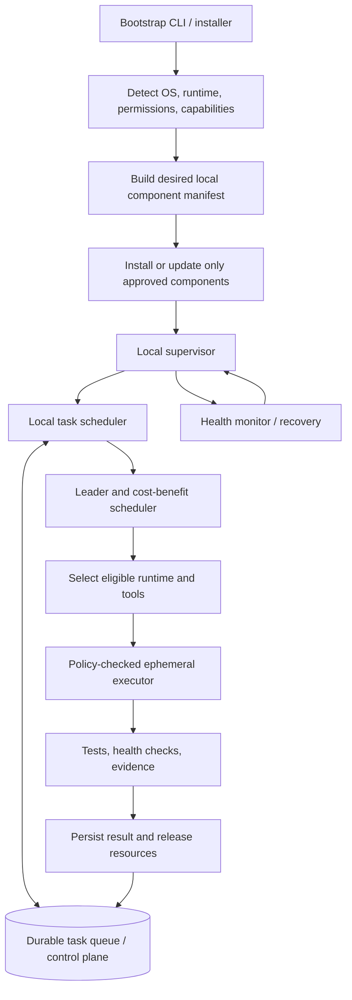

# Cross-machine Task Orchestrator and Bootstrap

## Purpose
Make the Jarvis Harness portable across machines while keeping task scheduling centralized and machine-specific execution local. This document is an implementation contract; it does not claim automatic installation is already implemented.

## Architecture



## Responsibilities

- **Bootstrap:** detect OS, architecture, user context, installed versions, available runtimes, network reachability, and required permissions. Produce a dry-run plan first; apply only supported, allowlisted changes.
- **Desired-state manifest:** declare component ID, version, platform constraints, dependencies, startup mode (always_on, on_demand, or scheduled), health check, restart policy, and required privilege.
- **Local supervisor:** start and monitor long-lived components, deduplicate instances, record health, restart with bounded backoff, and shut down gracefully.
- **Scheduler:** create or claim due tasks, enforce priorities, dependencies, concurrency and deadlines, use idempotency keys, and persist attempts/outcomes.
- **Leader:** assign each task to an eligible runtime based on capabilities, availability, cost, latency, risk and measured outcomes. Roles are task-scoped, not permanent.
- **Executor:** run only validated structured actions through an allowlist; apply timeouts, resource limits, cancellation, evidence capture and cleanup.
- **Control plane:** store task state, leases, heartbeats, attempts and append-only events. Treat delivery as at-least-once; handlers and external effects must be idempotent.
- **Installer adapters:** use Windows Task Scheduler, systemd, launchd, or a supported service manager only when appropriate. The shared scheduler remains portable; OS-specific adapters implement local triggers.

## Lifecycle

1. Discover and report machine capabilities.
2. Compare installed state with the desired-state manifest.
3. Produce a dry-run plan showing installs, updates, permissions and service changes.
4. Validate source, version constraints, permissions and policy.
5. Apply reversible changes; save backups and a transaction journal.
6. Register the minimal OS-level bootstrap trigger.
7. Start the supervisor and verify readiness/health.
8. Register the machine/runtime heartbeat with the shared control plane.
9. Schedule and execute tasks locally; persist results centrally.
10. On failure, preserve evidence, back off, and recover without overwriting concurrent changes.

## Startup-mode policy

- **always_on:** only the supervisor, required control-plane connectivity, and essential bridge services.
- **on_demand:** browser automation, code analysis, model agents, tests, and other finite jobs.
- **scheduled:** periodic maintenance, health reconciliation, updates and repository scans.
- Desktop interaction components run only in a valid interactive session. A SYSTEM startup task must not be assumed to provide a usable desktop session.
- A remote tunnel remains active only when remote access is required. It must not be started twice if its health endpoint and owning process confirm a healthy instance.

## Safety and idempotency

- Re-running bootstrap must converge on the desired state without duplicating tasks, processes, environment entries or services.
- Use stable component/task IDs and idempotency keys.
- Do not store secrets in repository files, command-line arguments, logs, or client-visible manifests. Use the OS credential store or a trusted secret provider.
- Never disable valid tests to obtain a green build.
- Do not silently delete tasks, stop remote-access services, elevate privileges, change credentials, or apply production database migrations.
- Destructive or privilege-expanding changes require explicit approval.
- Do not treat a successful API response as proof of end-to-end readiness; verify process identity, health endpoint, queue round-trip, logs and acceptance tests.
- Use bounded retries with exponential backoff and jitter; expose degraded state rather than creating restart loops.

## Proposed component manifest

```yaml
schema_version: 1
components:
  - id: jarvis-supervisor
    startup_mode: always_on
    platforms: [windows, linux, macos]
    desired_state: running
    privilege: user
    health_check: local-supervisor-health
  - id: desktop-mcp
    startup_mode: on_demand
    platforms: [windows]
    privilege: interactive_user
    health_check: mcp-ready
  - id: secure-remote-tunnel
    startup_mode: on_demand
    platforms: [windows]
    privilege: interactive_user
    health_check: tunnel-ready
  - id: repository-maintenance
    startup_mode: scheduled
    schedule: configurable
    privilege: user
    health_check: task-result
```

The schema above is illustrative. It must be validated against a formal schema before implementation; it is not an installable configuration yet.

## Implementation sequence

1. Inventory current startup paths, scheduled tasks, service managers, process owners and ports.
2. Reuse the existing queue, scheduler, leader, orchestrator and task runner; do not create a competing scheduler.
3. Define manifest schema, bootstrap plan/apply interface, OS adapter protocol and idempotent registry.
4. Implement supervisor lifecycle, heartbeat, lease renewal, graceful shutdown and reconciliation.
5. Add Windows adapter first, preserving the existing MCP and tunnel until replacement health checks pass.
6. Add tests for repeated bootstrap, duplicate starts, stale leases, concurrent claims, reboot recovery, privilege boundaries, rollback and secret redaction.
7. Validate migrations on staging and test two real Harness runtimes end-to-end.
8. Open a PR with test evidence. Migrate existing machine tasks incrementally only after acceptance checks pass.

## Acceptance criteria

- Bootstrap is safe to run repeatedly and produces no duplicate task/service/process.
- A new supported machine can be configured from the repository and an explicit configuration/secret setup, without hard-coded user paths.
- OS-specific triggers invoke the same portable supervisor contract.
- A task survives a supervisor/process restart and is not silently lost.
- Concurrent workers cannot both own the same valid lease; duplicate delivery does not duplicate external effects.
- Health reconciliation detects missing, stale and unhealthy agents.
- The system does not remove or replace a working remote-access path before a verified fallback exists.
- Unit, integration and end-to-end tests pass without weakening existing tests.
